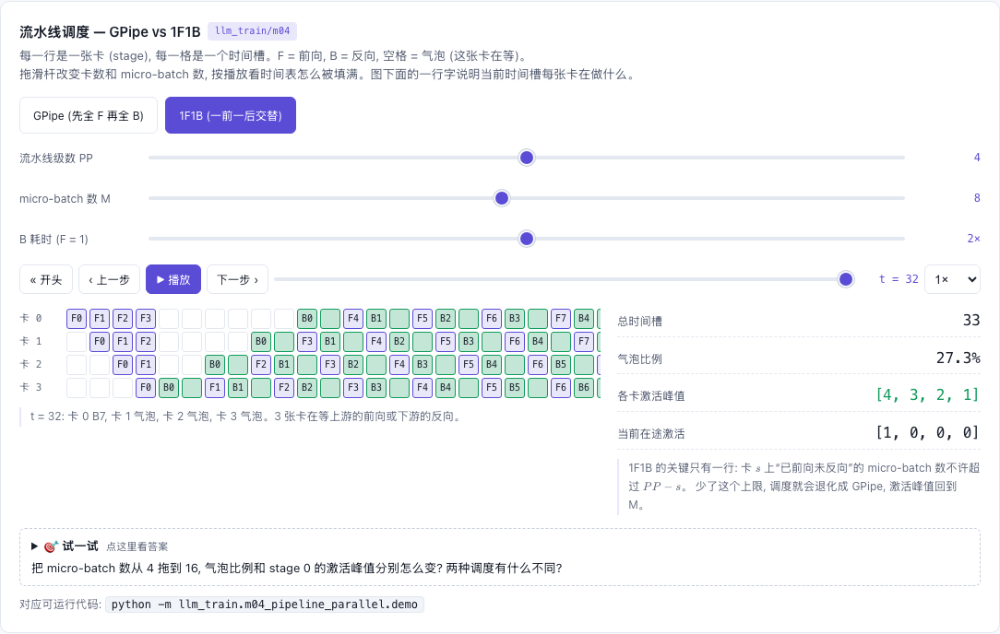
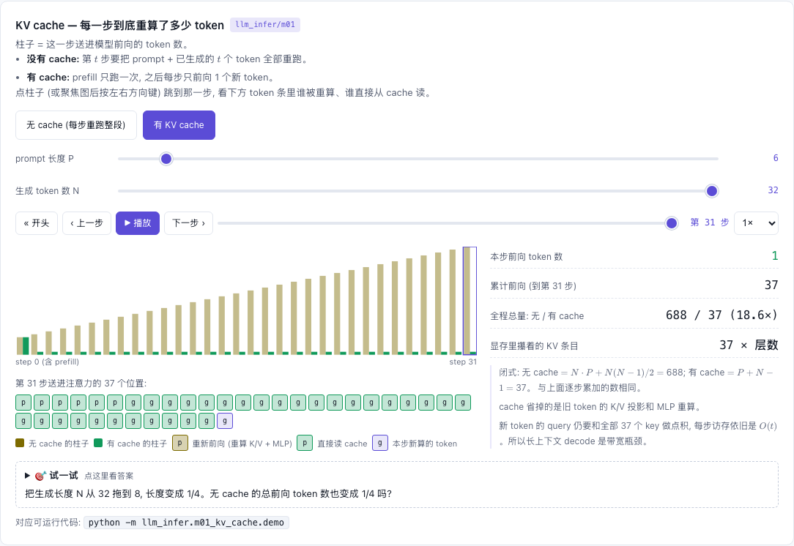
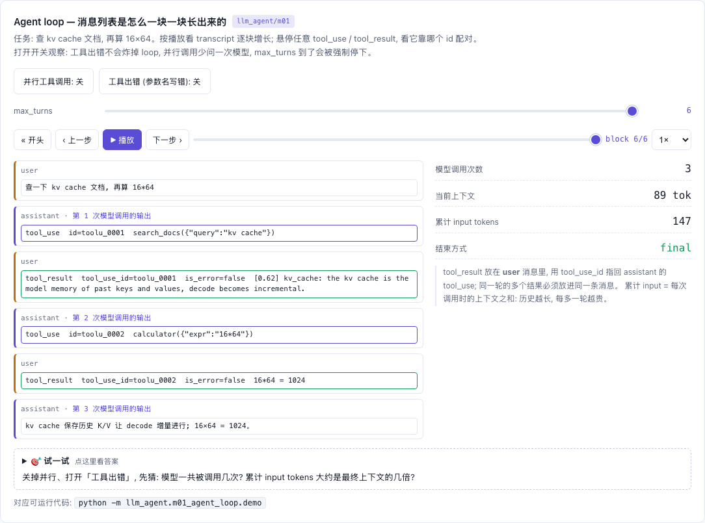

# LLM Engineering Lab

A hands-on lab for learning LLM engineering: build a Transformer from scratch, explore model architectures, simulate distributed training, fine-tune and align models, optimize inference, and build agents. Includes CPU-runnable Python experiments, interactive visualizations, and replayable execution evidence across six learning stages. The tutorial text is primarily in Chinese.

[在线教程 / Interactive tutorial](https://beleev.github.io/llm-engineering-lab/) · [v1.1.0](https://github.com/beleev/llm-engineering-lab/releases/tag/v1.1.0) · [贡献指南 / Contributing](CONTRIBUTING.md) · [引用 / Cite](CITATION.cff)

| 训练：拖动参数，看流水线气泡 | 推理：KV cache 少算了多少 | Agent：单步看工具调用 |
| --- | --- | --- |
| [](https://beleev.github.io/llm-engineering-lab/#/train/model-parallel) | [](https://beleev.github.io/llm-engineering-lab/#/infer/kv-memory) | [](https://beleev.github.io/llm-engineering-lab/#/agent/loop) |

点击截图进入实验。更多配图见[章节预览](docs/screenshots/README.md)。

把"训出一个能用、能部署、能行动的大模型系统"拆成**六个递进阶段**，每个阶段都能单独跑。

numpy 手写反向传播 → PyTorch 现代架构 → 规模化训练 → 微调对齐 → 推理优化 → Agent 应用层。

- 每个模块 `python -m xxx.demo` 单独跑，CPU 几秒到几十秒，零 GPU 依赖。
- 每个 demo 末尾都用 `assert` 验证它声称的结论（与单卡基线逐位相等、与朴素解码逐 token 相同……）。断言不过，程序直接报错退出。
- 配套 **交互式 Web 教程**：六阶段、27 个主题组、126 个章节入口（120 个三级章节 + 6 个总览）、209 个实验入口，478 道章末自测，329 条术语速查；实验台包含可拖动可视化与 Python 执行记录回放。页面上的代码直接取自仓库里的 Python 源文件。

**在线教程**: https://beleev.github.io/llm-engineering-lab/

## 怎么学

```
阶段 1 · llm_basic       numpy 手写 forward / backward / Adam / 采样 / BPE —— 看清梯度怎么流过 Transformer
    ↓
阶段 2 · llm_models      PyTorch 实现 31 个模型: 2017 Transformer → 2026 DeepSeek-V4 / 混合线性架构 / mHC
    ↓
阶段 3 · llm_train       纯 numpy 模拟大规模训练: DDP / TP / PP / ZeRO / EP / Ring + Ulysses / FP8 / FP4 / Muon / 容错与 DiLoCo
                          以及数据去重与 packing、scaling law、μP、课程/合成数据、校准与多语言评测
    ↓
阶段 4 · llm_finetune    SFT / LoRA / QLoRA / DoRA / DPO / KTO / SimPO / ORPO / RM / PRM / PPO / GRPO 及变体
                          / IPO / RLAIF / 在线偏好 / Prompt-Prefix-Adapter / 知识编辑 / DP 与遗忘 / 蒸馏
    ↓
阶段 5 · llm_infer       34 个推理模块 (含推理图、剪枝融合、端侧预算与服务容量) + 真分页的 mini-vLLM 引擎
    ↓
阶段 6 · llm_agent       Agent 循环 / 工具 / 权限 / 上下文工程 / Hook / Skill / MCP / 子智能体 / 护栏 / 评测
                          / RAG 联合目标 / Computer use / A2A / 记忆 / 验收恢复 / 学习世界模型 / 代码与形式验证
```

推荐节奏：**先在网页上拖实验台建立直觉 → 做章末自测 → 再跑对应的 Python demo 读源码**。模块目录下的 README 大体按这个顺序写：

> 直觉 → 核心原理 → 运行 → 运行后应该看到什么（真实数字）→ 与真实系统的差距 → 常见误区 → 自测题

各包首页统一为「概览 → 运行 → 模块与阅读顺序 → 实现说明 → 边界」。

Agent 的阅读路线见 [从执行到验证与改进](docs/agent-extensions.md)：首错诊断、记忆更新、完成验收、重试与取消、上下文净成本、多跳证据、轨迹学习和四阶段改进评估。

### 知识覆盖与实验

教程按六阶段、27 个主题组组织。每项实验在主讲章节完整展示，相关章节提供跳转。QK-Norm 与 SWA 在注意力章，YaRN 在位置编码章；LoRA/DoRA、缓存与上下文成本、编排与协作、记忆生命周期与隐私分别在同一主题内学习。

工程实验现有 **9 组、49 个条件**：

| 主讲章节 | 可运行内容 |
| --- | --- |
| 选型与落盘 | [交付包、新进程加载与错误配置拒绝](llm_finetune/run_finetune/artifact_delivery/README.md) |
| RAG | [文档解析、权限、索引更新与引用失效](llm_agent/m54_document_lifecycle/README.md) |
| MCP | [旧新报文对照、本机 HTTP 与授权反例](llm_agent/m55_mcp_versions/README.md) |
| GRPO 进阶 | [策略版本、队列背压与重要性校正](llm_finetune/run_finetune/async_rollout/README.md) |
| 评测套件 | [切片门槛、小流量回放与发布回滚](llm_agent/m56_release_loop/README.md) |
| 算子与调度开销 | [真实 CPU profiler 与选做 CUDA 测量](llm_infer/m32_profiling/README.md) |
| 服务调度 | [租户公平轮转、配额与 goodput](llm_infer/m33_tenant_scheduling/README.md) |
| 会话持久化与恢复 | [版本迁移、权限重验与提交后强退恢复](llm_agent/m57_checkpoint_migration/README.md) |
| 前缀缓存 | [可信共享域、模型/adapter 身份与错误命中](llm_infer/m34_cache_identity/README.md) |

工程流程默认使用小模型或固定夹具；MCP HTTP 仅在本机运行。网页明确区分实测、确定性模拟与执行记录回放，不把它们作为真实大模型或生产服务的能力证明。

[机制实验指南](docs/knowledge-completion.md) 介绍多轮模板、trace/span、RFT、流式工具调用、语义检索、多维并行和服务容量。[研究主题与验证边界](docs/research-completion.md) 按 45 个主题列出实验、阅读入口与适用范围；[工程实验指南](docs/engineering-completion.md) 介绍交付、索引生命周期、协议、调度和恢复。

Agent 包包含工具执行、异步任务、代码修复、CPU 小模型训练与可选浏览器验证，模块目录见 [Agent 首页](llm_agent/README.md)。

研究实验包括 **25 组实验、76 个对照条件**，按知识主题分布在六阶段教程中。

| 学习位置 | 内容与阅读入口 |
| --- | --- |
| 数据与评测 | [课程与主动选域](llm_train/m23_data_curriculum/README.md)、[多代合成反馈](llm_train/m24_synthetic_feedback/README.md)、[校准/拒答/人工评价](llm_train/m25_reliability_metrics/README.md)、[多语言](llm_train/m26_multilingual/README.md) |
| 微调与对齐 | [IPO](llm_finetune/run_finetune/ipo/README.md)、[四类 PEFT](llm_finetune/run_finetune/peft_comparison/README.md)、[在线偏好](llm_finetune/run_finetune/online_preference/README.md)、[知识编辑](llm_finetune/run_finetune/knowledge_edit/README.md)、[隐私与遗忘](llm_finetune/run_finetune/privacy_unlearning/README.md) |
| 模型与多模态 | [递归记忆/分层读取](llm_models/run_models/foundation/hierarchical_memory/README.md)、[机制解释/SAE](llm_models/run_models/foundation/interpretability/README.md)、[视觉任务](llm_models/run_models/multimodal/vision_tasks/README.md)、[音频信号链](llm_models/run_models/multimodal/audio_pipeline/README.md)、[媒体一致性与来源](llm_models/run_models/generative/media_evaluation/README.md) |
| 推理与设备 | [链/树/图推理](llm_infer/m29_reasoning_graph/README.md)、[剪枝与融合](llm_infer/m30_pruning_fusion/README.md)、[端侧预算](llm_infer/m31_edge_budget/README.md) |
| Agent 与知识 | [RAG 联合目标](llm_agent/m46_joint_rag/README.md)、[有效上下文](llm_agent/m47_context_utilization/README.md)、[安全与治理](llm_agent/m48_safety_governance/README.md)、[工具数据筛选](llm_agent/m53_tool_data/README.md) |
| 行动与验收 | [学习世界模型](llm_agent/m49_learned_world/README.md)、[仓库级代码验证](llm_agent/m50_repository_verification/README.md)、[形式证明与科学验证](llm_agent/m51_formal_science/README.md)、[专业领域工作流](llm_agent/m52_domain_workflows/README.md) |

这些实验包含实际梯度更新、采样、像素/波形计算和独立进程验收，也包含明确标注的预算模型。网页按钮切换的是 **Python 实际运行记录**，不会现场训练或调用 API。真实大模型泛化、多机 GPU 性能、真实机器人与领域上线效果尚未据此验证；不能把教学闭环当成这些能力的完成证明。

## 安装与运行

```bash
pip install -e ".[dev]"      # Python ≥ 3.10；包含 numpy / torch；不需要 GPU
python main.py               # 冒烟: 每个核心模型跑一次前向, 断言初始 loss ≈ ln V、KV cache 有无一致

pytest                       # 所有 demo / infer 脚本, 耗时依机器而定
pytest -m slow               # 所有训练脚本
```

每个阶段一条命令全跑：

```bash
python -m llm_train.run_all
python -m llm_finetune.run_all
python -m llm_infer.run_all
python -m llm_agent.run_all                  # 标准库 + numpy 的离线模块
python -m llm_agent.run_all --with-training  # 加上五个 torch 训练扩展
cd llm_basic && python gradcheck.py && python train.py && python sample.py "ROMEO:"
```

工程实验与内容一致性检查：

```bash
OMP_NUM_THREADS=1 MKL_NUM_THREADS=1 python web/scripts/export-engineering-completion.py --check
python scripts/check-engineering-coverage.py
pytest tests/test_engineering_completion.py tests/test_curriculum_consolidation.py
```

研究实验与证据检查（CPU；不调用模型 API）：

```bash
OMP_NUM_THREADS=1 MKL_NUM_THREADS=1 python scripts/run-research-completion.py
python scripts/check-research-coverage.py
OMP_NUM_THREADS=1 MKL_NUM_THREADS=1 python web/scripts/export-research-completion.py --check
```

修改实验后先重新导出 `web/scripts/export-research-completion.py`，核对各模块 README 中的结果，再运行 `--check`。`export-knowledge-completion.py` 摘要覆盖全仓库 Python，Python 源码变化后也要重新导出。浏览器回归命令见 [验证指南](docs/validation.md)。

单个模块：

```bash
python -m llm_models.run_models.language_models.llama.train_llama
python -m llm_models.run_models.moe.gpt_oss.infer_gpt_oss
python -m llm_train.m05_zero_fsdp.demo
python -m llm_finetune.run_finetune.grpo.train_grpo
python -m llm_infer.full_engine.demo
python -m llm_agent.m09_mcp.demo
```

Web 教程：

```bash
cd web
npm install
npm run dev
```

构建与内容检查（另开终端，在 `web` 目录运行）：

```bash
npm run check:sources        # 页面引用的 Python 符号
npm run check:math           # 公式渲染
npm run check:quiz           # 自测题结构
npm run check:evolution      # 章节演进内容
npm run check:consolidation  # 章节归属、旧链接与进度迁移
npm run build
```

验证范围与浏览器检查命令见 [验证指南](docs/validation.md)。

## 技术覆盖

### 阶段 2 · 模型架构 (llm_models)

| 主题 | 内容 |
|------|------|
| 注意力 | MHA → MQA/GQA → MLA（含只缓存 latent 的解码路径）→ DSA（LightningIndexer + KL 对齐损失）→ CSA / HCA（先压缩再在压缩条目上选 top-k）；QK-Norm；可学习 attention sink；逐头输出门 |
| 位置 | Sinusoidal / Learned → RoPE → NTK / YaRN 长上下文缩放 → M-RoPE；NoPE 与 iRoPE（不加位置编码的层与 RoPE 层交错） |
| 序列建模 | 滑动窗口（Mistral）、滑窗/全局交替（GPT-OSS-mini）、Gated DeltaNet 混合（Qwen3-Next）、Kimi Delta Attention 的通道级遗忘门、Mamba 选择性 SSM；按层排布混合的缓存账 |
| 输入表示 | BLT 字节 patch（按下一字节熵切分，不用 tokenizer）|
| MoE | Mixtral softmax top-k；DeepSeekMoE sigmoid + 共享专家 + **真正会更新的** aux-loss-free 路由偏置 |
| 残差结构 | Hyper-Connections 与 mHC（残差流加宽成 n 条，流间混合矩阵投到双随机矩阵保住恒等映射） |
| 条件计算 | MoD 按 token 跳层（top-k 容量 + 因果预测器）、MoR 共享块按 token 递归 |
| 训练目标 | next-token、MTP 多 token 预测、LLaDA 掩码扩散语言模型、BD3-LM 块扩散（块因果 + KV cache） |
| 生成 | 9 个自回归 LM（GPT-3、LLaMA、Mistral、Mamba、MTP、Qwen3-Next、Mixtral、DeepSeek-V3、GPT-OSS）共用带 KV cache 的 `GenerationMixin`（有/无 cache 输出 `torch.equal`）。多模态的 `Qwen2VLDecoder`、`OmniTalkerDecoder` 没有接，不支持 `generate()` |
| 多模态 | CLIP、Whisper、Qwen2-VL、Qwen2.5-Omni、Transfusion（理解与生成统一：文本 CE + 图像扩散，图内双向掩码） |
| 可解释性 | 线性探针与激活修补（研究实验）、激活引导：读出的方向与能改变行为的方向分开检验 |
| 视觉生成 | VAE / 因果 3D VAE、DiT、MM-DiT（Rectified Flow）、Video DiT、VAR（真 next-scale + 多尺度残差 VQ） |

### 阶段 3 · 规模化训练 (llm_train)

| 模块 | 技术 | 验证方式 |
|------|------|---------|
| m01–m02 | 梯度累积、DDP | 与单卡整 batch 一致 |
| m03 | Megatron 张量并行（前向 + 反向 all-reduce） | W、dX 均与 dense 一致 |
| m04 | GPipe / 1F1B / 交错 1F1B / Zero Bubble (ZB-H1)；DualPipe 按报告公式算 | 气泡 = 公式；1F1B 峰值精确为 `[PP, …, 1]`；ZB-H1 每卡空闲 = `(PP-1)(t_f+t_b-t_w)` 且峰值仍为 PP |
| m05 | ZeRO-1/2/3 + FSDP gather→compute→free | 三档与 DDP 逐位相同；字节数 = 2+2+12 公式 |
| m06 | FP16 / BF16、动态 loss scaling | 真实 fp16 溢出触发跳步 |
| m07 | 激活重算（真反向） | 梯度与全存基线逐位相同；峰值 = L/k + k |
| m08 | 断点续训（含 RNG、数据游标） | 漏恢复任何一项都有断言量化偏差 |
| m09 | 集合通信 + ring all-reduce + 通信量计数 | all_reduce = reduce_scatter + all_gather |
| m10 | warmup / cosine / WSD、裁剪、NaN guard | WSD 稳定段不随总步数变；裁剪只缩长度不改方向；坏 step 不改参数 |
| m11 | 专家并行（dispatch、combine 两步真 all-to-all）+ aux-loss-free 均衡 | 与 dense MoE 一致；all-to-all 计数 3 次（dispatch 把 token 和专家 id 分两次发） |
| m12 / m16 | Ring Attention（zigzag 均衡）/ Ulysses | 与完整 attention 一致 |
| m13 / m15 | FP8 配方消融 / MXFP4 · NVFP4 | FP32 基线 + A–E 五臂消融（相邻两臂只差一个旋钮：scaling / 反向格式 / 粒度 / master）；量化误差 FP8 < NVFP4 < MXFP4 |
| m14 | Muon（Newton–Schulz）+ QK-clip | 含 Adam 反而更好的反例 |
| m17 | 数据流水线：MinHash-LSH 去重、质量过滤、数据源温度配比 | 近似重复召回 0.258 → 0.967 |
| m18 | Sequence packing + 文档间 attention mask | 与逐篇单独 forward 误差 1e-15；不加 mask 就串文档 |
| m19 | Scaling law：36 个 (N, D) 点真训后拟合 | 拟合出的 E 接近噪声方差；指数 α≈1.08、β≈1.13，与 Chinchilla 论文的 0.34 / 0.28 不同 |
| m20 | μP 超参迁移 | 最优 lr 在三种宽度下不动；SP 下会漂 |
| m21 | 评测：perplexity、污染检测、pass@k 无偏估计、judge 位置偏差 | 朴素 pass@k 偏低；交换判消掉位置偏差 |
| m27 | 容错：整体 MTBF、Young / Daly checkpoint 间隔、goodput、慢节点、SDC、弹性缩容 | 最优间隔处落盘与重跑开销相等；解析模型与蒙特卡洛差 < 1pp |
| m28 | DiLoCo：本地 H 步 + 外层 Nesterov 动量，Streaming 分片错峰 | H=1 且外层退化时与 DDP 差 1.8e-07；通信量 ∝ 1/H |
| full_loop | DDP + 累积 + AMP + 分片 Adam + 裁剪 + 续训 | 续训逐位相同；fp32 下与单卡差 6e-8 |

### 阶段 4 · 微调对齐 (llm_finetune)

| 类别 | 方法 |
|------|------|
| 指令微调 | SFT（prompt mask） |
| 参数高效 | LoRA · QLoRA（NF4 真 4-bit 打包）· DoRA · LoRA 做 RL（全参 / 秩 1 / 冻结 norm 对照） |
| 量化训练 | QAT（假量化 + STE, 分组对称低比特） |
| 偏好对齐 | DPO · KTO（非成对）· SimPO · ORPO · Reward Model（Bradley–Terry）· PRM（逐步打分）· RLAIF（按宪法自动造偏好）· 生成式 / rubric 奖励（长度捷径与 reward hacking） |
| 在线 RL | PPO（critic + GAE）· GRPO（重要性比率 + clip），及 DAPO / Dr.GRPO / GSPO 变体 · 训练-推理不一致（TIS / MIS） |
| 推理模型 | 长 CoT 蒸馏 · 思考 / 非思考模式融合 · 思考预算（预算 token、强制截断） |
| 模型合并 | Task Arithmetic · TIES · DARE · SLERP |
| 蒸馏 | 离线（forward KL）· on-policy（reverse KL）· OPD 与 RLVR 的先后 / 联合组合 · 多教师按领域路由 |

合成任务是**依赖 prompt 的可学习任务**。验证看留出集指标，不看"loss 下降了"。

### 阶段 5 · 推理优化 (llm_infer)

| 方向 | 模块 |
|------|------|
| 省 KV 显存 | KV Cache · PagedAttention · Prefix Cache · Radix Cache · KV 占用对比 / MLA 解码 · 分层 KV offload · KV 淘汰 (H2O / SnapKV / TOVA) · 混合模型状态快照（前缀缓存 + 投机回滚） |
| 调度 | Continuous Batching（含抢占）· Chunked Prefill（Sarathi 混批）· P/D 分离 · 租户公平轮转 / 配额 / goodput 模拟 |
| 少算几次 | Speculative Decoding（拒绝采样 + 分布保持检验）· EAGLE · 树状投机 · 无草稿模型投机 (prompt lookup / n-gram 缓存) · MTP 自投机 · 稀疏注意力解码 · 扩散语言模型并行解码（置信度阈值 + 近似 / 块扩散缓存） |
| 压缩 | INT8 / group-wise INT4 / AWQ · GPTQ · SmoothQuant（W8A8）· FP8 · KIVI KV 量化 · 旋转量化 W4A4 (QuaRot / SpinQuant / QuIP#) · MXFP4 / NVFP4 |
| 算子与并行 | FlashAttention（Q/KV 双向分块 + LSE）· Flash-Decoding（split-K）· Tensor Parallel · CUDA Graph · MoE 推理 EP + EPLB · Attention–FFN 分离 (代价模型) |
| 输出控制 | Sampling · Beam Search · Structured Output（token 级预编译语法 mask）· Attention Sinks（SinkCache）· Multi-LoRA |
| 测试时计算 | best-of-N · 多数投票 · PRM 引导搜索 · budget forcing |
| 多副本 | 前缀感知路由 + 负载阈值兜底 |
| Agent 负载 | 思考块删留与前缀命中 · 工具停顿期间 KV 的 TTL / 应用提示 · effort 代价模型（估算） |
| 缓存边界 | 可信共享域 · 模型 / adapter 身份与版本 · 缓存错误命中对照 |
| 性能与设备 | CPU profiler · 选做 CUDA 测量 · 剪枝与融合 · 端侧预算模型 |

`full_engine` 是真分页的 mini-vLLM：物理 KV block 池、前缀命中真的跳过计算、分块 prefill 混批、recompute 抢占，**每条输出与朴素 greedy 逐 token 相同**。

### 阶段 6 · Agent (llm_agent)

| 层 | 内容 |
|------|------|
| 循环 | Agent 循环（`tool_use` / `tool_result` content block）· JSON Schema 工具 + 并行调用 |
| 安全 | 权限门（deny > ask > allow，六种模式，命令归一化与分段）· 护栏（注入、路径围栏、脱敏）· OS 级沙箱的策略评估（文件系统: 只写工作区 / 拒读密钥目录 / 路径先规范化; 网络: 出站代理按域名白名单） |
| 上下文 | 压缩与文件记忆 · 上下文工程 · TF-IDF 检索（中文 bigram）· RAG（切块、BM25 + 稠密混合检索、RRF、rerank）· Prompt caching |
| 扩展 | Hooks · Skills 渐进式披露 · 真 MCP（stdio JSON-RPC）· A2A（agent 之间的任务协议） |
| 操作界面 | Computer use（无障碍树观察、按元素 ref 点击） |
| 编排 | 计划模式 · 子智能体 · orchestrator–workers |
| 训练 | 多轮 Agent RL 的信用分配（轨迹级优势 / 锚状态分组的逐步优势 / 逐轮奖励）· 崩塌诊断（输入依赖度，策略熵查不出来）· 方差筛选与静态任务集的信号枯竭 |
| 运维 | JSONL 持久化与恢复 · checkpoint 版本迁移 / 权限重验 / 提交后强退恢复 · Agent 评测（pass@k / pass^k）· 发布门槛与回滚 · 模型路由与级联的成本 (按每个完成任务算) · 跨窗口接力（启动脚本 / 功能清单 / 进度文件 / 提交记录，每个新会话从干净上下文开始） |
| 接真模型 | 可选的 Claude API 适配器 (adaptive thinking、effort、历史只追加的离线自检)，默认不联网 |

工具全部是模拟或沙箱内的，可以放心跑。

## Web 教程

### 阅读分层 —— 可从 [速成路线](https://beleev.github.io/llm-engineering-lab/#/fast-track) 起步

| 档位 | 章数 | 用时 (粗估) | 覆盖范围 |
|------|-----:|------------|--------------|
| ★ 冲刺 | 12 | 约 4 小时 3 分 | 每个阶段最关键的一两章, 快速串起全栈主干 |
| ● 主干 | 42 | 约 12 小时 37 分 | 完整覆盖大模型训练、微调对齐、推理服务与 Agent 主线 |
| ○ 全部 | 127 | 约 34 小时 10 分 | 进一步包含前沿变体、替代方案对比与视觉/多模态分支 |

「全部」按速成路线页统计：126 个六阶段章节入口，加 1 个总览对照表；不含主线首页与术语速查。用时取当前页面估算，内容更新后以网页为准。

分层只是阅读建议, 不影响任何章节的内容。侧栏可以按档位收起扩展章, 每章开头标着它属于哪一层,
章内关键结论带有「重点」标记。用时按内容字数粗估, 供安排阅读节奏参考。

- **交互实验台**：每章先理清机制脉络，再通过实验台调整参数、观察图表与关键指标的变化，底部配有一道预测思考题。前端计算逻辑与对应 Python 模块对齐，核心读数可直接对照。
- **源码直连**：章节中的代码块在构建期直接读取 `llm_*/**/*.py` 并按符号截取，CI 自动校验每个源码引用有效，避免文档与实现脱节。
- **阅读辅助**：包含章末自测（全部答对后侧栏标记 ✓）、本地学习进度记忆、术语速查页、键盘 ← / → 翻章与移动端适配。
- **模块化扩展**：实验台、章节、自测与术语均按阶段分文件注册，详见 [`web/LABS.md`](web/LABS.md)；章节正文集中维护在 `web/src/data/topics/<stage>.js`。
- **渐进式结构**：每章统一按「它从哪来 → 要点 → 动手验证 → 去代码里看 → 章末自测」展开，从问题瓶颈引出核心机制、仓库实测数值与适用边界（写作规范见 [`web/LABS.md`](web/LABS.md)）。

## 实验规模与结论边界

教学代码最容易踩的坑，是借用了真实技术的名字却省略了关键约束。

因此仓库内每个 demo 末尾都通过 `assert` 校验其核心数学性质：分布式结果与单卡基线对齐、加速解码与朴素贪心逐 token 一致、手写反向传播通过有限差分检验。

同时，部分大规模工程现象在 CPU 小模型规模下并不会自然涌现，各模块 README 的「与真实系统的差距」一节如实记录了这些边界：

- 随机权重的小模型**没有 attention sink 现象**，稀疏解码的块打分也**不优于随机选块**。这两个效应只在植入了 sink / needle 的合成数据上演示。
- FP8 的 per-tensor 与 block scaling 在玩具任务上**打平**，outlier 要超过约 1e5 倍才拉开差距。
- `llm_basic` 的 2 层配置**不优于** 1 层（val 2.042 vs 1.986）。
- CUDA Graph 的加速比来自**显式注入的 launch 开销模型**，不是实测。
- 同步数下**全参微调优于 LoRA**（留出集 EM 0.809 vs 0.352）。LoRA 买的是显存和分发，不是收敛速度。这是 SFT 上的结论；GRPO 上标准 LoRA 也落后，但差距来自冻结的 RMSNorm 增益：只训 320 个 norm 增益的采样 pass@1 是 0.502，高于全参的 0.324。

这些结论都写在程序输出和文档里。数据没有为了让结论好看而调过。

## 参考文献

<details>
<summary>展开完整参考文献列表</summary>

### 基础 / 理解类
- *Attention Is All You Need* — Vaswani et al., 2017 ([arXiv:1706.03762](https://arxiv.org/abs/1706.03762))
- *BERT* — Devlin et al., 2019 ([arXiv:1810.04805](https://arxiv.org/abs/1810.04805))
- *GPT-3* — Brown et al., 2020 ([arXiv:2005.14165](https://arxiv.org/abs/2005.14165))
- *LLaMA* / *Llama 2* — Touvron et al., 2023 ([arXiv:2302.13971](https://arxiv.org/abs/2302.13971) · [arXiv:2307.09288](https://arxiv.org/abs/2307.09288))
- *The Llama 3 Herd of Models* — Llama Team, AI @ Meta, 2024 ([arXiv:2407.21783](https://arxiv.org/abs/2407.21783))
- *Mistral 7B* — Jiang et al., 2023 ([arXiv:2310.06825](https://arxiv.org/abs/2310.06825))
- *Mixtral of Experts* — Jiang et al., 2024 ([arXiv:2401.04088](https://arxiv.org/abs/2401.04088))
- *Mamba* — Gu & Dao, 2023 ([arXiv:2312.00752](https://arxiv.org/abs/2312.00752))
- *Gated Delta Networks* — Yang et al., 2024 ([arXiv:2412.06464](https://arxiv.org/abs/2412.06464))
- *Hyper-Connections* — Zhu et al., 2024 ([arXiv:2409.19606](https://arxiv.org/abs/2409.19606)); *mHC: Manifold-Constrained Hyper-Connections* — DeepSeek-AI, 2025 ([arXiv:2512.24880](https://arxiv.org/abs/2512.24880))
- *Kimi Linear* (KDA) — Moonshot AI, 2025 ([arXiv:2510.26692](https://arxiv.org/abs/2510.26692)); *Gated Attention for LLMs* — Qiu et al., 2025 ([arXiv:2505.06708](https://arxiv.org/abs/2505.06708))
- *The Impact of Positional Encoding on Length Generalization* (NoPE) — Kazemnejad et al., 2023 ([arXiv:2305.19466](https://arxiv.org/abs/2305.19466))
- *DeepSeek-V4* — DeepSeek-AI, 2026 ([arXiv:2606.19348](https://arxiv.org/abs/2606.19348)); *Kimi K3* — Moonshot AI, 2026 ([arXiv:2607.24653](https://arxiv.org/abs/2607.24653)); *Nemotron 3.5* — NVIDIA, 2026 ([arXiv:2610.38095](https://arxiv.org/abs/2610.38095))
- *DeepSeek-V2 / V3 / V3.2 Technical Reports* — DeepSeek-AI, 2024-2025

### 组件层面
- *RoFormer* (RoPE) — Su et al., 2021 ([arXiv:2104.09864](https://arxiv.org/abs/2104.09864))
- *RMSNorm* — Zhang & Sennrich, 2019 ([arXiv:1910.07467](https://arxiv.org/abs/1910.07467))
- *GLU Variants* — Shazeer, 2020 ([arXiv:2002.05202](https://arxiv.org/abs/2002.05202))
- *GQA* — Ainslie et al., 2023 ([arXiv:2305.13245](https://arxiv.org/abs/2305.13245))
- *Switch Transformer* — Fedus et al., 2021 ([arXiv:2101.03961](https://arxiv.org/abs/2101.03961))
- *Multi-token Prediction* — Gloeckle et al., 2024 ([arXiv:2404.19737](https://arxiv.org/abs/2404.19737))
- *Ring Attention* — Liu et al., 2023 ([arXiv:2310.01889](https://arxiv.org/abs/2310.01889))

### 多模态
- *CLIP* — Radford et al., 2021 ([arXiv:2103.00020](https://arxiv.org/abs/2103.00020))
- *Whisper* — Radford et al., 2022 ([arXiv:2212.04356](https://arxiv.org/abs/2212.04356))
- *Flamingo* — Alayrac et al., 2022 ([arXiv:2204.14198](https://arxiv.org/abs/2204.14198))
- *Qwen2-VL* — Wang et al., 2024 ([arXiv:2409.12191](https://arxiv.org/abs/2409.12191))
- *Qwen2.5-Omni Technical Report* — Xu et al., 2025
- *Transfusion* — Zhou et al., 2024 ([arXiv:2408.11039](https://arxiv.org/abs/2408.11039))

### 生成模型
- *VAE* — Kingma & Welling, 2013 ([arXiv:1312.6114](https://arxiv.org/abs/1312.6114))
- *DDPM* — Ho et al., 2020 ([arXiv:2006.11239](https://arxiv.org/abs/2006.11239))
- *DDIM* — Song et al., 2021 ([arXiv:2010.02502](https://arxiv.org/abs/2010.02502))
- *Latent Diffusion / Stable Diffusion* — Rombach et al., 2022 ([arXiv:2112.10752](https://arxiv.org/abs/2112.10752))
- *Classifier-Free Diffusion Guidance* — Ho & Salimans, 2022 ([arXiv:2207.12598](https://arxiv.org/abs/2207.12598))
- *DiT* — Peebles & Xie, 2023 ([arXiv:2212.09748](https://arxiv.org/abs/2212.09748))
- *SD3 / Rectified Flow* — Esser et al., 2024 ([arXiv:2403.03206](https://arxiv.org/abs/2403.03206))
- *Flow Matching* — Lipman et al., 2023 ([arXiv:2210.02747](https://arxiv.org/abs/2210.02747))
- *Sora* — OpenAI, 2024
- *VAR* — Tian et al., NeurIPS 2024 ([arXiv:2404.02905](https://arxiv.org/abs/2404.02905))
- *VQ-VAE* — van den Oord et al., 2017 ([arXiv:1711.00937](https://arxiv.org/abs/1711.00937))

### 推理优化
- *vLLM / PagedAttention* — Kwon et al., 2023 ([arXiv:2309.06180](https://arxiv.org/abs/2309.06180))
- *FlashAttention* — Dao et al., 2022 ([arXiv:2205.14135](https://arxiv.org/abs/2205.14135))
- *Speculative Decoding* — Leviathan et al., 2023 ([arXiv:2211.17192](https://arxiv.org/abs/2211.17192))
- *EAGLE* — Li et al., 2024 ([arXiv:2401.15077](https://arxiv.org/abs/2401.15077))
- *SGLang / RadixAttention* — Zheng et al., 2024 ([arXiv:2312.07104](https://arxiv.org/abs/2312.07104))
- *StreamingLLM / Attention Sinks* — Xiao et al., 2023 ([arXiv:2309.17453](https://arxiv.org/abs/2309.17453))
- *H2O* — Zhang et al., 2023 ([arXiv:2306.14048](https://arxiv.org/abs/2306.14048)); *SnapKV* — Li et al., 2024 ([arXiv:2404.14469](https://arxiv.org/abs/2404.14469)); *TOVA* (Transformers are Multi-State RNNs) — Oren et al., 2024 ([arXiv:2401.06104](https://arxiv.org/abs/2401.06104))
- *QuaRot* — Ashkboos et al., 2024 ([arXiv:2404.00456](https://arxiv.org/abs/2404.00456)); *SpinQuant* — Liu et al., 2024 ([arXiv:2405.16406](https://arxiv.org/abs/2405.16406)); *QuIP#* — Tseng et al., 2024 ([arXiv:2402.04396](https://arxiv.org/abs/2402.04396)); *OCP Microscaling (MX) Formats v1.0*, 2023
- *Prompt Lookup Decoding* — Saxena, 2023 ([GitHub](https://github.com/apoorvumang/prompt-lookup-decoding)); *REST* — He et al., 2023 ([arXiv:2311.08252](https://arxiv.org/abs/2311.08252)); *Lookahead Decoding* — Fu et al., 2024 ([arXiv:2402.02057](https://arxiv.org/abs/2402.02057)); *SuffixDecoding* — Oliaro et al., 2024 ([arXiv:2411.04975](https://arxiv.org/abs/2411.04975))
- *Fast-dLLM*, 2025 ([arXiv:2505.22618](https://arxiv.org/abs/2505.22618)); *Marconi* (混合模型前缀缓存), MLSys 2025 ([arXiv:2411.19379](https://arxiv.org/abs/2411.19379)); *Continuum* (工具调用期间按 TTL 钉住 KV), 2025 ([arXiv:2511.02230](https://arxiv.org/abs/2511.02230))
- *MegaScale-Infer* — ByteDance Seed, 2025 ([arXiv:2504.02263](https://arxiv.org/abs/2504.02263)); *Step-3 (AFD)* — StepFun, 2025 ([arXiv:2507.19427](https://arxiv.org/abs/2507.19427)); *Revealing the Challenges of Attention-FFN Disaggregation*, 2026 ([arXiv:2602.09721](https://arxiv.org/abs/2602.09721)); *FastAFD*, 2026 ([arXiv:2611.07149](https://arxiv.org/abs/2611.07149))

### 微调 / 对齐
- *LoRA* — Hu et al., 2021 ([arXiv:2106.09685](https://arxiv.org/abs/2106.09685))
- *QLoRA* — Dettmers et al., 2023 ([arXiv:2305.14314](https://arxiv.org/abs/2305.14314))
- *DPO* — Rafailov et al., 2023 ([arXiv:2305.18290](https://arxiv.org/abs/2305.18290))
- *InstructGPT* — Ouyang et al., 2022 ([arXiv:2203.02155](https://arxiv.org/abs/2203.02155))
- *GRPO / DeepSeekMath* — Shao et al., 2024 ([arXiv:2402.03300](https://arxiv.org/abs/2402.03300))
- *DeepSeek-R1* — DeepSeek-AI, 2025 ([arXiv:2501.12948](https://arxiv.org/abs/2501.12948))
- *Knowledge Distillation* — Hinton et al., 2015 ([arXiv:1503.02531](https://arxiv.org/abs/1503.02531))
- *Your Efficient RL Framework Secretly Brings You Off-Policy RL Training* — Yao et al., 2025 ([博客](https://fengyao.notion.site/off-policy-rl)); *When Speed Kills Stability* — Liu et al., 2025 ([博客](https://richardli.xyz/post/rl-collapse-training-inference/)); *Defeating the Training-Inference Mismatch via FP16* — Qi et al., 2025 ([arXiv:2510.26788](https://arxiv.org/abs/2510.26788))
- *Qwen3 Technical Report* — Qwen Team, 2025 ([arXiv:2505.09388](https://arxiv.org/abs/2505.09388)); *s1: Simple test-time scaling*, 2025 ([arXiv:2501.19393](https://arxiv.org/abs/2501.19393)); *L1: Controlling How Long A Reasoning Model Thinks With Reinforcement Learning* — Aggarwal & Welleck, 2025 ([arXiv:2503.04697](https://arxiv.org/abs/2503.04697))
- *Quantization and Training of Neural Networks for Efficient Integer-Arithmetic-Only Inference* — Jacob et al., 2018 ([arXiv:1712.05877](https://arxiv.org/abs/1712.05877)); *Estimating or Propagating Gradients Through Stochastic Neurons* (STE) — Bengio et al., 2013 ([arXiv:1308.3432](https://arxiv.org/abs/1308.3432)); *LLM-QAT* — Liu et al., 2023 ([arXiv:2305.17888](https://arxiv.org/abs/2305.17888))


### 长上下文 / 低精度 / 新架构
- *YaRN* — Peng et al., 2023 ([arXiv:2309.00071](https://arxiv.org/abs/2309.00071))
- *QK-Norm / OLMo 2* — Team OLMo, 2024 ([arXiv:2501.00656](https://arxiv.org/abs/2501.00656)); *Qwen3 Technical Report*, 2025
- *gpt-oss model card* — OpenAI, 2025
- *LLaDA: Large Language Diffusion Models* — Nie et al., 2025 ([arXiv:2502.09992](https://arxiv.org/abs/2502.09992))
- *Block Diffusion (BD3-LM)* — Arriola et al., 2025 ([arXiv:2503.09573](https://arxiv.org/abs/2503.09573))
- *Mixture-of-Depths* — Raposo et al., 2024 ([arXiv:2404.02258](https://arxiv.org/abs/2404.02258)); *Mixture-of-Recursions* — Bae et al., 2025 ([arXiv:2507.10524](https://arxiv.org/abs/2507.10524))
- *Byte Latent Transformer* — Pagnoni et al., 2024 ([arXiv:2412.09871](https://arxiv.org/abs/2412.09871)); *H-Net* — Hwang, Wang & Gu, 2025 ([arXiv:2507.07955](https://arxiv.org/abs/2507.07955))
- *ActAdd* — Turner et al., 2023 ([arXiv:2308.10248](https://arxiv.org/abs/2308.10248)); *CAA* — Rimsky et al., 2023 ([arXiv:2312.06681](https://arxiv.org/abs/2312.06681)); *Persona Vectors* — Chen et al., 2025 ([arXiv:2507.21509](https://arxiv.org/abs/2507.21509))
- *Auxiliary-Loss-Free Load Balancing* — Wang et al., 2024 ([arXiv:2408.15664](https://arxiv.org/abs/2408.15664))
- *Muon* — Jordan et al., 2024; *Muon is Scalable for LLM Training* — Liu et al. (Moonshot AI), 2025 ([arXiv:2502.16982](https://arxiv.org/abs/2502.16982))
- *Zero Bubble Pipeline Parallelism* — Qi et al., ICLR 2024 ([arXiv:2401.10241](https://arxiv.org/abs/2401.10241)); *Pipeline Parallelism with Controllable Memory* — Qi et al., 2024 ([arXiv:2405.15362](https://arxiv.org/abs/2405.15362))
- *DeepSeek-V3 Technical Report* (DualPipe) — DeepSeek-AI, 2024 ([arXiv:2412.19437](https://arxiv.org/abs/2412.19437))
- *DiLoCo* — Douillard et al., 2023 ([arXiv:2311.08105](https://arxiv.org/abs/2311.08105)); *Streaming DiLoCo* — Douillard et al., 2025 ([arXiv:2501.18512](https://arxiv.org/abs/2501.18512))
- *A first order approximation to the optimum checkpoint interval* — Young, CACM 1974; *A higher order estimate of the optimum checkpoint interval for restart dumps* — Daly, FGCS 2006
- *The Llama 3 Herd of Models* — Grattafiori et al., 2024 ([arXiv:2407.21783](https://arxiv.org/abs/2407.21783))
- *OCP Microscaling Formats (MX) Specification*, 2023; *NVFP4* — NVIDIA, 2025
- *DeepSpeed-Ulysses* — Jacobs et al., 2023 ([arXiv:2309.14509](https://arxiv.org/abs/2309.14509))
- *ZeRO* — Rajbhandari et al., 2019 ([arXiv:1910.02054](https://arxiv.org/abs/1910.02054))
- *DoRA* — Liu et al., 2024 ([arXiv:2402.09353](https://arxiv.org/abs/2402.09353))
- *SimPO* — Meng et al., 2024 ([arXiv:2405.14734](https://arxiv.org/abs/2405.14734)); *ORPO* — Hong et al., 2024 ([arXiv:2403.07691](https://arxiv.org/abs/2403.07691))
- *DAPO* — Yu et al., 2025 ([arXiv:2503.14476](https://arxiv.org/abs/2503.14476)); *Dr. GRPO* — Liu et al., 2025 ([arXiv:2503.20783](https://arxiv.org/abs/2503.20783)); *GSPO* — Zheng et al., 2025 ([arXiv:2507.18071](https://arxiv.org/abs/2507.18071))
- *On-Policy Distillation of Language Models (GKD)* — Agarwal et al., 2023 ([arXiv:2306.13649](https://arxiv.org/abs/2306.13649))
- *Sarathi-Serve (chunked prefill)* — Agrawal et al., 2024 ([arXiv:2403.02310](https://arxiv.org/abs/2403.02310))
- *AWQ* — Lin et al., 2023 ([arXiv:2306.00978](https://arxiv.org/abs/2306.00978)); *KIVI* — Liu et al., 2024 ([arXiv:2402.02750](https://arxiv.org/abs/2402.02750))
- *Medusa* — Cai et al., 2024 ([arXiv:2401.10774](https://arxiv.org/abs/2401.10774)); *EAGLE-2* — Li et al., 2024 ([arXiv:2406.16858](https://arxiv.org/abs/2406.16858))
- *XGrammar* — Dong et al., 2024 ([arXiv:2411.15100](https://arxiv.org/abs/2411.15100))
- *Quest* — Tang et al., 2024 ([arXiv:2406.10774](https://arxiv.org/abs/2406.10774)); *Native Sparse Attention* — Yuan et al., 2025 ([arXiv:2502.11089](https://arxiv.org/abs/2502.11089))
- *Mooncake* — Qin et al., 2024 ([arXiv:2407.00079](https://arxiv.org/abs/2407.00079)); *DeepSeek EPLB*, 2025
- *Model Context Protocol* — modelcontextprotocol.io; *Building Effective Agents* — Anthropic, 2024
- *τ-bench (pass^k)* — Yao et al., 2024 ([arXiv:2406.12045](https://arxiv.org/abs/2406.12045))

</details>

## License

MIT
