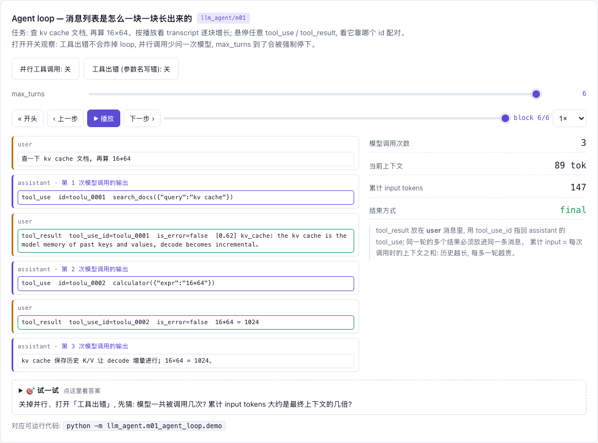

# llm_agent — LLM 应用层 / Agent 教学章节

[](https://beleev.github.io#/agent/loop)

[打开相关交互实验：Agent loop — 消息列表是怎么一块一块长出来的 llm_agent/m01](https://beleev.github.io#/agent/loop)

[项目首页](../README.md) · [在线教程](https://beleev.github.io/llm-engineering-lab/#/agent)

## 概览

> 用纯 Python stdlib 写一个可运行、可断言的 agent harness, 讲清楚生产级 agent 的关键机制:
> 循环、工具、权限、上下文、扩展、持久化、子智能体、MCP、规划、护栏、评测。
> 设计刻意对齐 Claude Code (权限模式名、hook 事件名、`mcp__server__tool` 命名) 和 Claude Messages API (content block 格式)。

### 设计目标

- **原理优先**: 默认"模型"是 `RuleBasedLLM` (关键词规则), 行为完全确定 —— 所以每个 demo 都能用 `assert` 证明自己声称的行为, 而不是无条件打印 OK。
- **一个 loop, 任意模型**: `core/llm.py` 的 `LLM` 协议只有一个方法 `next(messages, tools) -> ModelAction`。换成 `core/claude_llm.py` 的真实模型, loop 一行不改 (m15, opt-in)。
- **transcript 即 API 格式**: assistant 的 `tool_use` 与 user 的 `tool_result` 都是 content block, 按 id 配对。落盘的 JSONL 里还有 system 角色的消息和 `name` 字段, 发给真实 API 前要经 `core/claude_llm.py: to_api_messages` 转换 (m15)。
- **安全可跑**: `ShellTool` 只模拟、永不执行; 没有网络; 文件只写临时目录; 基础模块的子进程是 m09 的本地 MCP server; m28 还会运行临时项目中固定的 Python 测试。
- **基础零依赖**: 默认路径只用 stdlib。`--with-training` 加入 m32 / m37 / m44 的 CPU 训练, 复用仓库已有 PyTorch。CI 在 Python 3.10 和 3.13 上跑。

## 运行

```bash
# 在仓库根目录
python -m llm_agent.run_all                 # 42 个默认 demo, 标准库即可运行
python -m llm_agent.run_all --with-training # 加入 3 个 CPU 训练扩展, 共 45 个
python -m llm_agent.m03_permissions.demo    # 单模块
python -m llm_agent.full_loop.demo          # 组合闭环

# 可选: 真实模型 (需要 pip install anthropic + ANTHROPIC_API_KEY; 否则只跑离线检查后礼貌退出)
python -m llm_agent.m15_claude_api.demo
```

## 模块与阅读顺序

### 学习路径

```
m01 Agent Loop ─ m02 Tool Use ─ m03 Permissions ─ m04 Context & Memory      基础: 一个能行动、受约束的 loop
      │
m05 Skills & Hooks ─ m06 Persistence ─ m07 Subagents ─ m08 Retrieval        扩展: 可定制、可恢复、可分工、有知识
      │
m09 MCP ─ m10 Planning ─ m11 Orchestrator ─ m12 Guardrails                  进阶: 外部工具、先计划后动手、并行分工、防注入
      │
m13 Evals ─ m14 Context Engineering ─ (m15 真实模型, opt-in)                 工程化: 怎么知道它变好了, 怎么让它跑得久
      │
m16 RAG ─ m17 Computer Use ─ m18 A2A ─ m19 Prompt Caching                  扩展面: 知识、界面、别的 agent、成本
      │
full_loop  把执行机制拼在一起, 逐场景断言
      │
m20 记忆更新 ─ m21 完成验收 ─ m22 故障恢复 ─ m23 上下文成本
      │
m24 多跳证据 ─ m25 轨迹学习 ─ full_learning_loop 四阶段改进评估
```

### 模块清单

| # | 模块 | 讲什么 | 机制所在 |
|---|------|--------|----------|
| 01 | [Agent Loop](m01_agent_loop/) | while 循环、tool_use / tool_result block、按轮次推理 | `core/agent.py` `core/schema.py` |
| 02 | [Tool Use](m02_tool_use/) | JSON Schema 工具定义、执行前校验、并行工具调用 | `core/tools.py` |
| 03 | [Permissions](m03_permissions/) | deny > ask > allow、模式、命令归一化、黑名单的局限 | `core/permissions.py` |
| 04 | [Context & Memory](m04_context_memory/) | 文件记忆 (含中文)、清理 / 摘要 / 截断三档对比 | `core/memory.py` |
| 05 | [Skills & Hooks](m05_extensibility/) | SKILL.md 渐进式披露、7 个 hook 事件、hook 绕不过权限 | `core/skills.py` `core/hooks.py` |
| 06 | [Persistence](m06_persistence_resume/) | append-only JSONL、resume、权限不随会话恢复 | `core/persistence.py` |
| 07 | [Subagents](m07_subagents/) | 隔离上下文、只回摘要、子 transcript 落盘 | `core/subagents.py` |
| 08 | [Retrieval](m08_retrieval/) | TF-IDF 余弦、BM25 式 idf、中文 bigram、工具热替换 | `core/retrieval.py` |
| 09 | [MCP](m09_mcp/) | 真实 stdio JSON-RPC server/client、工具命名空间、同一权限门 | `core/mcp.py` `m09_mcp/server.py` |
| 10 | [Planning](m10_planning/) | todo 工具、plan 模式 (批准前只读)、并行调用计时 | `core/tools.py` `core/permissions.py` |
| 11 | [Orchestrator](m11_orchestrator/) | lead 扇出并行 worker、不同工具集、token 两本账 | `core/subagents.py` |
| 12 | [Guardrails](m12_guardrails/) | prompt injection (标记 + 污点)、路径围栏、密钥脱敏 | `core/guardrails.py` `core/sandbox.py` |
| 13 | [Evals](m13_evals/) | 终态 grader、轨迹检查、pass@k / pass^k、回归对比 | `m13_evals/demo.py` |
| 14 | [Context Engineering](m14_context_engineering/) | 工具结果清理、模型摘要压缩 (resume 真的变小)、即时检索、记忆工具 | `core/agent.py` `core/memory.py` |
| 15 | [Claude API](m15_claude_api/) | 真实模型适配器 (opt-in, 不在 run_all) | `core/claude_llm.py` |
| 16 | [RAG](m16_rag/) | 定长 vs 结构切块、BM25、字符 n-gram 稠密向量、RRF 混合、rerank、recall@k / MRR | `m16_rag/demo.py` |
| 17 | [Computer Use](m17_computer_use/) | 无障碍树快照 → click / type / scroll、ref vs 坐标点击、页面注入拦截 | `m17_computer_use/demo.py` |
| 18 | [A2A](m18_a2a/) | Agent Card、任务状态机 (input-required)、artifact、与 MCP 的分工 | `m18_a2a/demo.py` |
| 19 | [Prompt Caching](m19_prompt_caching/) | cache_control 断点、前缀字节匹配、写贵读便宜、TTL、时间戳反例 | `m19_prompt_caching/demo.py` |
| 20 | [记忆更新 · 来源、范围与版本](m20_memory_lifecycle/) | 记忆要保留对象、范围和证据; 新事实只替换它能证明的那一部分。 | `m20_memory_lifecycle/demo.py` |
| 21 | [完成验收 · 说完不等于做完](m21_completion_verification/) | 把 final 当候选结果; 只读验收通过才结束, 失败后在预算内修复。 | `m21_completion_verification/demo.py` |
| 22 | [故障恢复 · 重试、幂等与取消](m22_runtime_reliability/) | 超时表示不知道结果; 幂等确认副作用, 取消确认执行边界。 | `m22_runtime_reliability/demo.py` |
| 23 | [上下文成本 · 压缩与缓存一起算](m23_context_cache/) | 比较净成本, 同时检查范围、否定和来源是否保留。 | `m23_context_cache/demo.py` |
| 24 | [检索证据 · 从相关到足够回答](m24_agentic_rag/) | 别名、对象、版本与答案形成完整证据链, 才能输出结果。 | `m24_agentic_rag/demo.py` |
| 25 | [轨迹学习 · 先验证，再造训练数据](m25_trajectory_learning/) | 结果、来源、授权和预算一起决定轨迹能否进入训练集。 | `m25_trajectory_learning/demo.py` |
| ★ | [持续改进 · 学会、迁移、变化与保持](full_learning_loop/) | 先行动再读反馈, 把迁移、规则更新和旧能力保持分开验收。 | `full_learning_loop/demo.py` |
| ★ | [Full Loop](full_loop/) | 全部机制组合, 5 个场景逐一断言 | — |

新增扩展的依赖与阅读顺序见 [Agent 扩展阅读](../docs/agent-extensions.md)。默认入口共 42 个标准库 demo, 加 `--with-training` 后共 45 个（m15 仍需主动开启）。

## 实现说明

### 一次工具调用在 loop 里的完整路径

```
模型 → assistant[tool_use...]  ──先写入 transcript──►  JSONL
        │ 对每个 tool_use (串行):
        │   PreToolUse hook (可拦截 / 改写)
        │   污点检查 (本轮读过不可信数据 → 高风险工具锁死)
        │   权限门 evaluate(改写后的最终调用)      ← hook 不是提权通道
        ▼
   通过的调用 → 线程池并行执行 (先按 JSON Schema 校验参数)
        ▼
   脱敏 → 不可信输出包 <untrusted_data> → PostToolUse hook (注释走旁路 system 消息)
        ▼
   user[tool_result...] (全部结果同一条消息) → 超预算? 清旧结果 → 摘要压缩 → 再问模型
```

## 边界

### 业界覆盖度自评

| 技术 | 状态 | 说明 |
|---|:---:|---|
| Agent loop / tool use content blocks | yes | m01, 与 Messages API 同构 |
| JSON Schema 工具 + 参数校验 | partial | 一层 schema 子集; 真实系统用 `strict: true` / jsonschema |
| 并行工具调用 | yes | m02 / m10, 线程池 |
| 权限: 规则 + 模式 + plan mode | yes | m03 / m10; 黑名单局限已当场演示 |
| OS 级沙箱 / 真实 shell | no | 教学安全: 只模拟; 路径围栏见 m12 |
| Hooks (7 事件) | yes | Stop 仅通知, 不能阻止结束 |
| Skills 渐进式披露 | yes | m05 为目录/正文两层；m33 演示 index / SKILL / rules 三层资料及版本发布 |
| MCP | partial | 真实 stdio + tools; 无 resources / prompts / HTTP / OAuth |
| 持久化 / resume / compact boundary | yes | m06 / m14 |
| Subagents / orchestrator-workers | yes | m07 / m11; lead 不会多轮重规划 |
| 检索 | partial | m08/m16 覆盖词面与字符特征检索；m43 有固定向量 ANN 机制实验；无训练过的语义 embedding、完整 ANNOY/HNSW |
| Computer use / A2A | partial | m17 模拟浏览器，m35 可选真实 Chromium 截图/点击（颜色定位）；m18 仍为进程内 A2A，无 HTTP/流式/推送 |
| Context editing / compaction / memory tool | yes | m14; 预算按字符, token 为估算 |
| Prompt injection 防护 / 脱敏 | partial | 正则特征 + 轮级污点; 无信息流追踪。各层挡不住什么, 见 m03 / m07 / m09 / m12 / m17 的「与真实系统的差距」 |
| Evals | partial | m13/m31 有终态、轨迹、裁判校准夹具及配对 bootstrap；无真实 LLM-as-judge 或大规模任务验证 |
| 真实 LLM | opt-in | m15; 无 streaming / 重试 |
| Prompt caching | partial | m19 离线模拟计费与 TTL; m15 的真实调用未启用 |

读完本目录再看 Claude Code / Claude Agent SDK / OpenHands / LangGraph, 可以把复杂系统拆成几条主线:
**模型怎么选动作、工具怎么执行、权限怎么拦、上下文怎么控、状态怎么留、子任务怎么隔离、不可信输入怎么防、改动之后怎么验。**

## 全书知识补齐实验

继续沿用扩展层, 主线阅读顺序不变。逐节来源和覆盖层次见 [知识覆盖表](../docs/agent-book-coverage.md)。

| 模块 | 读完能解释什么 |
|---|---|
| [m26_tool_discovery](m26_tool_discovery/README.md) | 先发现能力, 再加载经过版本核验的工具定义。 |
| [m27_knowledge_organization](m27_knowledge_organization/README.md) | 树适合汇总范围, 图适合沿关系找证据, 两者都要回到来源。 |
| [m28_coding_agent](m28_coding_agent/README.md) | 读取、精确修改、运行测试和终态验收组成一次修复。 |
| [m29_async_runtime](m29_async_runtime/README.md) | 请求取消和确认停止之间有状态; 已提交的副作用仍然存在。 |
| [m30_collaboration](m30_collaboration/README.md) | 没有文本冲突不代表合并后满足共同约束。 |
| [m31_eval_suite](m31_eval_suite/README.md) | 固定环境和数据版本, 分层报失败, 再检查裁判自己会不会错。 |
| [m32_agent_training](m32_agent_training/README.md) | 进入环境采样、计算奖励、更新参数, 再用隔离任务验收。 |
| [m33_skill_evolution](m33_skill_evolution/README.md) | 先生成局部提案, 用迁移、保持和安全任务验收, 再发布版本。 |
| [m34_voice_interaction](m34_voice_interaction/README.md) | 语音输入和输出可以重叠, 旧任务的音频仍要按 generation 丢弃。 |
| [m35_visual_grounding](m35_visual_grounding/README.md) | 坐标属于一次观察, 提交前还要核对当前对象。 |
| [m36_embodied_control](m36_embodied_control/README.md) | 动作效果会漂移, 闭环反馈和最坏情况边界一起限制误差。 |
| [m37_midtraining](m37_midtraining/README.md) | 中期训练补底座, SFT 教协议, RL 调策略; 每一段都检查保持。 |
| [m38_programmatic_actions](m38_programmatic_actions/README.md) | 程序让执行可重复, 但规则、数据接口和生成结果仍须验证。 |
| [m39_meta_optimization](m39_meta_optimization/README.md) | 回放只能重组走过的分支; 学习搜索方法也需要独立测试。 |
| [m40_agent_society](m40_agent_society/README.md) | 个体奖励、公共目标和交互历史共同决定协作结果。 |
| [m41_system_design](m41_system_design/README.md) | 按任务不确定性分配自主性, 按证据与预算约束执行。 |
| [m42_memory_privacy](m42_memory_privacy/README.md) | 授权要在召回之前检查, 删除要覆盖原文、索引和派生缓存。 |

新增 m28 会在临时项目执行固定 Python 测试; m29 使用真实 asyncio 和 SQLite; m32、m37、m44 复用 PyTorch 训练小模型。m35 的 Chromium 版本是单独的可选验证, 不加入默认依赖。

- [向量索引 · 精确扫描与近似搜索](m43_vector_index/README.md): 近似索引用更少的距离计算换召回率, 必须保留精确基准。

- [在轨自蒸馏 · 特权信息与部署边界](m44_self_distillation/README.md): 教师分支可以多看验证信息, 学生部署时仍只能看普通观察。
