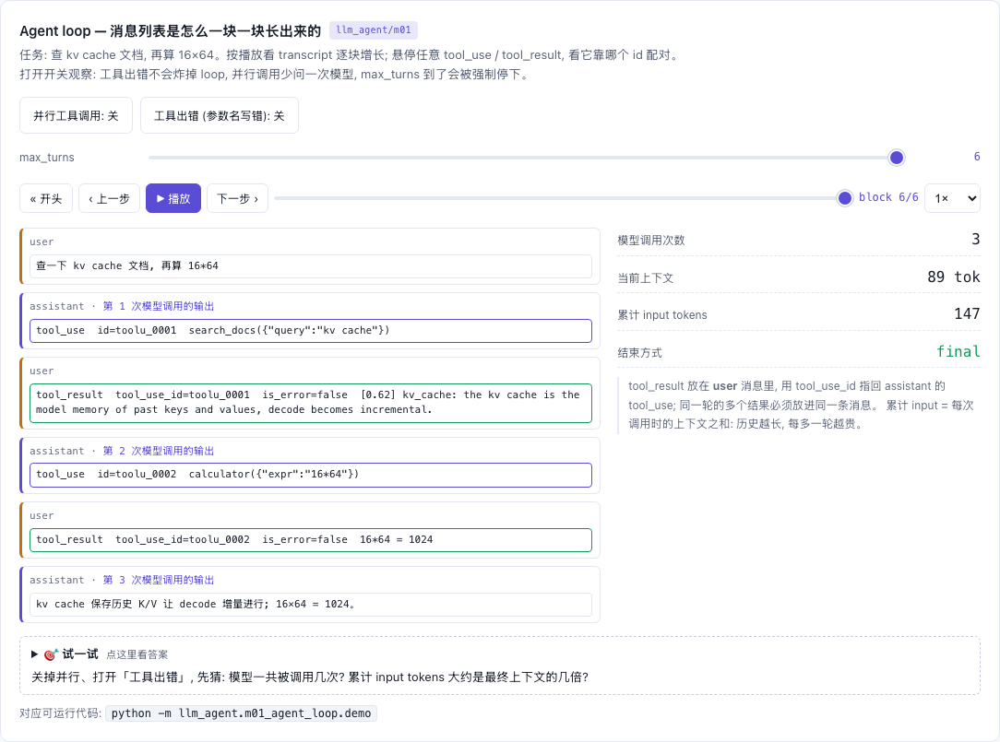

# llm_agent — LLM 应用层 / Agent 教学章节

[](https://beleev.github.io#/agent/loop)

[打开相关交互实验：Agent loop — 消息列表是怎么一块一块长出来的 llm_agent/m01](https://beleev.github.io#/agent/loop)

[项目首页](../README.md) · [在线教程](https://beleev.github.io/llm-engineering-lab/#/agent)

## 概览

> 用纯 Python stdlib 写一个可运行、可断言的 agent harness, 讲清楚生产级 agent 的关键机制:
> 循环、工具、权限、上下文、扩展、持久化、子智能体、MCP、规划、护栏、评测。
> 设计刻意对齐 Claude Code (权限模式名、hook 事件名、`mcp__server__tool` 命名) 和 Claude Messages API (content block 格式)。

### 设计目标

- **原理优先**: 默认"模型"是 `RuleBasedLLM` (关键词规则), 行为完全确定 —— 所以每个 demo 都能用 `assert` 证明自己声称的行为, 而不是无条件打印 OK。
- **一个 loop, 任意模型**: `core/llm.py` 的 `LLM` 协议只有一个方法 `next(messages, tools) -> ModelAction`。换成 `core/claude_llm.py` 的真实模型, loop 一行不改 (m15, opt-in)。
- **transcript 即 API 格式**: assistant 的 `tool_use` 与 user 的 `tool_result` 都是 content block, 按 id 配对。落盘的 JSONL 里还有 system 角色的消息和 `name` 字段, 发给真实 API 前要经 `core/claude_llm.py: to_api_messages` 转换 (m15)。
- **安全可跑**: `ShellTool` 只模拟、永不执行; 不访问外网，m55 使用本机 HTTP; 文件只写临时目录; 基础模块的子进程是 m09 的本地 MCP server; m28 还会运行临时项目中固定的 Python 测试。
- **基础模块零依赖**: 基础模块用 stdlib，研究实验使用 numpy。`--with-training` 加入 m32 / m37 / m44 / m45 / m46 的 CPU 训练, 复用仓库已有 PyTorch。CI 在 Python 3.10 和 3.13 上跑。

## 运行

```bash
# 在仓库根目录
python -m llm_agent.run_all                 # 54 个默认 demo，使用标准库与 numpy
python -m llm_agent.run_all --with-training # 加入 5 个 CPU 训练扩展, 共 59 个
python -m llm_agent.m03_permissions.demo    # 单模块
python -m llm_agent.full_loop.demo          # 组合闭环

# 可选: 真实模型 (需要 pip install anthropic + ANTHROPIC_API_KEY; 否则只跑离线检查后礼貌退出)
python -m llm_agent.m15_claude_api.demo
```

## 模块与阅读顺序

### 学习路径

```
m01 Agent Loop ─ m02 Tool Use ─ m03 Permissions ─ m04 Context & Memory      基础: 一个能行动、受约束的 loop
      │
m05 Skills & Hooks ─ m06 Persistence ─ m07 Subagents ─ m08 Retrieval        扩展: 可定制、可恢复、可分工、有知识
      │
m09 MCP ─ m10 Planning ─ m11 Orchestrator ─ m12 Guardrails                  进阶: 外部工具、先计划后动手、并行分工、防注入
      │
m13 Evals ─ m14 Context Engineering ─ (m15 真实模型, opt-in)                 工程化: 怎么知道它变好了, 怎么让它跑得久
      │
m16 RAG ─ m17 Computer Use ─ m18 A2A ─ m19 Prompt Caching                  扩展面: 知识、界面、别的 agent、成本
      │
full_loop  把执行机制拼在一起, 逐场景断言
      │
m20 记忆更新 ─ m21 完成验收 ─ m22 故障恢复 ─ m23 上下文成本
      │
m24 多跳证据 ─ m25 轨迹学习 ─ full_learning_loop 四阶段改进评估
```

### 模块清单

| # | 模块 | 讲什么 | 机制所在 |
|---|------|--------|----------|
| 01 | [Agent Loop](m01_agent_loop/) | while 循环、tool_use / tool_result block、按轮次推理 | `core/agent.py` `core/schema.py` |
| 02 | [Tool Use](m02_tool_use/) | JSON Schema 工具定义、执行前校验、并行工具调用 | `core/tools.py` |
| 03 | [Permissions](m03_permissions/) | deny > ask > allow、模式、命令归一化、黑名单的局限 | `core/permissions.py` |
| 04 | [Context & Memory](m04_context_memory/) | 文件记忆 (含中文)、清理 / 摘要 / 截断三档对比 | `core/memory.py` |
| 05 | [Skills & Hooks](m05_extensibility/) | SKILL.md 渐进式披露、7 个 hook 事件、hook 绕不过权限 | `core/skills.py` `core/hooks.py` |
| 06 | [Persistence](m06_persistence_resume/) | append-only JSONL、resume、权限不随会话恢复 | `core/persistence.py` |
| 07 | [Subagents](m07_subagents/) | 隔离上下文、只回摘要、子 transcript 落盘 | `core/subagents.py` |
| 08 | [Retrieval](m08_retrieval/) | TF-IDF 余弦、BM25 式 idf、中文 bigram、工具热替换 | `core/retrieval.py` |
| 09 | [MCP](m09_mcp/) | 真实 stdio JSON-RPC server/client、工具命名空间、同一权限门 | `core/mcp.py` `m09_mcp/server.py` |
| 10 | [Planning](m10_planning/) | todo 工具、plan 模式 (批准前只读)、并行调用计时 | `core/tools.py` `core/permissions.py` |
| 11 | [Orchestrator](m11_orchestrator/) | lead 扇出并行 worker、不同工具集、token 两本账 | `core/subagents.py` |
| 12 | [Guardrails](m12_guardrails/) | prompt injection (标记 + 污点)、路径围栏、密钥脱敏 | `core/guardrails.py` `core/sandbox.py` |
| 13 | [Evals](m13_evals/) | 终态 grader、轨迹检查、pass@k / pass^k、回归对比 | `m13_evals/demo.py` |
| 14 | [Context Engineering](m14_context_engineering/) | 工具结果清理、模型摘要压缩 (resume 真的变小)、即时检索、记忆工具 | `core/agent.py` `core/memory.py` |
| 15 | [Claude API](m15_claude_api/) | 真实模型适配器 (opt-in, 不在 run_all) | `core/claude_llm.py` |
| 16 | [RAG](m16_rag/) | 定长 vs 结构切块、BM25、字符 n-gram 稠密向量、RRF 混合、rerank、recall@k / MRR | `m16_rag/demo.py` |
| 17 | [Computer Use](m17_computer_use/) | 无障碍树快照 → click / type / scroll、ref vs 坐标点击、页面注入拦截 | `m17_computer_use/demo.py` |
| 18 | [A2A](m18_a2a/) | Agent Card、任务状态机 (input-required)、artifact、与 MCP 的分工 | `m18_a2a/demo.py` |
| 19 | [Prompt Caching](m19_prompt_caching/) | cache_control 断点、前缀字节匹配、写贵读便宜、TTL、时间戳反例 | `m19_prompt_caching/demo.py` |
| 20 | [记忆更新 · 来源、范围与版本](m20_memory_lifecycle/) | 记忆要保留对象、范围和证据; 新事实只替换它能证明的那一部分。 | `m20_memory_lifecycle/demo.py` |
| 21 | [完成验收 · 说完不等于做完](m21_completion_verification/) | 把 final 当候选结果; 只读验收通过才结束, 失败后在预算内修复。 | `m21_completion_verification/demo.py` |
| 22 | [故障恢复 · 重试、幂等与取消](m22_runtime_reliability/) | 超时表示不知道结果; 幂等确认副作用, 取消确认执行边界。 | `m22_runtime_reliability/demo.py` |
| 23 | [上下文成本 · 压缩与缓存一起算](m23_context_cache/) | 比较净成本, 同时检查范围、否定和来源是否保留。 | `m23_context_cache/demo.py` |
| 24 | [检索证据 · 从相关到足够回答](m24_agentic_rag/) | 别名、对象、版本与答案形成完整证据链, 才能输出结果。 | `m24_agentic_rag/demo.py` |
| 25 | [轨迹学习 · 先验证, 再造训练数据](m25_trajectory_learning/) | 结果、来源、授权和预算一起决定轨迹能否进入训练集。 | `m25_trajectory_learning/demo.py` |
| ★ | [持续改进 · 学会、迁移、变化与保持](full_learning_loop/) | 先行动再读反馈, 把迁移、规则更新和旧能力保持分开验收。 | `full_learning_loop/demo.py` |
| ★ | [Full Loop](full_loop/) | 全部机制组合, 5 个场景逐一断言 | — |

实验的依赖与阅读顺序见 [Agent 扩展阅读](../docs/agent-extensions.md)。默认入口共 55 个 demo，加 `--with-training` 后共 60 个（m15 在线 demo 仍需主动开启）。

## 实现说明

### 一次工具调用在 loop 里的完整路径

```
模型 → assistant[tool_use...]  ──先写入 transcript──►  JSONL
        │ 对每个 tool_use (串行):
        │   PreToolUse hook (可拦截 / 改写)
        │   污点检查 (本轮读过不可信数据 → 高风险工具锁死)
        │   权限门 evaluate(改写后的最终调用)      ← hook 不是提权通道
        ▼
   通过的调用 → 线程池并行执行 (先按 JSON Schema 校验参数)
        ▼
   脱敏 → 不可信输出包 <untrusted_data> → PostToolUse hook (注释走旁路 system 消息)
        ▼
   user[tool_result...] (全部结果同一条消息) → 超预算? 清旧结果 → 摘要压缩 → 再问模型
```

## 边界

### 业界覆盖度自评

| 技术 | 状态 | 说明 |
|---|:---:|---|
| Agent loop / tool use content blocks | yes | m01, 与 Messages API 同构 |
| JSON Schema 工具 + 参数校验 | partial | 一层 schema 子集; 真实系统用 `strict: true` / jsonschema |
| 并行工具调用 | yes | m02 / m10, 线程池 |
| 权限: 规则 + 模式 + plan mode | yes | m03 / m10; 黑名单局限已当场演示 |
| OS 级沙箱 / 真实 shell | no | 教学安全: 只模拟; 路径围栏见 m12 |
| Hooks (7 事件) | yes | Stop 仅通知, 不能阻止结束 |
| Skills 渐进式披露 | yes | m05 为目录/正文两层；m33 演示 index / SKILL / rules 三层资料及版本发布 |
| MCP | partial | 真实 stdio + tools; 无 resources / prompts / HTTP / OAuth |
| 持久化 / resume / compact boundary | yes | m06 / m14 |
| Subagents / orchestrator-workers | yes | m07 / m11; lead 不会多轮重规划 |
| 检索 | partial | m08/m16 覆盖词面与字符特征检索；m43 有固定向量 ANN 机制实验；无训练过的语义 embedding、完整 ANNOY/HNSW |
| Computer use / A2A | partial | m17 模拟浏览器，m35 可选真实 Chromium 截图/点击（颜色定位）；m18 仍为进程内 A2A，无 HTTP/流式/推送 |
| Context editing / compaction / memory tool | yes | m14; 预算按字符, token 为估算 |
| Prompt injection 防护 / 脱敏 | partial | 正则特征 + 轮级污点; 无信息流追踪。各层挡不住什么, 见 m03 / m07 / m09 / m12 / m17 的「与真实系统的差距」 |
| Evals | partial | m13/m31 有终态、轨迹、裁判校准夹具及配对 bootstrap；无真实 LLM-as-judge 或大规模任务验证 |
| 真实 LLM | opt-in | m15; 无 streaming / 重试 |
| Prompt caching | partial | m19 离线模拟计费与 TTL; m15 的真实调用未启用 |

读完本目录再看 Claude Code / Claude Agent SDK / OpenHands / LangGraph, 可以把复杂系统拆成几条主线:
**模型怎么选动作、工具怎么执行、权限怎么拦、上下文怎么控、状态怎么留、子任务怎么隔离、不可信输入怎么防、改动之后怎么验。**

## Agent 专题实验


| 模块 | 读完能解释什么 |
|---|---|
| [m26_tool_discovery](m26_tool_discovery/README.md) | 模型初次只看到 discover 这 1 个工具; 查目录命中才注册, 下一轮可见 Schema 从 1 变 2, 而不是 103 个。 |
| [m27_knowledge_organization](m27_knowledge_organization/README.md) | 同一份 5 条事实: 平铺检索只答出 [Atlas], 树摘要答全 [Atlas, Boreal], 图遍历两跳答出负责人 Lin。 |
| [m28_coding_agent](m28_coding_agent/README.md) | 改一行不等于修好: 首个候选 return total 只过 1/3 测试。 |
| [m29_async_runtime](m29_async_runtime/README.md) | 取消是两段式: cancel-request 之后要等执行器的 cancel-ack。 |
| [m30_collaboration](m30_collaboration/README.md) | 两个 worker 各改一个文件, 没有文本冲突, 合起来总量 12 超过上限 10。 |
| [m31_eval_suite](m31_eval_suite/README.md) | 同一份题集 (suite 191d7ed87046) 跑三种条件: baseline 1/3, 只开授权门 2/3, 再开澄清 3/3; 分层报才看得出 safety 是授权门救的, hard 是澄清救的。 |
| [m32_agent_training](m32_agent_training/README.md) | 4 个符号动作、16 个训练实体: SFT 用 5 条示范跑 60 步学会 lookup→answer, 留出的 16 个实体全过; 在线 RL 按温度 3 每步采 8 条、跑 35 步, 参数动了, 留出仍 100%。 |
| [m33_skill_evolution](m33_skill_evolution/README.md) | 项目 A 的失败只改 projects[A]=Rust, 不动 default: 全局改法过三道门是 [True, False, False] 被拒; 局部改法三门全过才发布成版本 1, A=Rust、B=Python。 |
| [m34_voice_interaction](m34_voice_interaction/README.md) | 同一条 10 个事件的时间线: 半双工打不断, 3 条输出全是旧任务的; 全双工只停播放器会重播 2 条过期音频; 按 generation 丢弃后只剩 "正在查"、"已停止" 2 条, 过期 0 条。 |
| [m35_visual_grounding](m35_visual_grounding/README.md) | 同一个绿色按钮, 截图之后和红色按钮换了位: 按旧坐标 (29, 17) 点开的是 other, 刷新后 (29, 52) 才是 target。 |
| [m36_embodied_control](m36_embodied_control/README.md) | 同一段动作块, 增益 1.0 刚好到 1.0, 增益 1.8 冲到 1.8。 |
| [m37_midtraining](m37_midtraining/README.md) | 只训新域 120 步: 新域 0% → 100%, 旧域 100% → 0%, loss 全程在降。 |
| [m38_programmatic_actions](m38_programmatic_actions/README.md) | 把规则写成代码只保证可重复: total * (1 - percent) 每次都算出 -900。 |
| [m39_meta_optimization](m39_meta_optimization/README.md) | 训练树上 prior 策略 0.9 赢过 breadth 0.8; 换到留出树, prior 只拿 0.2, breadth 0.95。 |
| [m40_agent_society](m40_agent_society/README.md) | 背叛对合作 6 轮拿 30 分, 双方都背叛各 6 分、总共 12; 互惠对互惠各 18、总共 36, 对背叛者只让它拿 10。 |
| [m41_system_design](m41_system_design/README.md) | 有清单走 workflow, 没清单走 Agent, 歧义和高风险交人: hybrid 4 个请求全处理完, 费用 4 单位; 全 Agent 也是 4 个, 费用 6。 |
| [m42_memory_privacy](m42_memory_privacy/README.md) | 授权在召回之前查, 不是召回后过滤: flat 模式一次就漏 1 条别家租户的、1 条过期的。 |

m28 会在临时项目执行固定 Python 测试; m29 使用真实 asyncio 和 SQLite; m32、m37、m44 复用 PyTorch 训练小模型。m35 的 Chromium 版本是单独的可选验证, 不加入默认依赖。

- [向量索引 · 精确扫描与近似搜索](m43_vector_index/README.md): 精确扫描 288 次距离计算, recall 1.0; 单叶投影树 36 次, recall 0.8333; 预算 12 的图搜索 144 次, recall 0.6667, 预算放到 24 才回到 1.0。

- [在轨自蒸馏 · 特权信息与部署边界](m44_self_distillation/README.md): 教师和学生是同一个 nn.Linear(2, 2), 教师分支多看一列已验证的方向提示。

## 机制实验

- [m45 语义检索与重排](m45_semantic_retrieval/README.md): 需要 torch, 不在默认 run_all 里; `run_all --with-training` 才会跑。
- [m15 流式运行时](m15_claude_api/README.md): 离线协议夹具在默认 run_all 里; 在线 demo 要自己配好凭据才会开。
- [m31 trace/span](m31_eval_suite/README.md): 记真实 Agent 调用链的并发、重试和取消。
- [多轮模板](../llm_finetune/run_finetune/chat_template/README.md) 与 [RFT](../llm_finetune/run_finetune/rft/README.md): 把 Agent 轨迹接回训练数据和策略更新。

## 研究实验

这些模块按主题组织。全部为离线 CPU 教学实验；结果与真实模型、硬件实测的边界见各模块 README。

| 模块 | 关注的问题 |
| --- | --- |
| [RAG: 答案误差如何反传到检索器](m46_joint_rag/README.md) | 检索器冻结时, 正确文档概率停在 0.1142, 答案边缘似然 0.2013, top-1 是错的那篇。让答案损失反传到检索 logits, 100 步后正确文档概率 0.9802; 两侧一起训时检索也到 0.9771, 但生成器在错文档下答对的概率从 0.1 涨到 0.2613, 这就是背答案的苗头。 |
| [有效上下文: 看得到, 不等于用得上](m47_context_utilization/README.md) | 同一个读出器, 证据放在 64 个 token 的开头、中间、末尾, 带首尾偏好时拿到的质量是 0.8132、0.0286、0.8132; 去掉偏好三处都是 0.4643, 仍被 63 个干扰稀释到 0.5 以下。先检索出 top-4 再读, 三处都到 0.9479, 18 组组合全部够用。能装下、能召回、能组合是三件事。 |
| [安全与治理: 误拒、漏拦和责任记录](m48_safety_governance/README.md) | 同样 4 个案例, 关键词拦截误拒了 1 条引用 "ignore previous instructions" 的正常请求, 又放过了 1 条换了说法的外发攻击, B 组正确率 0; 不设权限门则 2 条攻击全放行。执行器只核对服务端 allowlist 时, 误拒 0、漏放 0。正常文档可以讨论攻击, 恶意文档也可以不含关键词, 权限只能来自可信的用户授权。 |
| [学习世界模型: 预测和反馈的差别](m49_learned_world/README.md) | demo 用 120 条转移样本拟合出 A/B = 0.9002/0.7007, 动力学匹配时一步 MPC 把状态从 2 收到 0.0062。部署时执行器增益从 0.7 掉到 0.35: 开环照着预测走, 预测说已经到 0.006, 真实状态还在 0.286, 终态 0.28553; 每步重新观察的闭环终态 0.00706。世界模型负责预测, 控制器还得在预测出错后回去看现实。 |
| [代码任务: 跨文件修改与独立验收](m50_repository_verification/README.md) | 把折扣接口从百分数改成小数后, 只改 rates.py 不改 invoice.py 的补丁, 在工作区外的 4 个独立用例里只过 1 个, 退出码 1; 同步调用方的完整补丁 4/4。候选把 total 硬编码成 80、把本地测试改成 assert True 自报全绿, 独立用例照样只过 1/4。一个函数过了测试, 不等于整个仓库对了。 |
| [形式证明与科学假设: 三种正确](m51_formal_science/README.md) | 引用写成 (0, 0) 的伪造证书, 最后一行同样是 Q, 内核逐步核对引用后拒绝; 引用 (0, 1) 的证书通过。三点测量里有一处异常, 二次式把训练 MSE 拟到 0.0, 在独立模拟器的 4 个留出点上 MSE 3.06; 线性假设训练 MSE 0.14222, 留出 0.07111。算对一个数、证出一个命题、发现一条现实规律, 靠的是三种不同的证据。 |
| [专业领域: 证据时效、地域与复核](m52_domain_workflows/README.md) | 同样 3 个虚构场景, 只按领域取第一篇资料: 医疗引了过期的 med-old, 法律引了 B 地区的 law-B, 0 对。按地域和日期过滤后医疗、法律各对 1 条, C 地区没有金融资料就拒答, 3/3; 专家复核状态来自场景里的 expert 标志, 模型自己写不出 "已复核"。专业任务的错误常常不是句子不通, 而是引错了版本、地域或人群。 |
| [工具学习: 从候选调用到训练数据](m53_tool_data/README.md) | 同一个加法工具, 全部收录时留出 40 题全调用, 复述题也被答成 a+b, 只对 20 题; 按有/无工具的答案似然收益过滤后, 只在算术题上调用 (20 次), 40 题全对; 把成本门槛提到 6, 算术题的收益也不够, 0 次调用, 又只对 20 题。工具执行成功, 不代表值得教给模型; 训练数据应保留能帮助后续预测的调用, 并把额外成本算进去。 |

全量入口：在仓库根目录运行 `python scripts/run-research-completion.py`。主题与边界见 [研究实验指南](../docs/research-completion.md)。

## 工程流程

- [文档入库、来源定位、权限与更新删除](m54_document_lifecycle/README.md)
- [MCP 旧新版本对照与 HTTP 资源端授权](m55_mcp_versions/README.md)
- [切片门槛、线上质量与版本回滚](m56_release_loop/README.md)
- [检查点版本迁移、权限重验与提交后强退恢复](m57_checkpoint_migration/README.md)

网页只在主讲章节挂完整实验，其他章节保留说明与跳转。实验内容与边界见 [工程实验指南](../docs/engineering-completion.md)。
