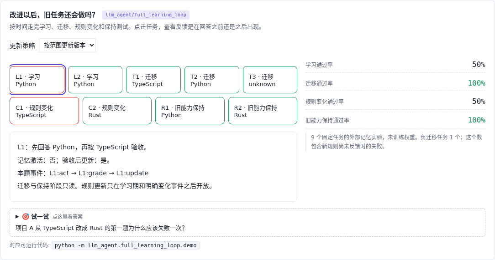

# 持续改进 · 学会、迁移、变化与保持

[](https://beleev.github.io/llm-engineering-lab/#/agent/learning-loop)

[项目首页](../../README.md) · [Agent 目录](../README.md) · [交互实验](https://beleev.github.io/llm-engineering-lab/#/agent/learning-loop)

## 直觉

根据反馈修好了新任务之后, 如何验证原有的旧任务能力没有因此退化?

本章的「持续学习」不更新模型权重, 而是根据任务反馈维护一份外部规则记忆 (如「alice 在项目 A 使用 TypeScript」), 并按四个维度分别验收:
- 学会 (learning): 接收反馈后写入新规则。
- 迁移 (transfer): 在未见过的同类任务上正确复用已学规则。
- 变化 (change): 当既有规则发生变更时及时更新恢复。
- 保持 (retention): 未变更的旧规则不受新规则覆盖而失效。
每道任务严格按固定时序执行:
1. 先基于当前记忆作答。
2. 再对照标准答案判分。
3. 判分完成后才将反馈交给学习器, 作答前无法提前获知答案。
demo 对照结果显示:
- 仅按对象与作用域版本化的记忆在四个阶段全部达标 (通过率分别为 50% / 100% / 50% / 100%)。
- 直接追加反馈的策略在保持阶段通过率为 0%, 局部新规则覆盖了未变更的旧规则。

## 核心原理

### 行动之前看不到标准答案

学习器 Learner 在作答时严禁接触标准答案与当题反馈, 只能读取任务的输入上下文。每次调用仅传入 entity (对象, 如 alice) 与 scope (作用域, 如项目 A), 任务定义中的 expected (标准答案) 与 feedback (事后反馈) 均对作答过程不可见。
单道任务的生命周期固定按三步依次推进:
1. act: 学习器根据当前规则记忆输出预测动作。
2. grade: 评估器比对预测结果与 expected 完成判分。
3. update: 判分结束后才将当题 feedback 交给学习器更新记忆。
evaluate 将每一步事件按发生先后写入 order 列表, demo 对此执行两项不变量断言:
- 单题时序递增: 凡附带反馈的任务, 其 act、grade、update 三个事件在 order 中的下标严格递增。
- 评估期零更新: 迁移与保持阶段的任务不携带反馈, 断言这两个阶段内触发的更新次数为 0。
此外还设有因果截断检查: 仅传入前 5 道题运行得到的结果, 与跑完全部 9 道题后截取前 5 行的记录完全一致, 证明后续任务的反馈未发生跨时间步泄漏。

### 规则变化应有一个可解释的恢复点

面对外部规则变更, 合规学习器的正常轨迹应当是「首次遇变答错、接收反馈更新、后续任务恢复正确」, 而非在变更发生当刻即答对。本例设定的规则变更是项目 A 的指定语言由早期的 TypeScript 切换为 Rust。
demo 中版本化学习器在 change 阶段连续回答两道题:
- C1 首次遇变: 询问 alice 在项目 A 使用的语言时, 学习器沿用此前记忆中的 TypeScript 而判错; 判分完成后才收到反馈证据 e3 (alice, A, Rust) 并发布为新版本。
- C2 变更恢复: 再次询问同一问题时, 学习器读取最新版本回答 Rust 并判对。
因此 change 阶段的真实通过率为 50%, 且明确呈现「前题错、后题对」的可解释恢复点。
若在作答前提前注入反馈, C1 也会判对并使 change 通过率变为 100%。这一 100% 并非模型具备自适应恢复能力, 而是评估协议发生了答案提前泄漏。

### 不要用总分掩盖旧能力丢失

单一总分会将「习得新规则」与「遗忘旧规则」混同抵消, 必须将四个阶段拆开独立统计通过率。三种学习器在 demo 中的分阶段表现为:
- static (静态固定规则): 忽略一切外部反馈, 对 alice 一律返回默认语言 Python, 学习 50%、迁移 67%、变化 0%、保持 50%。该策略保住了项目 B 的 Python, 但无法习得项目 A 后续变更的 Rust。
- append (无作用域顺序追加): 将每条反馈追加至列表末尾, 查询时仅按对象取首条命中记录, 学习 0%、迁移 67%、变化 0%、保持 0%。由于首条记录为 alice 在项目 A 使用 TypeScript, 后续无论查询哪个项目均返回 TypeScript, 追加在末尾的 Rust 也无法被取到, 非学习阶段因命中错误规则导致的负迁移达 5 道题。
- versioned (按对象与作用域版本化, 复用 m20): 学习 50%、迁移 100%、变化 50%、保持 100%。查询项目 B 时因无项目级专属规则而自动回退至 alice 的全局规则 Python, 查询项目 A 时则读取最新发布的 Rust 版本, 负迁移仅剩规则刚变更时的 C1 这 1 道题。
保持阶段 (retention) 的两道题分别检验项目 B 的 Python 与项目 A 的 Rust。append 策略因旧记录阻塞与局部规则越界导致两题全错, 单看总分容易掩盖这一缺陷, 拆出保持阶段的 0% 通过率即可直接定位旧能力丢失。

### 这里改的是外部知识

本实验中的持续改进不修改模型权重, 而是受控更新一份外部规则记忆。写入路径直接复用 m20 的三步审核流程:
1. 登记原始证据: 将每条反馈注册为不可篡改的 Evidence 记录 (同一证据 id 不允许覆写)。
2. 生成候选提案: 基于已登记的证据构造待发布的候选版本。
3. 校验并发布版本: 核对候选版本的对象、作用域、目标值与源证据完全一致, 且其基线版本号对应当前最新版本后才予以生效。
记忆写入仅在学习阶段 (learning) 与显式规则变更阶段 (change) 开放; 迁移 (transfer) 与保持 (retention) 两个阶段严格锁定为只读模式, 防止边测试边更新将测试集信息混入状态。
边界: 实验仅包含 9 个固定合成任务, 采用确定性规则策略配合外部记忆读写; 各阶段百分比仅反映该评估协议下的状态转换是否合规, 不能外推为通用大模型的参数级持续学习能力, 且候选审核复用 m20 的确定性校验程序而非独立的 LLM 评审。

### 读代码的顺序

- `demo.py:Learner`
- `demo.py:evaluate`

## 运行

```bash
python -m llm_agent.full_learning_loop.demo
```

默认只用 Python 标准库, 不访问网络。所有断言都随 demo 运行, 也被 `pytest` 自动发现。

## 运行后应该看到什么

静态 / 追加 / 版本化的保持阶段通过率为 50%、0%、100%。版本化第一次遇到规则变化仍失败, 反馈后下一题恢复; 项目 B 的 Python 规则保持正确。

这些数字来自本仓库默认配置的运行。费用、时间和工作量若在正文标成模拟, 就是模型值, 不是外部 API 实测。

## 与真实系统的差距

9 个固定任务, 规则模型与外部记忆更新。百分比只解释状态与评估协议, 不能外推通用持续学习能力。候选审核复用 m20, 非独立大模型评审。

## 常见误区

- **为什么先行动再提供当前任务反馈?** 反馈是学习信号, 不是本题行动前可读取的标准答案。
- **哪项最能发现新规则污染旧能力?** 保持测试有独立任务, 才能发现局部更新破坏了不该变化的行为。

## 自测题

1. 为什么先行动再提供当前任务反馈?

<details><summary>答案</summary>

避免当前答案提前泄漏给策略。反馈是学习信号, 不是本题行动前可读取的标准答案。

</details>

2. 哪项最能发现新规则污染旧能力?

<details><summary>答案</summary>

检查未改变规则的旧任务表现。保持测试有独立任务, 才能发现局部更新破坏了不该变化的行为。

</details>

3. 迁移阶段应该开放哪种能力?

<details><summary>答案</summary>

读取已有规则, 不写入测试答案。本实验在迁移和保持阶段禁用更新, 避免边测试边泄漏答案。

</details>
