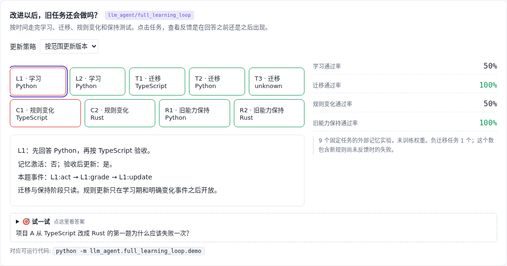

# 持续改进 · 学会、迁移、变化与保持

[](https://beleev.github.io/llm-engineering-lab/#/agent/learning-loop)

[项目首页](../../README.md) · [Agent 目录](../README.md) · [交互实验](https://beleev.github.io/llm-engineering-lab/#/agent/learning-loop)

## 直觉

修好了新任务, 怎么知道旧任务没坏?

先行动再读反馈, 把迁移、规则更新和旧能力保持分开验收。

## 核心原理

### 行动之前看不到标准答案

策略只接收 entity 和 scope, 不能读取 expected 或未来反馈。每题事件顺序固定为 act → grade → update。

### 规则变化应有一个可解释的恢复点

项目 A 改用 Rust 的第一题先失败, 才收到新反馈; 下一题恢复正确。这比提前看反馈拿满分更可信。

### 不要用总分掩盖旧能力丢失

版本化策略四阶段通过率为 50%、100%、50%、100%。直接追加策略的保持阶段为 0%; 静态规则保持旧 Python, 但学不会新 Rust。

### 这里改的是外部知识

复用 m20 的来源、作用域与版本审核。迁移和保持阶段只读; 学习期和显式规则变化才开放更新。没有训练模型权重。

### 读代码的顺序

- `demo.py:Learner`
- `demo.py:evaluate`

## 运行

```bash
python -m llm_agent.full_learning_loop.demo
```

默认只用 Python 标准库, 不访问网络。所有断言都随 demo 运行, 也被 `pytest` 自动发现。

## 运行后应该看到什么

静态 / 追加 / 版本化的保持阶段通过率为 50%、0%、100%。版本化第一次遇到规则变化仍失败, 反馈后下一题恢复; 项目 B 的 Python 规则保持正确。

这些数字来自本仓库默认配置的运行。费用、时间和工作量若在正文标成模拟, 就是模型值, 不是外部 API 实测。

## 与真实系统的差距

9 个固定任务, 规则模型与外部记忆更新。百分比只解释状态与评估协议, 不能外推通用持续学习能力。候选审核复用 m20, 非独立大模型评审。

## 常见误区

- **为什么先行动再提供当前任务反馈?** 反馈是学习信号, 不是本题行动前可读取的标准答案。
- **哪项最能发现新规则污染旧能力?** 保持测试有独立任务, 才能发现局部更新破坏了不该变化的行为。

## 自测题

1. 为什么先行动再提供当前任务反馈?

<details><summary>答案</summary>

避免当前答案提前泄漏给策略。反馈是学习信号, 不是本题行动前可读取的标准答案。

</details>

2. 哪项最能发现新规则污染旧能力?

<details><summary>答案</summary>

检查未改变规则的旧任务表现。保持测试有独立任务, 才能发现局部更新破坏了不该变化的行为。

</details>

3. 迁移阶段应该开放哪种能力?

<details><summary>答案</summary>

读取已有规则, 不写入测试答案。本实验在迁移和保持阶段禁用更新, 避免边测试边泄漏答案。

</details>

## 延伸阅读

机制设计借鉴 [ai-agent-book 的相关章节](https://github.com/bojieli/ai-agent-book/blob/dbc046eb896ac4e39aa19c7774c8bf49583b89a6/chapter9/self-evolution-eval/harness.py#L9)。本例为本仓库独立编写的离线教学实验; 不复用书中未经复跑的提升数字。
