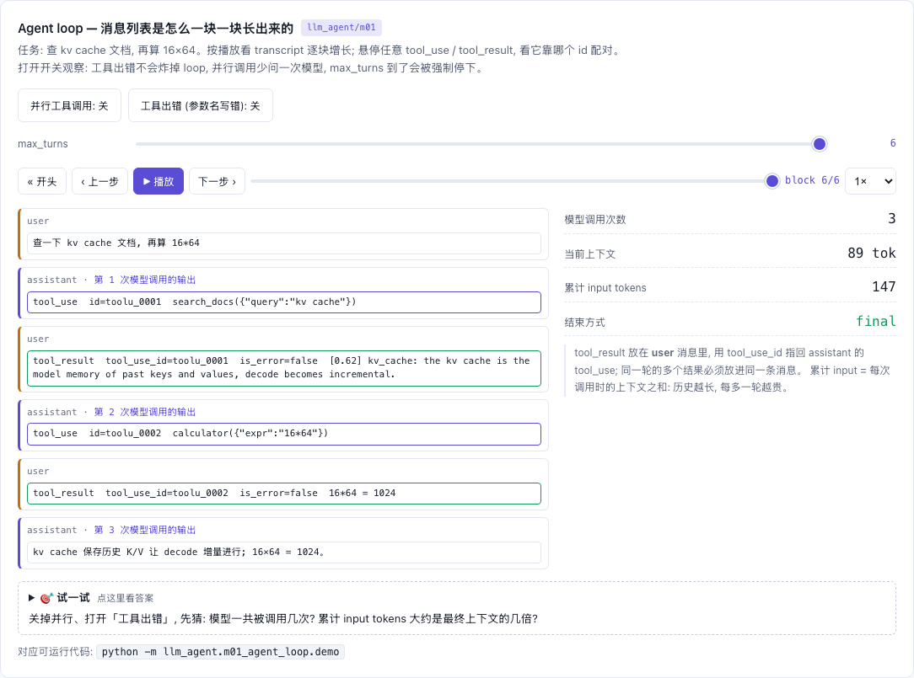

# M15 — 接真实模型 (opt-in)

[](https://beleev.github.io#/agent/loop)

[打开相关交互实验：Agent loop — 消息列表怎么一块一块长出来, 每问一次模型为什么都要重发全部历史 llm_agent/m01](https://beleev.github.io#/agent/loop)

## 直觉

前面 14 个模块的"模型"都是关键词规则, 学员自然会怀疑: 换成真模型是不是要重写 loop?
答案是不用: harness 对模型的全部依赖就是 `LLM` 协议的一个方法 `next(messages, tools) -> ModelAction`, 工具、权限、hook、持久化一行不改。
能这么干净, 是因为 transcript 从 m01 起就用 Messages API 同款的 content block (`tool_use` / `tool_result` 按 id 配对)。
剩下的适配工作只有"格式上的最后一公里": system 消息放哪、相邻同角色消息怎么合并、模型返回的原始 block 怎么存回去。
这一步做错的后果很具体: API 直接 400 (角色不交替、tool_result 不在最前、thinking block 被改动), 或者密钥被写进代码。
当前代模型还多了几条请求侧的约束: thinking 恒开, 深浅只能用 effort 调; 采样参数、强制 tool_choice 和 assistant 预填都会 400; 历史只能追加, 改了旧消息, 其后的 thinking 块就失效。

**重要声明**: 本仓库的开发与测试环境没有安装 `anthropic` SDK, 也没有 API key; 在线路径 (`ClaudeLLM.next` 和 demo 的第 [4] 段) 从未对真实 API 运行过。被断言覆盖的只有离线部分: `to_api_messages`、`build_request`、`stale_thinking`, 以及 `stream_demo` 用注入客户端跑的流式累积。请求参数的写法依据 Claude API 文档 (Claude Code 内置 claude-api skill, 模型表缓存于 2026-11-03), 不是实测结果。

## 核心原理

### 核心数据结构与控制流

- `core/llm.py` — `LLM` 协议: `next(messages, tools) -> ModelAction`, 无状态, 状态全在 messages 里。
- `core/claude_llm.py` — `to_api_messages(messages) -> (system, api_messages)`: 纯函数, 不需要 SDK, 可离线测试。
- `core/claude_llm.py` — `build_request(model, max_tokens, messages, tools, effort)`: 纯函数, 把内部 transcript 变成 `messages.create` 的参数:
  - thinking 一律 `{"type": "adaptive"}`; 只有 `claude-haiku-4-5` 及更老的模型发 `{"type": "enabled", "budget_tokens": max_tokens // 2}`。Opus 5.5 上 `disabled` 和 `budget_tokens` 都返回 400。
  - effort 可选, 放在 `output_config: {"effort": ...}` 里 (low / medium / high / xhigh / max), 不设就用模型默认值 (Opus 5.5 是 medium)。
  - 不发 `temperature` / `top_p` / `top_k`, 不发 `tool_choice` (即 auto), 末尾是 assistant 消息 (预填) 直接抛 `ValueError`。
- `core/claude_llm.py` — `stale_thinking(sent, now)`: 纯函数, 离线近似真实 API 的 history-editing check。返回这一次请求原样保留了上一次的多少条前缀消息, 以及哪些 thinking 块会失效。
- `core/claude_llm.py` — `ClaudeLLM`:
  - 构造时延迟 `import anthropic`, 缺 SDK 或缺 `ANTHROPIC_API_KEY` 抛 `RuntimeError`。
  - 模型默认 `claude-opus-5-5`, 环境变量 `LLM_AGENT_MODEL` 可覆盖 (如 `claude-fable-5-2`、`claude-sonnet-5-5`、`claude-haiku-5-5`、`claude-haiku-4-5`); effort 用构造参数或 `LLM_AGENT_EFFORT` 设。
- `core/schema.py` — `ModelAction.raw_content`: API 返回的原始 content blocks; `ToolCall.id`: 真实模型自带 id, 为空时才由 agent 分配 `toolu_NNNN`。

```
to_api_messages(内部 transcript)
  1. 开头连续的 system 消息            → 拼成顶层 system 参数
  2. 对话中途的 system 消息 (hook 注释、
     hook_context 等 harness 注入)      → role=user 的 <system-reminder> 文本块
  3. 相邻同角色消息                     → 合并成一条 (保证 user/assistant 严格交替)
  4. 每条消息内按"是否 tool_result"稳定排序 → tool_result 排最前, 其余顺序不变

ClaudeLLM.next(messages, tools)
  kwargs = build_request(model, max_tokens=16000, messages, tools, effort)   tools 为空时沿用上次的
         = {model, max_tokens, messages, thinking=adaptive (老模型: budget_tokens),
            +output_config.effort, +system, +tools}                         无采样参数, 无 tool_choice
  stream = client.messages.create(**kwargs, stream=True)
  response = MessageStream 累积到 message_stop 后得到完整 blocks
  stop_reason 不在已知集合     → StreamError                         先看 stop_reason 再读 content
  stop_reason == "refusal"      → final("[模型拒绝了该请求]")
  stop_reason == "max_tokens"   → final + 截断提示 (即使含 tool_use 也不执行: 参数可能不完整)
  有 tool_use block 且带 tools  → ModelAction(kind="tool", tool_calls=用 API 给的 id, raw_content=raw); 否则 → final
Agent.run 把 action.raw_content 原样 append 进 transcript (含 thinking block)

stale_thinking(sent, now)
  system 或 tools 集合变了       → 前缀保留 0 条
  否则逐条比较 messages           → 前缀保留到第一条不同的消息之前
  前缀之后的 thinking 块          → 全部失效 (签名绑定之前的全部消息, 且链着前一个 thinking 块)
```

关键设计:

- 转换写成纯函数: 适配器里最容易错的是格式, 而格式可以不联网就断言。
- 中途的 system 消息降级成 user 侧 `<system-reminder>`: 这种写法任何模型都接受, 且 harness 注入与用户原话、工具数据在文本上仍可区分。
- 原始 blocks 原样存回: 带 thinking 的工具循环要求把 thinking block 原封不动回传, 只存拍平后的文本会丢掉它们。
- 历史只追加: thinking 块的签名绑定产生它时的 system、tools 集合和之前的全部消息。harness 想压缩或改指令时, 要换成追加式的做法 (服务端 compaction、context editing、对话中途追加 system 消息), 不能回头改旧消息。
- 请求参数单独写成纯函数: 当前代模型的约束 (adaptive thinking、effort 位置、不发采样参数和强制 tool_choice、不预填) 不联网就能断言。
- 用 API 给的 `tool_use.id`, 参数直接用已解析的 dict: 不对序列化后的 JSON 字符串做匹配。
- key 只由 SDK 从环境变量读, 代码不经手; SDK 延迟导入, 所以没装 SDK 时包的其余部分照常工作。

## 运行

同一个 agent loop, 把 `RuleBasedLLM` 换成调用 Claude Messages API 的 `ClaudeLLM`。本模块不在 `run_all` 里; 默认 demo 不会实例化 `ClaudeLLM`, 不发网络请求 (m19 只借用了同文件里的纯函数 `to_api_messages`)。

## 运行后应该看到什么

```bash
cd <仓库根目录> && python3 -m llm_agent.m15_claude_api.demo          # 无 SDK / 无 key: 只跑离线部分
pip install anthropic && export ANTHROPIC_API_KEY=... && python3 -m llm_agent.m15_claude_api.demo   # 在线 (会产生真实调用与费用)
```

无 SDK 环境下的真实输出 (长行已截断, 单线程 CPU 约 0.3 s):

```
[1] 离线: transcript → Messages API 请求体
    user      [{"type": "text", "text": "计算 17 * 23"}, {"type": "text", "text": "<system-reminder>\nShow your work.\n</system-reminder
    assistant [{"type": "tool_use", "id": "toolu_0001", "name": "calculator", "input": {"expr": "17 * 23"}}]
    user      [{"type": "tool_result", "tool_use_id": "toolu_0001", "content": "17 * 23 = 391", "is_error": false}, {"type": "text", "
    assistant [{"type": "text", "text": "基于工具结果完成：\ncalculator: 17 * 23 = 391"}]
  system                  : You are a small teaching agent. | Answer in Chinese.

[2] 离线: 请求参数
  keys                    : ['max_tokens', 'messages', 'model', 'output_config', 'system', 'thinking', 'tools']
  thinking                : {'type': 'adaptive'}
  output_config           : {'effort': 'low'}
  haiku-4-5 thinking      : {'type': 'enabled', 'budget_tokens': 8000}
  prefill                 : 拒绝: 请求必须以 user 消息结尾

[3] 离线: 改历史的 5 种做法, 真实 API 上哪些 thinking 块会失效
  追加下一问                   : 前缀保留 8/8 条, thinking 失效 0/4, 没再发送 0
  清旧工具结果 (m14 第 1 档)      : 前缀保留 2/8 条, thinking 失效 3/4, 没再发送 0
  重拼 system (m04 每问检索记忆)  : 前缀保留 0/8 条, thinking 失效 4/4, 没再发送 0
  摘要旧轮, 保留当前轮 (m14 第 2 档) : 前缀保留 0/8 条, thinking 失效 2/4, 没再发送 2
  整段换成摘要 (simple compaction): 前缀保留 0/8 条, thinking 失效 0/4, 没再发送 4

[4] 在线: 真实模型
  跳过: 需要可选依赖: pip install anthropic。设置好之后重跑本 demo 即可, 其余模块不受影响。
```

第 [3] 段的 transcript 是规则替身跑两道算术题得到的 8 条 API 消息, 规则替身不产生 thinking, demo 给 4 条 assistant 消息各补了一个空文字的 thinking 块 (Opus 5.5 默认 `display: "omitted"`, 返回的 thinking 文字本来就是空的)。5 种改动里只有追加能让 4 个 thinking 块全部有效; 整段换成摘要虽然没有失效的块, 但 4 段推理一段也没带过去。

断言验证的内容 (离线段):

- 角色序列恰为 `user, assistant, user, assistant`: 以 user 开头、严格交替 (`hook_context` 被并进第一条 user, `post_tool_hook` 注释被并进携带 tool_result 的那条 user)。
- `session_start` hook 注入的 "Answer in Chinese." 位于用户 prompt 之前, 因而进了顶层 `system`。
- 第三条消息的第 0 个 block 是 `tool_result`, 第 1 个才是 `<system-reminder>` 文本 (hook 注释排在工具结果之后)。
- assistant 的 `tool_use.id` 与下一条 user 的 `tool_result.tool_use_id` 相等。

请求参数段:

- 当前代模型 (Opus 5.5、Fable 5.2、Sonnet 5.5、Haiku 5.5、Opus 5、Sonnet 4.6) 一律发 `thinking: {"type": "adaptive"}`; `claude-haiku-4-5` 发 `budget_tokens: 8000`。
- effort 在 `output_config` 里, 不在顶层; 请求里没有 `temperature` / `top_p` / `top_k` / `tool_choice`。
- 末尾追加一条 assistant 消息 (预填) 时 `build_request` 抛 `ValueError`。

改历史段:

- 只追加下一问: 前缀保留 8/8 条, 0 个 thinking 块失效。
- 清掉第一个工具结果 (m14 第 1 档的 `clear_tool_results`, 只改发送视图): 前缀只保留到第 2 条, 其后的 3 个 thinking 块全部失效。
- 顶层 system 变了 (m04 按每个问题现拼记忆): 4 个全部失效。
- m14 第 2 档的 `_compact` (摘要换掉旧轮, 当前轮原样保留): 旧轮的 2 个没再发送, 保留的当前轮 2 个也失效, 因为它们产生时前面还是完整历史。
- 整段换成一条摘要: 没有失效的块, 但 4 个 thinking 块都没再发送。

在线段 (仅在有 SDK 和 key 时执行, 本仓库未跑过): 断言 transcript 通过 `validate_transcript`, 且最终回答包含 `396`。

## 与真实系统的差距

- 在线路径未经真实 API 验证 (见上方声明)。`model_dump` 出来的 block 能否原样被 API 接受需要实测; 压缩请求 (`summarize_with_llm` 传空工具列表) 会沿用上一次的 tools, 因为历史含 tool_use 时 API 要求必须声明 tools。
- 未启用服务端 refusal fallbacks (需要 beta 端点与 `fallbacks` 参数): 这里只识别 `stop_reason == "refusal"`, 返回一句 `[模型拒绝了该请求]`, 没有读 `stop_details.category`。
- 本库的 `Agent` 不是 append-only harness: m04 每个问题现拼一次记忆进顶层 system, m14 第 1 档每次请求清旧工具结果, 第 2 档用本地摘要换掉旧轮。Opus 5.5 / Sonnet 5.5 对 2026-08-31 及之后创建的账号执行 history-editing check (Fable 5.2 对所有账号), 这些请求在那里会因 thinking 块失效被拒 (400); 适配器没有发 `thinking.block_binding.prefix_mismatch_behavior: "drop_block"`, 也没有在 400 后剥掉 thinking 块重试。真实系统的做法是冻结 system、对话中途追加 system 消息、用服务端 compaction 或 context editing 代替本地改写。
- `stale_thinking` 是近似: 按整条消息比较 (真实签名绑定到 block 位置), 不模拟服务端 compaction 之后检查前缀从 compaction 块重新起算, 也不模拟「从最前面按顺序删掉 thinking 块仍然合法」这类例外。
- 未接入服务端 compaction、context editing、memory tool、message threads、task budgets、tool search、programmatic tool calling; 它们与仓库各模拟章的对应见网页 Agent loop 章的补充段「当前 Claude API 对 harness 的约束」。
- 工具定义没有加 `strict: true`; 不能强制工具调用以后, 想保证参数符合 schema 要靠 strict 工具或结构化输出 (`output_config.format`)。
- 默认流式，支持 on_text 回调；工具仍等整条消息闭合，见下方运行时实验。
- 未主动配置 prompt caching；缓存 token 和其他服务端 usage 可接收。`Agent.usage` 是字符估算，实报在 `reported_usage`。
- 适配器有有界重试和错误分类，SDK 重试关闭；已开始的流或不可重试错误仍会中断 loop。
- 支持 end_turn/tool_use/stop_sequence/refusal/max_tokens；未知停止原因显式报错，pause_turn 未实现。
- thinking 显示用默认的 `display: "omitted"`, 返回的 thinking 文字为空; Opus 5.5 把工具调用之间较长的进度说明也放进 thinking 块, 只渲染 text 块的界面在长工具轮里会长时间没有输出。
- `max_tokens` 默认 16000; thinking 也计入 max_tokens, 长的 agentic 回合文档建议从 64K 起步。
- 中途 system 消息一律降级为 user 文本; Opus 5.5、Haiku 5.5 等模型原生支持 messages 数组里的 system 角色 (带运营方权限, 也保住缓存前缀), 这里没有利用。降级后的提醒文字留在原位不删, 所以仍是追加式的。
- 认证只认 `ANTHROPIC_API_KEY`, 比 SDK 自身支持的凭据来源更窄。

## 常见误区

- "接真实模型要改 agent loop。" loop 只调用 `llm.next()`。需要改的是适配器里的格式转换, 而这部分是纯函数, 已被离线断言覆盖。
- "thinking block 只是调试信息, 存 transcript 时可以丢掉或只留文本。" 工具循环里上一轮 assistant 的 thinking block 必须原样回传, 所以 `Agent` 存的是 `raw_content`, 不是拍平后的文本。
- "system 消息可以出现在对话任意位置。" 顶层 `system` 只有一个; 本适配器把开头的 system 消息拼进去, 中途的 harness 注入转成 user 侧 `<system-reminder>` 并与相邻 user 消息合并, 否则会破坏角色交替。
- "本地摘要只省 token, 换到真实 API 上照样能用。" 摘要换掉旧轮、保留当前轮时, 保留下来的 thinking 块产生时前面还是完整历史, 发回去就失效; demo 第 [3] 段里这 2 个块全部失效。要么整段换成摘要不带旧 thinking, 要么用服务端 compaction。
- "关掉 thinking 或者强制 tool_choice 就能让模型更快、更可控。" Opus 5.5 上两者都返回 400; 要快就把 effort 调低, 要保证调用某个工具就在 prompt 里点名并检查回复里有没有 tool_use, 参数格式用 strict 工具保证。

## 自测题

1. `post_tool_use` hook 的注释在内部 transcript 里是一条独立的 system 消息, 位于 tool_result 那条 user 消息之后。转换后它去了哪里? 为什么必须排在 tool_result 后面?

<details><summary>答案</summary>
它被转成 role=user 的 `<system-reminder>` 文本块; 因为前一条也是 user, 两者被合并成同一条 user 消息。API 要求 tool_result 出现在紧跟 tool_use 的那条 user 消息的最前面, 所以 `to_api_messages` 最后对每条消息的 blocks 做稳定排序, 把 tool_result 提到前面, 其余相对顺序不变。demo 断言了 `content[0]` 是 tool_result、`content[1]` 含 `<system-reminder>`。
</details>

2. `Agent.run` 里有 `if not call.id: 分配 toolu_NNNN`。为什么接真实模型时绝不能覆盖 API 返回的 id?

<details><summary>答案</summary>
`raw_content` 是原样存回的, 其中 tool_use block 带着 API 的 id; 下一条 user 消息里的 tool_result 必须引用同一个 id。如果 harness 另起一个 id, transcript 里的 tool_use.id 与 tool_result.tool_use_id 就对不上, 下一次请求会因孤儿 tool_result 被拒。所以只有 toy LLM (id 为空) 才由 agent 分配; `_run_tools` 也始终把结果挂在模型发出的那个 id 上, 即使 hook 改写了调用。
</details>

3. 为什么 `ClaudeLLM` 在 `__init__` 里才 `import anthropic`, 而不是在文件顶部? 这与"m15 不在 run_all 里"是什么关系?

<details><summary>答案</summary>
包的卖点是零依赖、确定性、可断言。顶部导入会让任何导入 `claude_llm` 的代码在没装 SDK 时失败; 延迟导入后, 纯函数 `to_api_messages` 无需 SDK 即可导入和测试, 缺 SDK 或缺 key 时构造函数抛 `RuntimeError`, demo 捕获后打印跳过信息并正常退出, 不发任何网络请求。不进 `run_all` 是同一原则的另一半: 默认路径的结果不应依赖网络、费用和非确定的模型输出。
</details>

## 流式运行时补充：先闭合，再执行

`python -m llm_agent.m15_claude_api.stream_demo` 使用注入客户端跑真实 ClaudeLLM 适配器，绝不访问网络。MessageStream 逐块拼接 text / thinking / signature / tool JSON，必须等 block_stop 和 message_stop 完整闭合才返回工具动作。累计 output_tokens 为 1→4→6，最终取 6 而不是 11；重复 tool id、非法 JSON、未闭合流一律拒绝。未知顶层通知可忽略，未知内容类型显式报错。

仅对 408/429/部分 5xx、连接错误、超时在 message_start **之前**重试，默认最多两次，SDK 自带重试关闭；数值 Retry-After 最多等待 5 秒，否则指数退避加抖动。开始接收后断流不自动重发，已经展示的文本不能撤销，账单也不能假定为零。所有流在 finally 关闭。

`last_usage` 是成功请求服务端实报；`last_attempts` 保留每次尝试和不完整记账标记。`Agent.usage` 继续保留字符估算，真实计数放在 `Agent.reported_usage`，两者不能相加。缓存读取/写入计数可接收，但本适配器未自动配置 cache_control。`on_text` 可展示增量文本，工具副作用仍必须等完整动作和权限门。

[Claude 官方事件契约](https://platform.claude.com/docs/en/build-with-claude/streaming)。当前支持客户端 text/tool/thinking 内容子集，未覆盖服务端工具/所有扩展事件；没有跨请求限流器或全局调用时限。离线夹具通过不代表在线 API 验证通过。

自测：断流前已经收到完整的第一条 tool JSON，可否立即执行？不能，整个消息可能缺第二条调用或在停止原因处失败。
