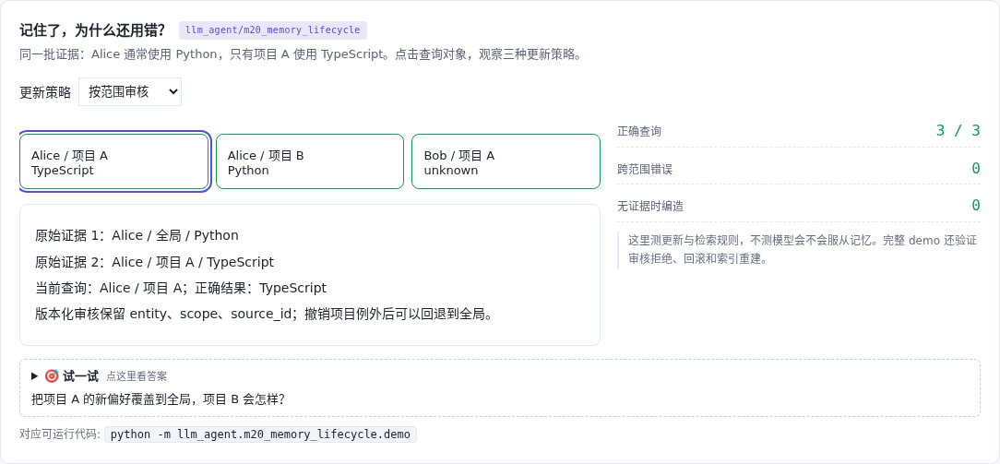

# 记忆更新 · 来源、范围与版本

[](https://beleev.github.io/llm-engineering-lab/#/agent/memory-lifecycle)

[项目首页](../../README.md) · [Agent 目录](../README.md) · [交互实验](https://beleev.github.io/llm-engineering-lab/#/agent/memory-lifecycle)

## 直觉

用户仅声明在项目 A 中改用 TypeScript, 为什么查询项目 B 的语言偏好时返回值也跟着变成了 TypeScript?

- 长期记忆条目 (如「Alice 偏好 Python」) 不能仅存储结论值, 还必须同步记录归属主体 (entity)、生效范围 (scope) 与原始依据 (evidence)。在 demo 中, Alice 全局默认使用 Python, 仅在项目 A 中改用 TypeScript; 简单追加与全局覆盖两种存储方式在 3 个测试查询中各仅答对 2 个, 而按「对象 + 范围」建索引的版本化存储全部答对 3 个。
- 新事实更新严格遵循局部生效与可追溯原则:
  - 发布前逐项核对候选更新与原始证据的对象、范围、原值是否一致, 并校验其基准版本号是否为最新生效版本。
  - 回滚操作仅向事件日志追加一条撤销记录并重建索引, 原始证据库不做任何删改。

## 核心原理

### 先看证据有没有支持这次修改

记忆候选更新能否正式发布生效, 取决于其引用的原始证据能否完整支撑该项变更。
demo 将每条原始事实建模为不可变的 Evidence 记录, 包含唯一 id、主体 entity (如 alice)、作用域 scope (具体项目名或代表全局的 "*")、偏好值 value 与时间戳 time。发起更新时需先调用 propose(source_id) 构造候选对象 Proposal, 复制目标证据的主体、范围与值, 并记录生成候选时该 (entity, scope) 键已生效的版本号 based_on (尚未生效过记为 0)。
publish 接收候选更新时依次执行三道确定性校验:
- 来源一致性: 候选的 source_id 必须指向已登记的真实证据, 且候选携带的主体、作用域与值必须与原证据逐项完全一致; 扩大作用域或篡改数值均按「候选缺少对应证据」拒绝。
- 乐观并发版本: 候选的 based_on 必须严格等于当前已生效版本号, 防止基于旧状态生成的过期候选覆盖期间已发布的新版本。
- 时序单调性: 新证据的时间戳 time 必须晚于当前生效证据的时间戳, 过时证据或同时间戳的冲突证据不予直接覆盖。
demo 基于同一条合法候选 (Alice 在项目 A 改用 Rust) 构造了 3 个篡改样本, 均被 publish 准确拦截:
- 将 source_id 伪造为未登记的 "invented"。
- 将局部作用域 scope 擅自扩大为全局 "*"。
- 将偏好值 value 篡改为 "Go"。
合法原候选首次发布顺利通过; 随后原样重复提交一次时, 因当前生效版本已递增导致 based_on 过期, 同样被拒绝。
后台异步归并整理长期记忆时, 同样必须经过这套来源证据与基线版本核验; 单条记忆的被检索频次高, 并不证明其内容真实有效。

### 查询先找项目, 再回退全局

以 (entity, scope) 复合键存储并在读取时按「先具体项目、后全局默认」的顺序回退查找, 可彻底隔离局部例外对其他项目的干扰。
demo 依次登记两条证据: Alice 在全局范围 (scope 为 "*") 使用 Python, Alice 在项目 A 中使用 TypeScript。随后针对三个查询检验返回结果, 标准答案分别为:
- Alice 在项目 A 使用的语言: TypeScript。
- Alice 在项目 B 使用的语言: Python。
- Bob 在项目 A 使用的语言: unknown (未登记任何关于 Bob 的证据)。
三种存储策略的表现对比如下:
- 简单追加 (append-first): 仅按主体追加记录且检索时返回首条命中; 早期写入的 Python 始终排在首位, 导致查询项目 A 时仍误答 Python, 3 题仅答对 2 题。
- 全局覆盖 (overwrite): 新事实到达时直接覆盖主体记录且检索取末条; 项目 A 更新为 TypeScript 后导致查询项目 B 也误答 TypeScript, 3 题同样仅答对 2 题。
- 按范围版本化 (versioned): recall(entity, scope) 先查找精确键 (alice, A), 未命中时再回退查找全局键 (alice, "*"), 3 题全部答对:
  - 查询项目 A 时直接命中局部例外并返回 TypeScript。
  - 查询项目 B 时无局部例外, 自动回退至全局键返回 Python。
  - 查询 Bob 时两级键均不存在, 准确返回 unknown。
由于生效索引 index 以 (entity, scope) 为独立键保存当前生效版本号, 项目级例外与全局默认分属不同键位, 彼此互不覆盖。

### 回滚不删证据

回滚错误记忆并非物理删除历史记录, 而是向事件流追加一条版本回退事件并重放重建生效索引, 原始证据与历史版本全程完整保留。
VersionedMemory 内部维护四类数据结构:
- evidence: 存储全量原始证据, register 登记时禁止覆写已有 id。
- versions: 按发布先后顺序保存所有通过校验的候选版本。
- events: 以只追加日志形式记录每次发布或回滚事件, 标明目标 (entity, scope) 切换至哪个版本号。
- index: 由 events 重放派生的当前生效版本映射表; 调用 rebuild() 从头重放事件流即可完整重建, 其中目标版本号为 0 的事件代表注销该作用域的当前配置。
demo 依次验证四步演进:
1. Alice 在项目 A 首先发布生效 TypeScript (第 2 版)。
2. 随后在同一作用域继续发布 Rust (第 3 版)。
3. 执行 rollback("alice", "A", 2) 后, 查询项目 A 恢复为 TypeScript。
4. 执行 rollback("alice", "A", 0) 彻底撤销项目 A 的局部例外后, 查询项目 A 自动回退至全局默认的 Python。
全程 Python、TypeScript、Rust 三条原始证据未做任何删减。最后将 evidence、versions 与 events 导出为 JSON 快照文件, 重新调用 load 加载并执行 rebuild 重建索引, 所得 index 与原内存状态完全一致, 证据总数仍为 3 条, 查询 Bob 依然返回 None。

### 审核的边界

publish 机制仅保证「候选更新忠实于已登记证据」, 无法鉴别原始证据本身的真伪。只要上游将一条失真偏好登记为合法的 Evidence 记录, 忠实抄录该记录的候选更新依然能够通过校验并发布, 因此证据源头的可信度审核必须由上游环节负责。
持久化快照同样属于面向单进程演示的教学简化实现: save 直接覆写单个 JSON 文件, 未实现文件锁、预写日志或原子提交; 面对多进程并发写入或中途断电崩溃时缺乏事务级崩溃恢复保障。
此外, demo 中的结构化事实均由测试夹具直接构造登记, 未涵盖从自然语言对话中抽取事实、判别真伪、划分隐私等级或推断自然过期时间等上游步骤。

### 读代码的顺序

- `demo.py:Evidence`
- `demo.py:Proposal`
- `demo.py:VersionedMemory`
- `demo.py:comparison`

## 运行

```bash
python -m llm_agent.m20_memory_lifecycle.demo
```

默认只用 Python 标准库, 不访问网络。所有断言都随 demo 运行, 也被 `pytest` 自动发现。

## 运行后应该看到什么

追加取首条 / 全局覆盖 / 按范围版本化: 正确查询 2/3、2/3、3/3。无来源、丢范围、改原值的三个候选均被拒绝; 回滚后全局 Python 仍可用。

这些数字来自本仓库默认配置的运行。费用、时间和工作量若在正文标成模拟, 就是模型值, 不是外部 API 实测。

## 与真实系统的差距

输入事实已由测试夹具登记, 不自动识别自然语言真假、隐私级别或过期时间。索引是内存字典, 快照不做文件锁和原子发布。

## 常见误区

- **同一用户只在项目 A 改用 TypeScript, 项目 B 应怎样处理?** 例外只适用于项目 A; 项目 B 仍受全局偏好约束。
- **候选带了 source_id, 就能直接发布吗?** ID 只能找到证据, 还要核对候选有没有改丢限定、是否基于旧版本。

## 自测题

1. 同一用户只在项目 A 改用 TypeScript, 项目 B 应怎样处理?

<details><summary>答案</summary>

仍按全局偏好使用 Python。例外只适用于项目 A; 项目 B 仍受全局偏好约束。

</details>

2. 候选带了 source_id, 就能直接发布吗?

<details><summary>答案</summary>

不行, 要核对来源、范围和基线版本。ID 只能找到证据, 还要核对候选有没有改丢限定、是否基于旧版本。

</details>

3. 为什么回滚后仍保留原始证据?

<details><summary>答案</summary>

方便追溯修改, 并重建生效视图。证据、版本与索引各司其职; 回滚改变生效状态, 不抹去曾经发生的输入。

</details>
