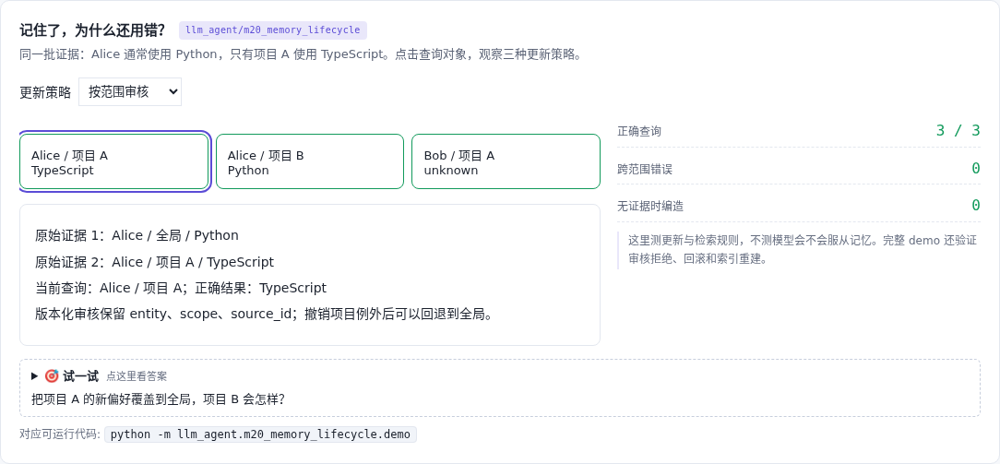

# 记忆更新 · 来源、范围与版本

[](https://beleev.github.io/llm-engineering-lab/#/agent/memory-lifecycle)

[项目首页](../../README.md) · [Agent 目录](../README.md) · [交互实验](https://beleev.github.io/llm-engineering-lab/#/agent/memory-lifecycle)

## 直觉

项目 A 改用 TypeScript, 为什么项目 B 也跟着变了?

记忆要保留对象、范围和证据; 新事实只替换它能证明的那一部分。

## 核心原理

### 先看证据有没有支持这次修改

候选必须与 source_id 对应的对象、范围和原值一致。提案还要指出基于哪个版本; 后来已有更新时, 旧提案不能直接覆盖。

### 查询先找项目, 再回退全局

Alice 的项目 A 用 TypeScript, 项目 B 用 Python; Bob 没有证据, 返回 unknown。三个查询中, 简单追加与全局覆盖各对 2 个, 按范围保存对 3 个。

### 回滚不删证据

发布与回滚都留下事件。撤销项目 A 的例外后, 查询回退到全局 Python。重新加载快照、重建索引后结果一致。

### 审核的边界

检查候选忠于证据, 不等于证明证据真实。快照是单进程教学文件, 没有数据库的事务、并发与崩溃恢复保证。

### 读代码的顺序

- `demo.py:Evidence`
- `demo.py:Proposal`
- `demo.py:VersionedMemory`
- `demo.py:comparison`

## 运行

```bash
python -m llm_agent.m20_memory_lifecycle.demo
```

默认只用 Python 标准库, 不访问网络。所有断言都随 demo 运行, 也被 `pytest` 自动发现。

## 运行后应该看到什么

追加取首条 / 全局覆盖 / 按范围版本化: 正确查询 2/3、2/3、3/3。无来源、丢范围、改原值的三个候选均被拒绝; 回滚后全局 Python 仍可用。

这些数字来自本仓库默认配置的运行。费用、时间和工作量若在正文标成模拟, 就是模型值, 不是外部 API 实测。

## 与真实系统的差距

输入事实已由测试夹具登记, 不自动识别自然语言真假、隐私级别或过期时间。索引是内存字典, 快照不做文件锁和原子发布。

## 常见误区

- **同一用户只在项目 A 改用 TypeScript, 项目 B 应怎样处理?** 例外只适用于项目 A; 项目 B 仍受全局偏好约束。
- **候选带了 source_id, 就能直接发布吗?** ID 只能找到证据, 还要核对候选有没有改丢限定、是否基于旧版本。

## 自测题

1. 同一用户只在项目 A 改用 TypeScript, 项目 B 应怎样处理?

<details><summary>答案</summary>

仍按全局偏好使用 Python。例外只适用于项目 A; 项目 B 仍受全局偏好约束。

</details>

2. 候选带了 source_id, 就能直接发布吗?

<details><summary>答案</summary>

不行, 要核对来源、范围和基线版本。ID 只能找到证据, 还要核对候选有没有改丢限定、是否基于旧版本。

</details>

3. 为什么回滚后仍保留原始证据?

<details><summary>答案</summary>

方便追溯修改, 并重建生效视图。证据、版本与索引各司其职; 回滚改变生效状态, 不抹去曾经发生的输入。

</details>
