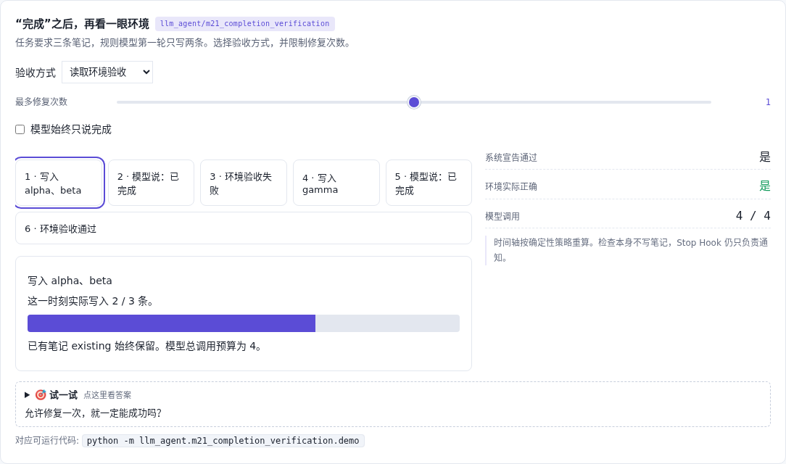

# 完成验收 · 说完不等于做完

[](https://beleev.github.io/llm-engineering-lab/#/agent/completion-verification)

[项目首页](../../README.md) · [Agent 目录](../README.md) · [交互实验](https://beleev.github.io/llm-engineering-lab/#/agent/completion-verification)

## 直觉

模型说已完成, 为什么还要看环境?

把 final 当候选结果; 只读验收通过才结束, 失败后在预算内修复。

## 核心原理

### 声明和事实分开

三个基线收到同样的完成声明。直接结束和文本检查都接受, 但环境里只有 alpha、beta。环境验收发现 gamma 缺失。

### 把缺口交回执行者

驱动器生成只包含缺失项的修复请求, 原 Agent 继续经过工具和权限门。默认允许一次修复, 模型调用从 2 次增加到 4 次。

### 验证器不替模型写答案

verify_notes 只读环境, 还检查多写的对象和已有内容是否被修改。它不能自己补 gamma 再宣称验收通过。

### 预算耗尽就报告未完成

模型持续空口声明、工具持续失败或预算太少, 都不能靠无限重试拖延。Stop Hook 保持通知接口, 外部驱动器负责验收。

### 读代码的顺序

- `demo.py:verify_notes`
- `demo.py:run_verified`
- `demo.py:experiment`

## 运行

```bash
python -m llm_agent.m21_completion_verification.demo
```

默认只用 Python 标准库, 不访问网络。所有断言都随 demo 运行, 也被 `pytest` 自动发现。

## 运行后应该看到什么

直接结束 / 文本验收: 系统宣告通过, 环境错误, 2 次模型调用。环境验收: 修复后环境正确, 4 次模型调用。持续失败和预算耗尽的对照均保持未完成。

这些数字来自本仓库默认配置的运行。费用、时间和工作量若在正文标成模拟, 就是模型值, 不是外部 API 实测。

## 与真实系统的差距

任务的可验证条件已知, 使用内存笔记和确定性模型; 不解决开放式文章的质量评价。总调用预算在本例禁用压缩的环境中验证, 不是可任意套用的生产调度器。

## 常见误区

- **要求写三条笔记, 回答有“已完成”能证明什么?** 完成声明是待验证输出; 状态必须从环境读取。
- **验收发现缺一条笔记, 谁应该补写?** 验证只读; 修复仍经过原 Agent 的权限、工具与记录链路。

## 自测题

1. 要求写三条笔记, 回答有“已完成”能证明什么?

<details><summary>答案</summary>

只能证明模型作出了完成声明。完成声明是待验证输出; 状态必须从环境读取。

</details>

2. 验收发现缺一条笔记, 谁应该补写?

<details><summary>答案</summary>

执行者收到缺失项后调用工具。验证只读; 修复仍经过原 Agent 的权限、工具与记录链路。

</details>

3. 一次修复后仍失败, 下一步是什么?

<details><summary>答案</summary>

在预算边界返回未完成状态。验收不能成为无限重试; 预算用完应保留失败事实。

</details>

## 延伸阅读

机制设计借鉴 [ai-agent-book 的相关章节](https://github.com/bojieli/ai-agent-book/blob/dbc046eb896ac4e39aa19c7774c8bf49583b89a6/book/chapter9.md#L19)。本例为本仓库独立编写的离线教学实验; 不复用书中未经复跑的提升数字。
