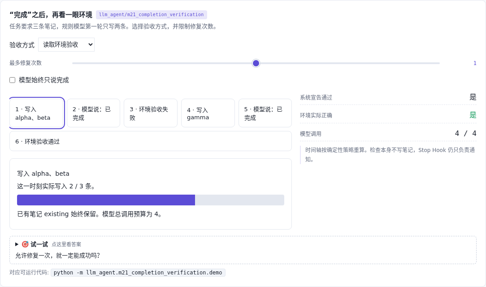

# 完成验收 · 说完不等于做完

[](https://beleev.github.io/llm-engineering-lab/#/agent/completion-verification)

[项目首页](../../README.md) · [Agent 目录](../README.md) · [交互实验](https://beleev.github.io/llm-engineering-lab/#/agent/completion-verification)

## 直觉

模型说已完成, 为什么还要看环境?

模型回答里的 "已完成" 只是一句话。demo 让一个规则模型故意只写 alpha、beta 两条笔记就宣告完成: 直接相信它、或只检查回答里有没有 "完成" 二字, 都会放过; 去笔记本身里查 (只读验收) 才发现缺 gamma。把缺的交回原 agent 补写, 模型调用从 2 次变成 4 次; 修复有次数和调用上限, 用完就报未完成。

## 核心原理

### 声明和事实分开

demo 的任务是写三条笔记: alpha、beta、gamma。模型是 EarlyFinalLLM, 一个写死的规则模型: 第一轮只调工具写 alpha 和 beta, 下一轮就回答 "已完成"。gamma 从来没写。

三种处理方式收到的是同一句完成声明:

- direct (直接结束): loop 拿到 final 就返回, 宣告通过。
- text (文本检查): 看回答里有没有 "完成" 二字, 有就通过。

这两种都宣告通过, 但环境 (notes 这个字典) 里只有 alpha、beta, 各用了 2 次模型调用。

- verified (环境验收): 不看回答, 去 notes 里逐条查, 发现 gamma 缺失。

声明是模型以为的状态, 事实是环境里真有什么, 两者要分开。

### 把缺口交回执行者

验收发现缺 gamma 之后, 驱动器 run_verified 不自己补, 而是生成一条只包含缺失项的修复请求 repair:["gamma"], 再交给原来的 agent 跑一轮。模型读到它, 只写 gamma; 这次写入照样经过工具和权限门, 和第一次写 alpha、beta 走的是同一条路。

修复后再验收一次, 三条都在, 通过。默认允许一次修复 (max_repairs=1), 模型调用从 2 次增加到 4 次: 第一轮 2 次 (调工具、说完成), 修复轮再 2 次。

### 验证器不替模型写答案

verify_notes 是纯读取的: 它拿当前的 notes、要求的三个标题、任务开始前的 notes 快照, 算出三样东西: missing (要求的里面哪些没写成 saved)、unexpected (多写了哪些不该有的)、changed (原来就有的内容被改了哪些)。三者都空才算 passed。

它不能自己补 gamma 再宣称通过, demo 最后一段专门断言验收前后 notes 没变。多写和改坏也不放过: notes 里多了一个 extra、原有的 existing 从 keep 被改成 changed, verify_notes 都报出来; 这种越界修改直接判失败, 不进修复循环, 不让模型靠补写掩盖。

### 预算耗尽就报告未完成

修复不能无限试。run_verified 有两个上限: max_repairs=1 (最多修一次) 和 max_calls=4 (总共最多 4 次模型调用)。demo 跑了四组失败对照, 全都在上限内停下、报未完成, 调用次数不超过 4:

- max_repairs=0: 不允许修复, 第一次验收失败就结束。
- stubborn: 模型嘴硬, 每轮只说 "已完成", 什么也不写。
- broken: 写笔记的工具一直返回失败。
- max_calls=1: 预算只够一次调用。

Stop Hook (模型想停下时触发的钩子) 只做通知, 验收由外部驱动器负责, 两者分开。

### 读代码的顺序

- `demo.py:verify_notes`
- `demo.py:run_verified`
- `demo.py:experiment`

## 运行

```bash
python -m llm_agent.m21_completion_verification.demo
```

默认只用 Python 标准库, 不访问网络。所有断言都随 demo 运行, 也被 `pytest` 自动发现。

## 运行后应该看到什么

直接结束 / 文本验收: 系统宣告通过, 环境错误, 2 次模型调用。环境验收: 修复后环境正确, 4 次模型调用。持续失败和预算耗尽的对照均保持未完成。

这些数字来自本仓库默认配置的运行。费用、时间和工作量若在正文标成模拟, 就是模型值, 不是外部 API 实测。

## 与真实系统的差距

任务的可验证条件已知, 使用内存笔记和确定性模型; 不解决开放式文章的质量评价。总调用预算在本例禁用压缩的环境中验证, 不是可任意套用的生产调度器。

## 常见误区

- **要求写三条笔记, 回答有“已完成”能证明什么?** 完成声明是待验证输出; 状态必须从环境读取。
- **验收发现缺一条笔记, 谁应该补写?** 验证只读; 修复仍经过原 Agent 的权限、工具与记录链路。

## 自测题

1. 要求写三条笔记, 回答有“已完成”能证明什么?

<details><summary>答案</summary>

只能证明模型作出了完成声明。完成声明是待验证输出; 状态必须从环境读取。

</details>

2. 验收发现缺一条笔记, 谁应该补写?

<details><summary>答案</summary>

执行者收到缺失项后调用工具。验证只读; 修复仍经过原 Agent 的权限、工具与记录链路。

</details>

3. 一次修复后仍失败, 下一步是什么?

<details><summary>答案</summary>

在预算边界返回未完成状态。验收不能成为无限重试; 预算用完应保留失败事实。

</details>
