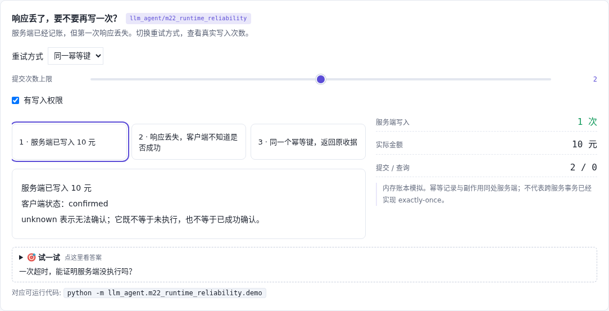

# 故障恢复 · 重试、幂等与取消

[](https://beleev.github.io/llm-engineering-lab/#/agent/runtime-reliability)

[](https://beleev.github.io/llm-engineering-lab/#/agent/runtime-reliability)

[项目首页](../../README.md) · [Agent 目录](../README.md) · [交互实验](https://beleev.github.io/llm-engineering-lab/#/agent/runtime-reliability)

## 直觉

超时了再试一次, 会不会执行两次?

- 超时只说明没收到回复, 不说明服务端没执行。demo 的账本第一笔已经写进去了才丢响应:
- 盲重试写了 2 行共 20 元。
- 带幂等键 (请求上附一个唯一编号, 服务端认出同一编号就不重复写) 或先查收据再决定, 都只写 1 行 10 元。
- 一次任务同时派 3 路去做, 最快的那路结果不合格; 等第一个合格结果出来就取消其余, 总工作量从 10 降到 7。
- 取消不是撤销:
- 从发出取消到执行器确认之间, 它还可能再写一笔。
- 确认之后旧任务迟到的结果要丢掉, 不能混进新任务。

## 核心原理

### 响应丢失不是没执行

一次写操作分三步:

1. 客户端发请求。

2. 服务端执行。

3. 服务端把响应发回来。

超时只说明第三步没等到, 第二步可能早就做完了。

demo 的 Ledger 是一个内存账本, 它故意模拟这种情况: 第一次 submit 先把这一行 (10 元) 写进 rows, 然后才抛 TimeoutError ("committed, response lost")。retry_write 收到超时后按三种策略处理, 每种最多发 2 次请求:

- blind (盲重试): 不带任何标识再发一次。第二次又写了一行, 结果 writes=2、amount=20。
- idempotent (幂等键): 两次请求都带同一个键 task-1/payment-1。账本按键记收据 (receipts), 第二次看到这个键已经有收据, 直接返回原来那行, 不再写。结果 writes=1、amount=10, requests=2。
- query (先查收据): 超时后不重发, 先查 receipts 里有没有这个键; 有就算确认。结果 writes=1、amount=10, requests=1, queries=1。

还有一个 assert: blind 只试 1 次就停, status 是 unknown, 不是 failed。没收到响应时只能记 "不知道", 不能当成没执行。

### 幂等键绑定同一个操作

幂等键只能代表一个固定的操作, 键和参数要一起核对, 不能只认键。

账本的 receipts 以键为索引, 记下 (操作名, 金额)。再来一个同键请求时, 先比参数:

- 一样就返回旧行。
- 不一样就抛 ValueError ("同一幂等键不能换参数")。

demo 用 Ledger(False) 验证: 同一个键先交 10 元再交 20 元, 第二次被拒, rows 还是 1 行。如果不比参数, 第二次会拿到第一次的收据, 误以为 20 元已经入账。

权限拒绝是另一类错误: submit 的 allowed=False 时抛 PermissionError, retry_write 把 status 记成 denied 并立刻停止, requests=1、writes=0。被拒绝的操作重试多少次都不会变成放行, 再试只是浪费。

### 最快不等于合格

同一个任务同时派给 3 路去做时, 先回来的那路不一定对, 所以要等的是 "第一个验收合格的", 不是 "第一个回来的"。

schedule 用逻辑时钟模拟, 没有真线程: 三个任务 fast-wrong、correct、slow 分别在时刻 1、3、6 做完, 其中 fast-wrong 的 valid=False (结果不合格)。每个时刻, 每个还在跑的任务消耗 1 个工作单位 (work)。

- all 模式 (等全部): 时刻 1 三个都在跑 (work 3), 之后 correct 和 slow 跑到时刻 3 (work 7), slow 再跑到时刻 6 (work 10)。accepted 是 [correct, slow]; fast-wrong 虽然完成, 但 valid=False, receive 不收它。最后工作时刻 6。
- first-valid 模式 (首个合格后取消): 时刻 1 fast-wrong 完成但不合格, 不触发取消; 时刻 3 correct 完成且合格, 这时才对其余任务 cancel 并 acknowledge, slow 变成 canceled。work 7, 最后工作时刻 3。

还有两个 assert:

- budget=2 时 work 只到 2, 什么都没验收通过。
- budget=0 时所有任务都被取消, 没有一个还在 running。

预算用完是取消的另一个触发条件。

### 取消不等于回滚

取消只是一个请求, 它不会撤销已经发生的事, 也不会瞬间停住正在跑的执行器。

Runtime 里一个任务有四种状态: running、cancel_requested (收到取消请求, 执行器还没确认)、canceled (执行器确认了)、completed。effect 方法模拟一次副作用: 它在 running 和 cancel_requested 两种状态下都会执行, 只有到了 canceled 才不执行。

demo 按顺序做了四件事, 日志是 [write:cancel_requested, write:effect, write:cancel_ack, write:ignored_result]:

- cancel: 状态变 cancel_requested。
- effect: 这时执行器还没确认, 副作用照样发生, effects 变成 1。
- acknowledge: 状态变 canceled。再调 effect 不再计数, effects 停在 1。
- 然后把 runtime.generation (任务代号, 新一轮任务就加 1) 从 1 拨到 2, 再用旧代号 1 调 receive: 结果被忽略, accepted 为空。旧任务迟到的结果不能污染新任务。

这里没模拟的: 分布式事务、重试退避、网络分区; 也不能据此说任意线程都能被安全杀掉。

### 读代码的顺序

- `demo.py:Ledger`
- `demo.py:retry_write`
- `demo.py:Runtime`
- `demo.py:schedule`

## 运行

```bash
python -m llm_agent.m22_runtime_reliability.demo
```

默认只用 Python 标准库, 不访问网络。所有断言都随 demo 运行, 也被 `pytest` 自动发现。

## 运行后应该看到什么

盲重试 / 幂等重试 / 查收据: 写入次数 2、1、1。等待全部 / 首个合格后取消: 工作量 10、7; 最后工作时刻 6、3。取消请求后、确认前的一次副作用仍保留。

这些数字来自本仓库默认配置的运行。费用、时间和工作量若在正文标成模拟, 就是模型值, 不是外部 API 实测。

## 与真实系统的差距

逻辑事件和内存账本, 不启动真实并发工具; 不模拟分布式事务、重试退避和网络分区。不能据此声称任意线程可被安全取消, 或跨服务已经 exactly-once。

## 常见误区

- **提交超时以后, 哪种推断成立?** 请求、执行和响应是不同环节; 响应丢失时执行可能已经完成。
- **幂等键相同但金额不同, 应怎么处理?** 同一幂等键必须标识同一操作; 否则不能安全复用结果。

## 自测题

1. 提交超时以后, 哪种推断成立?

<details><summary>答案</summary>

客户端还不能确定是否已执行。请求、执行和响应是不同环节; 响应丢失时执行可能已经完成。

</details>

2. 幂等键相同但金额不同, 应怎么处理?

<details><summary>答案</summary>

拒绝参数冲突并保留原操作。同一幂等键必须标识同一操作; 否则不能安全复用结果。

</details>

3. 收到取消请求之后, 哪项还不能保证?

<details><summary>答案</summary>

可以认定所有在途动作已停。取消请求不是确认; 在途动作可能在安全点之前产生副作用。

</details>
