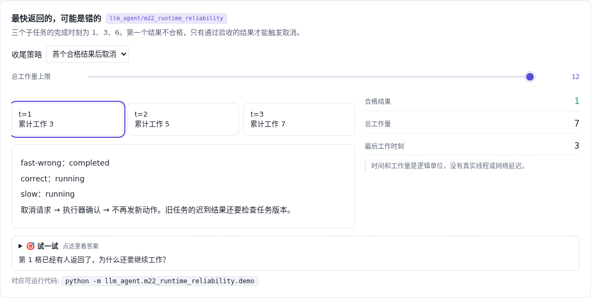

# 故障恢复 · 重试、幂等与取消

[](https://beleev.github.io/llm-engineering-lab/#/agent/runtime-reliability)

[](https://beleev.github.io/llm-engineering-lab/#/agent/runtime-reliability)

[项目首页](../../README.md) · [Agent 目录](../README.md) · [交互实验](https://beleev.github.io/llm-engineering-lab/#/agent/runtime-reliability)

## 直觉

请求超时后直接重试, 是否会导致副作用执行两次?

- 超时仅表明客户端未收到响应, 不能说明服务端未执行。demo 中的账本在第一笔写入完成后丢失响应:
  - 盲目重试会写入 2 行、合计 20 元。
  - 携带幂等键 (请求附带唯一标识, 服务端识别相同标识后不再重复写入) 或先查询收据再决定是否重发, 均只写入 1 行 10 元。
- 单次任务并发派发 3 路执行时, 最快返回的一路结果不合格; 等待首个验收合格的结果返回后立即取消其余分支, 总工作量从 10 降至 7。
- 取消不等于撤销:
  - 从发出取消请求到执行器确认之间, 执行器仍可能再产生一次写入。
  - 确认取消且任务换代后, 旧任务迟到的结果必须丢弃, 不能混入新任务。

## 核心原理

### 响应丢失不是没执行

超时仅表明客户端未收到响应, 不能证明服务端未执行副作用。一次写操作包含三个阶段:
1. 客户端发送请求。
2. 服务端执行写入。
3. 服务端返回响应。
超时只说明第三步未在时限内完成, 第二步可能早已落盘。
demo 中的内存账本 Ledger 专门复现这一故障窗口: 首次调用 submit 时先将 10 元记录写入 rows, 随后抛出 TimeoutError (「committed, response lost」)。retry_write 捕获超时后按三种策略处理, 每种最多发送 2 次请求:
- blind (盲目重试): 不附带任何唯一标识直接重发, 第二次请求再次写入一行, 最终 writes 为 2、amount 为 20。
- idempotent (幂等键): 两次请求携带同一幂等键 task-1/payment-1。账本按幂等键记录收据 receipts, 第二次识别到该键已有收据后直接返回原记录而不再写入, 最终 writes 为 1、amount 为 10、requests 为 2。
- query (先查收据): 超时后不立即重发写请求, 而是先查询 receipts 中是否存在该幂等键; 查到记录即确认为成功, 最终 writes 为 1、amount 为 10、requests 为 1、queries 为 1。
demo 还通过 assert 验证了另一种边界: blind 策略若仅尝试 1 次便停止, 返回的 status 为 unknown 而非 failed, 因为未收到响应时只能标记状态未知, 不能断定服务端未执行。

### 幂等键绑定同一个操作

幂等键必须绑定固定的操作与参数, 服务端校验时须同时核对键名与请求参数。账本的 receipts 以幂等键为索引记录 (操作名, 金额), 收到同键请求时先比对参数:
- 参数一致: 直接返回初次写入的记录。
- 参数不一致: 抛出 ValueError (「同一幂等键不能换参数」)。
demo 使用 Ledger(False) 验证该约束: 同一幂等键先后提交 10 元与 20 元时, 第二次请求被拒绝, rows 仍保持 1 行。若服务端仅核对键名而忽略参数, 第二次请求会误拿第一次的收据, 导致调用方误判 20 元已入账。
权限拒绝则属于不可重试的确定性错误: 当 submit 的 allowed=False 时抛出 PermissionError, retry_write 将 status 记为 denied 并立即终止, 最终 requests 为 1、writes 为 0。权限不足不会因重试而改变, 继续重发只会浪费配额。

### 最快不等于合格

并发派发多路子任务时, 停止其余分支的条件是收到首个验收合格的结果, 而非首个返回的结果。schedule 使用逻辑时钟模拟 3 路并发任务而未启动真实线程: fast-wrong、correct、slow 分别在时刻 1、3、6 完成, 其中 fast-wrong 的 valid=False (结果不合格); 每个逻辑时刻内, 每个仍处于运行态的任务消耗 1 个工作单位 (work)。
- all 模式 (等待全部完成): 时刻 1 三个任务同时运行 (累计 work 为 3), 随后 correct 与 slow 运行至时刻 3 (累计 work 为 7), slow 继续运行至时刻 6 (累计 work 为 10)。最终 accepted 为 [correct, slow]; fast-wrong 虽已完成, 但因 valid=False 被 receive 拒收, 最后工作时刻为 6。
- first-valid 模式 (首个合格后取消): 时刻 1 fast-wrong 完成但未通过验收, 不触发取消; 时刻 3 correct 完成且验收合格, 此时对其余运行中任务执行 cancel 与 acknowledge, slow 转为 canceled, 累计 work 降至 7, 最后工作时刻提前至 3。
demo 另外通过两个 assert 验证预算边界:
- budget=2: 累计 work 达到 2 时预算耗尽并触发取消, 无任何结果通过验收。
- budget=0: 所有任务在启动前即被取消, 没有任何任务处于 running 状态。
因此, 除首个合格结果外, 预算耗尽同样是触发取消的边界条件。

### 读代码的顺序

- `demo.py:Ledger`
- `demo.py:retry_write`
- `demo.py:Runtime`
- `demo.py:schedule`

## 运行

```bash
python -m llm_agent.m22_runtime_reliability.demo
```

默认只用 Python 标准库, 不访问网络。所有断言都随 demo 运行, 也被 `pytest` 自动发现。

## 运行后应该看到什么

盲重试 / 幂等重试 / 查收据: 写入次数 2、1、1。等待全部 / 首个合格后取消: 工作量 10、7; 最后工作时刻 6、3。取消请求后、确认前的一次副作用仍保留。

这些数字来自本仓库默认配置的运行。费用、时间和工作量若在正文标成模拟, 就是模型值, 不是外部 API 实测。

## 与真实系统的差距

逻辑事件和内存账本, 不启动真实并发工具; 不模拟分布式事务、重试退避和网络分区。不能据此声称任意线程可被安全取消, 或跨服务已经 exactly-once。

## 常见误区

- **提交超时以后, 哪种推断成立?** 请求、执行和响应是不同环节; 响应丢失时执行可能已经完成。
- **幂等键相同但金额不同, 应怎么处理?** 同一幂等键必须标识同一操作; 否则不能安全复用结果。

## 自测题

1. 提交超时以后, 哪种推断成立?

<details><summary>答案</summary>

客户端还不能确定是否已执行。请求、执行和响应是不同环节; 响应丢失时执行可能已经完成。

</details>

2. 幂等键相同但金额不同, 应怎么处理?

<details><summary>答案</summary>

拒绝参数冲突并保留原操作。同一幂等键必须标识同一操作; 否则不能安全复用结果。

</details>

3. 收到取消请求之后, 哪项还不能保证?

<details><summary>答案</summary>

可以认定所有在途动作已停。取消请求不是确认; 在途动作可能在安全点之前产生副作用。

</details>
