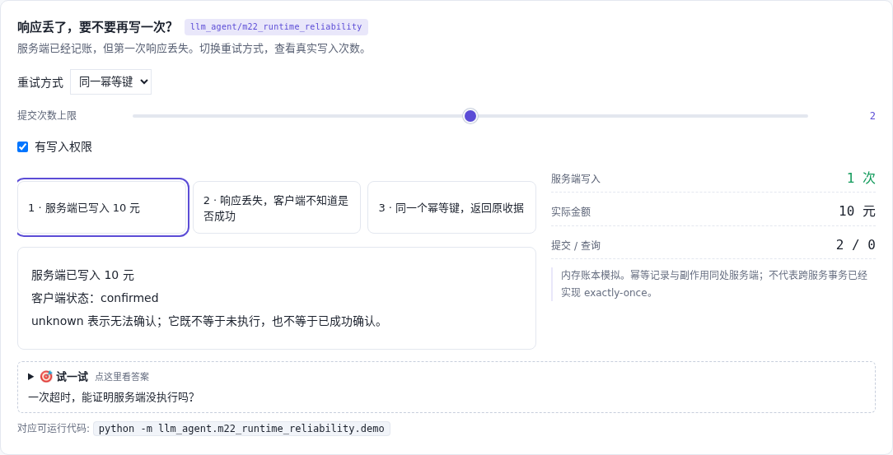
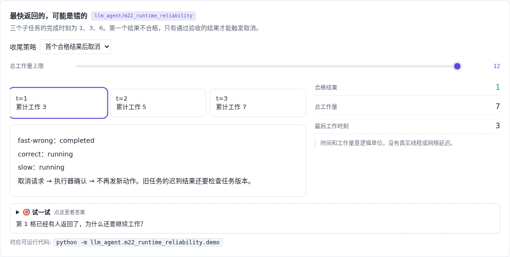

# 故障恢复 · 重试、幂等与取消

[](https://beleev.github.io/llm-engineering-lab/#/agent/runtime-reliability)

[](https://beleev.github.io/llm-engineering-lab/#/agent/runtime-reliability)

[项目首页](../../README.md) · [Agent 目录](../README.md) · [交互实验](https://beleev.github.io/llm-engineering-lab/#/agent/runtime-reliability)

## 直觉

超时了再试一次, 会不会执行两次?

超时表示不知道结果; 幂等确认副作用, 取消确认执行边界。

## 核心原理

### 响应丢失不是没执行

账本第一次提交已经成功, 然后抛超时。盲重试写入两次共 20 元; 同一幂等键或先查收据都只写一次 10 元。

### 幂等键绑定同一个操作

键和参数必须一起核对。同键换金额直接拒绝; 授权拒绝只发一次请求, 不因重试切换成放行。

### 最快不等于合格

三个任务在时刻 1、3、6 完成, 第一个不合格。等全部耗费 10 个工作单位; 首个合格后取消耗费 7 个, 最后工作时刻从 6 变成 3。

### 取消不等于回滚

取消请求和执行器确认之间仍可能出现副作用。确认后不能发新动作; 旧 generation 的迟到结果不会进入新任务。

### 读代码的顺序

- `demo.py:Ledger`
- `demo.py:retry_write`
- `demo.py:Runtime`
- `demo.py:schedule`

## 运行

```bash
python -m llm_agent.m22_runtime_reliability.demo
```

默认只用 Python 标准库, 不访问网络。所有断言都随 demo 运行, 也被 `pytest` 自动发现。

## 运行后应该看到什么

盲重试 / 幂等重试 / 查收据: 写入次数 2、1、1。等待全部 / 首个合格后取消: 工作量 10、7; 最后工作时刻 6、3。取消请求后、确认前的一次副作用仍保留。

这些数字来自本仓库默认配置的运行。费用、时间和工作量若在正文标成模拟, 就是模型值, 不是外部 API 实测。

## 与真实系统的差距

逻辑事件和内存账本, 不启动真实并发工具; 不模拟分布式事务、重试退避和网络分区。不能据此声称任意线程可被安全取消, 或跨服务已经 exactly-once。

## 常见误区

- **提交超时以后, 哪种推断成立?** 请求、执行和响应是不同环节; 响应丢失时执行可能已经完成。
- **幂等键相同但金额不同, 应怎么处理?** 同一幂等键必须标识同一操作; 否则不能安全复用结果。

## 自测题

1. 提交超时以后, 哪种推断成立?

<details><summary>答案</summary>

客户端还不能确定是否已执行。请求、执行和响应是不同环节; 响应丢失时执行可能已经完成。

</details>

2. 幂等键相同但金额不同, 应怎么处理?

<details><summary>答案</summary>

拒绝参数冲突并保留原操作。同一幂等键必须标识同一操作; 否则不能安全复用结果。

</details>

3. 收到取消请求之后, 哪项还不能保证?

<details><summary>答案</summary>

可以认定所有在途动作已停。取消请求不是确认; 在途动作可能在安全点之前产生副作用。

</details>
