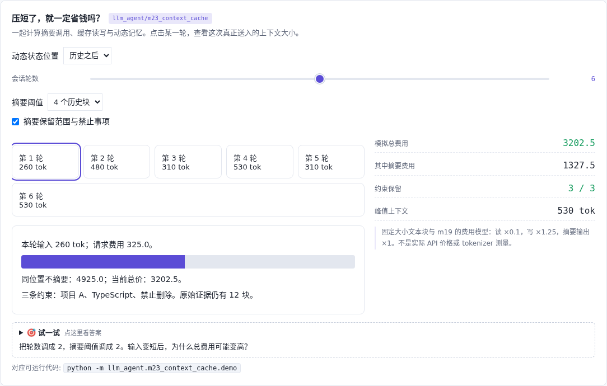

# 上下文成本 · 压缩与缓存一起算

[](https://beleev.github.io/llm-engineering-lab/#/agent/context-cost)

[项目首页](../../README.md) · [Agent 目录](../README.md) · [交互实验](https://beleev.github.io/llm-engineering-lab/#/agent/context-cost)

## 直觉

输入短了, 为什么总费用反而更高?

比较净成本, 同时检查范围、否定和来源是否保留。

## 核心原理

### 动态状态放哪会影响前缀

固定同一批工具日志, 把变化状态放在最前部会破坏其后的复用。6 轮模拟费用 6075; 放到历史后为 4925。

### 摘要也有账单

阈值为 4 个历史块时, 总模拟费用 3202.5, 其中摘要费用 1327.5; 峰值从 1360 降到 530。两轮短会话里, 摘要却让费用从 695 增至 840。

### 便宜与正确分别验收

保留限定与丢限定的摘要费用相同, 但前者保住 3 条事实, 后者只保住语言值。两者原始审计记录都还有 12 个块。

### 使用的是费用模型

复用 m19 的缓存与计价函数; 固定长度 ASCII 块、TTL 和输入费用都为示意。没有真实 API、tokenizer 或延迟实测。

### 读代码的顺序

- `demo.py:summarize`
- `demo.py:simulate`

## 运行

```bash
python -m llm_agent.m23_context_cache.demo
```

默认只用 Python 标准库, 不访问网络。所有断言都随 demo 运行, 也被 `pytest` 自动发现。

## 运行后应该看到什么

6 轮: 前部状态 6075, 尾部状态 4925, 阈值 4 的摘要 3202.5。两轮: 不摘要 695, 摘要 840。所有费用均为模型值。

这些数字来自本仓库默认配置的运行。费用、时间和工作量若在正文标成模拟, 就是模型值, 不是外部 API 实测。

## 与真实系统的差距

摘要是确定性字段筛选, 没有测真实 LLM 的语义保留率; 文本块是固定大小的教学代理。实际价格、缓存长度门槛和请求协议需按供应商实现测量。

## 常见误区

- **上下文从 1000 变成 300 token, 能断言费用下降吗?** 要把摘要输入输出和缓存失效后的请求全部计入。
- **两份摘要费用相同, 哪个指标仍可能不同?** 尺寸相同不代表保留了相同事实; 语义约束需另行验收。

## 自测题

1. 上下文从 1000 变成 300 token, 能断言费用下降吗?

<details><summary>答案</summary>

不能, 摘要和缓存重建也花钱。要把摘要输入输出和缓存失效后的请求全部计入。

</details>

2. 两份摘要费用相同, 哪个指标仍可能不同?

<details><summary>答案</summary>

保留下来的作用域与禁止事项。尺寸相同不代表保留了相同事实; 语义约束需另行验收。

</details>

3. 本实验打印的 3202.5 应怎样解读?

<details><summary>答案</summary>

固定假设下的模拟费用单位数。这是本地费用模型计算的数, 不是 API 账单或延迟测量。

</details>
