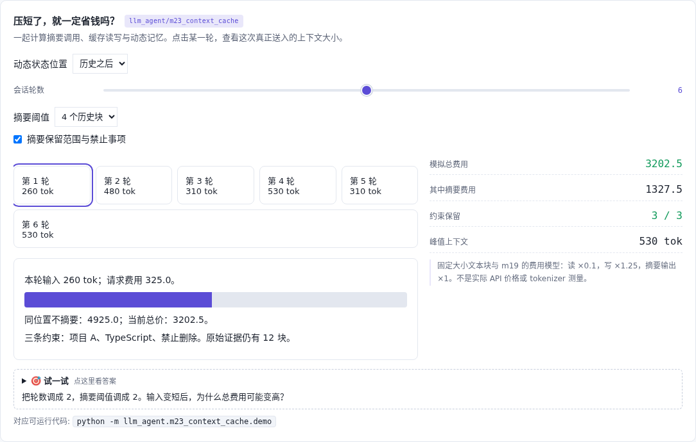

# 上下文成本 · 压缩与缓存一起算

[](https://beleev.github.io/llm-engineering-lab/#/agent/context-cost)

[项目首页](../../README.md) · [Agent 目录](../README.md) · [交互实验](https://beleev.github.io/llm-engineering-lab/#/agent/context-cost)

## 直觉

输入短了, 为什么总费用反而更高?

- 这页接着 m19 的前缀缓存算一本总账: 省下的 (缓存命中、上下文变短) 和多花的 (摘要那次调用本身、改写前缀导致的缓存失效) 要记在一起。m23 用固定长度的文本块模拟 6 轮工具对话:
- 每轮都变的状态块放在最前面, 费用 6075。
- 放到历史后面, 4925。
- 摘要也有账单:
- 历史满 4 块就压成 1 块, 6 轮峰值从 1360 降到 530, 总价 3202.5, 其中摘要调用占 1327.5。
- 换成两轮短会话, 摘要让费用从 695 涨到 840。
- 便宜和正确要分别验: 保住范围和否定的摘要, 和丢掉它们的摘要, 费用一样。

## 核心原理

### 动态状态放哪会影响前缀

前缀缓存只认 "从头开始一字不差" 的那一段 (m19)。所以每轮都会变的内容放在哪, 决定了后面有多少能命中。

m23 的 simulate 固定同一批工具日志来模拟 6 轮对话。每轮的请求由几种定长文本块拼成:

- policy: 200 token 的固定规则, 相当于 system prompt。
- history: 之前每轮的 query 和 tool_result, 每轮多 2 块共 220 token。
- state: 40 token, 记当前记忆和已做到第几轮, 每轮都变。
- query: 20 token。

两个断点的位置: 第一块末尾和最后一块 (对应 m19 的 system 末尾和最后一个 block)。

- front: 顺序是 state, policy, history, query。每轮变的 state 排第一, 第一块的字节就变了, 后面整条前缀全部失配, 6 轮读到的缓存 token 是 0, 模拟费用 6075。
- tail: 顺序是 policy, history, state, query。policy 排第一且不变, 从第 2 轮起每轮都能读到它, 费用 4925。

两种放法的峰值上下文都是 1360 token (第 6 轮): 缓存只改单价, 不改窗口有多满。

### 摘要也有账单

把历史压成摘要能让窗口变小, 但摘要那次模型调用本身也要付钱, 不能当免费。

threshold=4 表示历史满 4 块就触发一次摘要:

1. simulate 先发一次摘要请求 (policy、全部历史、一个 10 token 的 summarize 指令块, 同样走缓存计费)。

2. 再加 50 当摘要输出的费用。

3. 然后把历史替换成 1 块 50 token 的 summary 块。

6 轮里触发了 2 次, 峰值上下文从 1360 降到 530, 总模拟费用 3202.5, 其中摘要费用 1327.5。对 6 轮来说摘要是划算的: 3202.5 低于不摘要的 4925。

两轮短会话 (turns=2, threshold=2) 就反过来:

- 不摘要: 两轮分别 325 和 370, 合计 695。
- 摘要版: 第 1 轮同样 325, 第 2 轮因为历史变短只要 157.5, 但中间那次摘要调用花了 357.5, 合计 840。

会话越短, 摘要的固定开销越摊不开。

### 便宜与正确分别验收

费用一样, 不代表摘要保住了同样的事实, 两件事要分开验。

demo 的记忆里有 3 条事实:

- scope: project-A, 这些偏好只在项目 A 成立。
- language: TypeScript。
- prohibition: do-not-delete, 一条禁止事项。

summarize 是一个确定性的字段筛选器, 不是真的模型:

- keep_scope=True 时三条全保留。
- keep_scope=False 时只留 language 一条, 范围和否定都丢了。

两种摘要的块长度一样 (都是 50 token), 所以费用都是 3202.5; 但保留的事实数 retained 一个是 3, 一个是 1。只看账单看不出区别, 要单独数保留了几条限定。

两者的原始审计记录 audit 都还有 12 个块 (6 轮, 每轮 query 和 tool_result 各 1 块): 摘要替换的是发给模型的历史, 不动留底的原文。

### 使用的是费用模型

所有数字都是本地费用模型算出来的, 不是 API 账单。simulate 复用 m19 的 PromptCache (前缀缓存) 和 bill (三档计价); 文本块是固定长度的 ASCII 填充, TTL 和输入单价都是示意值。没有真实 API、真实 tokenizer, 也没有延迟实测。摘要是字段筛选, 没有测真实模型的语义保留率。

### 读代码的顺序

- `demo.py:summarize`
- `demo.py:simulate`

## 运行

```bash
python -m llm_agent.m23_context_cache.demo
```

默认只用 Python 标准库, 不访问网络。所有断言都随 demo 运行, 也被 `pytest` 自动发现。

## 运行后应该看到什么

6 轮: 前部状态 6075, 尾部状态 4925, 阈值 4 的摘要 3202.5。两轮: 不摘要 695, 摘要 840。所有费用均为模型值。

这些数字来自本仓库默认配置的运行。费用、时间和工作量若在正文标成模拟, 就是模型值, 不是外部 API 实测。

## 与真实系统的差距

摘要是确定性字段筛选, 没有测真实 LLM 的语义保留率; 文本块是固定大小的教学代理。实际价格、缓存长度门槛和请求协议需按供应商实现测量。

## 常见误区

- **上下文从 1000 变成 300 token, 能断言费用下降吗?** 要把摘要输入输出和缓存失效后的请求全部计入。
- **两份摘要费用相同, 哪个指标仍可能不同?** 尺寸相同不代表保留了相同事实; 语义约束需另行验收。

## 自测题

1. 上下文从 1000 变成 300 token, 能断言费用下降吗?

<details><summary>答案</summary>

不能, 摘要和缓存重建也花钱。要把摘要输入输出和缓存失效后的请求全部计入。

</details>

2. 两份摘要费用相同, 哪个指标仍可能不同?

<details><summary>答案</summary>

保留下来的作用域与禁止事项。尺寸相同不代表保留了相同事实; 语义约束需另行验收。

</details>

3. 本实验打印的 3202.5 应怎样解读?

<details><summary>答案</summary>

固定假设下的模拟费用单位数。这是本地费用模型计算的数, 不是 API 账单或延迟测量。

</details>
