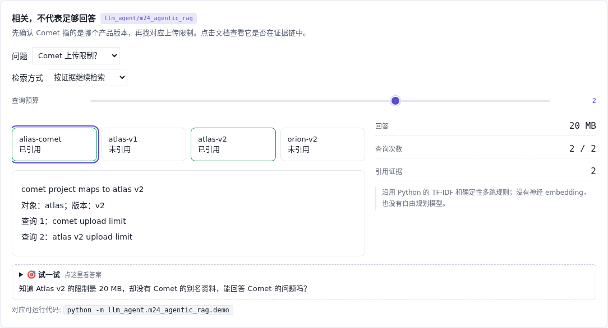

# 检索证据 · 从相关到足够回答

[](https://beleev.github.io/llm-engineering-lab/#/agent/evidence-chain)

[项目首页](../../README.md) · [Agent 目录](../README.md) · [交互实验](https://beleev.github.io/llm-engineering-lab/#/agent/evidence-chain)

## 直觉

相关文档找到了, 为什么还是不能回答?

检索找到一个"长得像"的文档块, 不等于能回答。一个数字要当答案, 得有一条能核对的证据链: 问的是哪个对象 (产品)、哪个版本、这个数字出自哪条来源; 问题里用了别名 (comet 其实是 atlas v2), 还要多一条"别名指向谁"的记录。demo 里 4 个块都写着 upload limit: 只取最相似那块的做法三道题全答不出; 把对象和版本写进块里再筛, 直接问 atlas v2 的题答出 20 MB; 别名题要查两跳、引用两条来源才答出 20 MB; 没有别名记录的 nova 老老实实答 insufficient (证据不足)。

## 核心原理

### 先给块补对象与版本

demo 的语料是 4 个文档块 (Document), 每块带元数据: entity (对象, 哪个产品)、version (版本)、body (正文), 还有可选的 alias (别名) 和 limit (数值):

- alias-comet: atlas v2, 正文 "comet project maps to atlas v2", alias=comet, 没有数字
- atlas-v1: atlas v1, "upload limit is 10 MB", limit=10
- atlas-v2: atlas v2, "upload limit is 20 MB", limit=20
- orion-v2: orion v2, "upload limit is 90 MB", limit=90

后三块的正文几乎一样, 都写着 upload limit, 只有数字不同。检索用的是 TF-IDF (按词出现的频率给文本打相似度分的算法), 它只看正文的字面相似, 分不出 v1 和 v2, 也分不出 atlas 和 orion。

- plain (无上下文基线): 检索文本只有正文, 只取最相似的 1 块 (top-1), 也不筛元数据。直接问 "atlas v2 upload limit", 最相似的是 alias-comet, 因为只有它的正文里有 atlas 和 v2 这两个词, 可它没有数字; 三道题全答 None。
- contextual (上下文版): 建索引时在每块正文前面加上 "atlas v2" 这样的对象和版本前缀, 让检索认得出它们; 命中之后再按 entity 和 version 筛, 只要 limit 不为空、对象和版本都对的块。直接问 atlas v2, 一跳 (查 1 次) 就得到 20, 引用来源 atlas-v2。

相似度只负责找候选, 对不对要看元数据。不把相似度当真实性。

### 两跳要有两段证据

第二道题问 "comet upload limit"。comet 不是产品名, 是一个别名; 语料里只有 alias-comet 这一条记录说它指向 atlas v2, 这条记录本身没有数字。

- contextual 模式只查一跳: 命中了 alias-comet, 知道了对象是 atlas v2, 但代码里第一跳只用来定对象, 不从别的产品块猜数字, 于是答 None。
- agentic 模式: 第一跳定对象 (entity=atlas, version=v2, 记下来源 alias-comet); 发现查询预算还有剩, 就发第二跳查询 "atlas v2 upload limit", 命中 atlas-v2, 得到 20, 再记一条来源。最终答案 20, sources 是 [alias-comet, atlas-v2], 一共查了 2 次。

两条来源都要引用: 只引 atlas-v2 的 20 MB, 就缺了"comet 为什么对应 atlas v2"这一段证据, 别人没法核对, 下面的验证器也不认。不能拿到数字就跳过对象确认。

### 预算不足时承认缺证据

每道题有一个查询预算 budget, 默认 2, 表示最多发几次检索。预算用完还没凑齐证据, 就答 None 并把 status 标成 insufficient (证据不足), 不拿别的对象或旧版本凑数:

- 直接问 atlas v2: 一跳就够, 用 1 次预算, 答 20。
- comet 需要两跳: 预算是 2 时答 20; 把预算改成 1, 第一跳定完对象就没预算了, 答 None。
- nova: 语料里没有任何别名记录说 nova 指向谁。第一跳查不到 alias, 对象定不下来, 即使 atlas、orion 的资料都齐全, 也只能 insufficient。

预算设成 0 时连第一跳都不发, queries 为空。把 atlas-v2 这块从语料里删掉再问 comet, 别名能定出对象, 但找不到 v2 的数字, 同样答 None, 不会退回去拿 v1 的 10 MB 顶替。

### 指标从排名走到支持度

传统检索指标看的是排名 (正确的块排在第几)。这里改成看支持度: 回答引用的来源能不能撑起这个答案。supported() 是一个独立的验证函数, 不看回答里有没有某个数字, 只核对 sources 里引用的块:

- 引用的来源 id 不能重复, 也不能是语料里没有的。
- 问题带别名时, 引用里必须有一条 alias 等于这个别名的记录, 对象和版本从这条记录里取。
- 引用里必须有一块的 entity、version 都对得上, 并且它的 limit 等于回答的数字。

demo 拿 comet 那题的正确结果改出三个坏样本去试: 把答案改成 10 (错版本); 把 sources 改成只有 [atlas-v2] (少了别名记录, 链断了); 把 sources 改成 [alias-comet, orion-v2] (错对象)。三种都判不支持, 哪怕回答里的数字碰巧是对的。

边界: 检索是 TF-IDF, 多跳计划是确定性规则, 没有神经检索, 也没有让模型自由规划; 元数据在夹具里给定, 真实系统还要验证来源和时间范围。

### 读代码的顺序

- `demo.py:retrieve`
- `demo.py:answer`
- `demo.py:supported`

## 运行

```bash
python -m llm_agent.m24_agentic_rag.demo
```

默认只用 Python 标准库, 不访问网络。所有断言都随 demo 运行, 也被 `pytest` 自动发现。

## 运行后应该看到什么

直接查询: 上下文版一跳得到 20 MB。Comet: 一跳证据不足, 两跳得到 20 MB 并引用 alias-comet、atlas-v2。Nova 保留未知。

这些数字来自本仓库默认配置的运行。费用、时间和工作量若在正文标成模拟, 就是模型值, 不是外部 API 实测。

## 与真实系统的差距

TF-IDF 与确定性查询规划, 不测神经检索或通用 Agent 自主规划。资料的元数据在夹具中给定; 真实系统还要验证来源与时间范围。

## 常见误区

- **Comet 问题只引用 atlas-v2 限制, 缺了什么?** 答案数字和对象关系都需要支持; 别名链不能省略。
- **什么时候两跳检索只是额外开销?** 能直接定位完整证据的简单题, 不必强制多跳。

## 自测题

1. Comet 问题只引用 atlas-v2 限制, 缺了什么?

<details><summary>答案</summary>

缺少 Comet 对应哪个版本的证据。答案数字和对象关系都需要支持; 别名链不能省略。

</details>

2. 什么时候两跳检索只是额外开销?

<details><summary>答案</summary>

问题已经明确对象和版本时。能直接定位完整证据的简单题, 不必强制多跳。

</details>

3. 预算用完还缺当前版本资料, 应怎么办?

<details><summary>答案</summary>

返回证据不足并保留缺失来源。预算与证据约束同时成立; 不能拿其他对象或旧版本凑答案。

</details>
