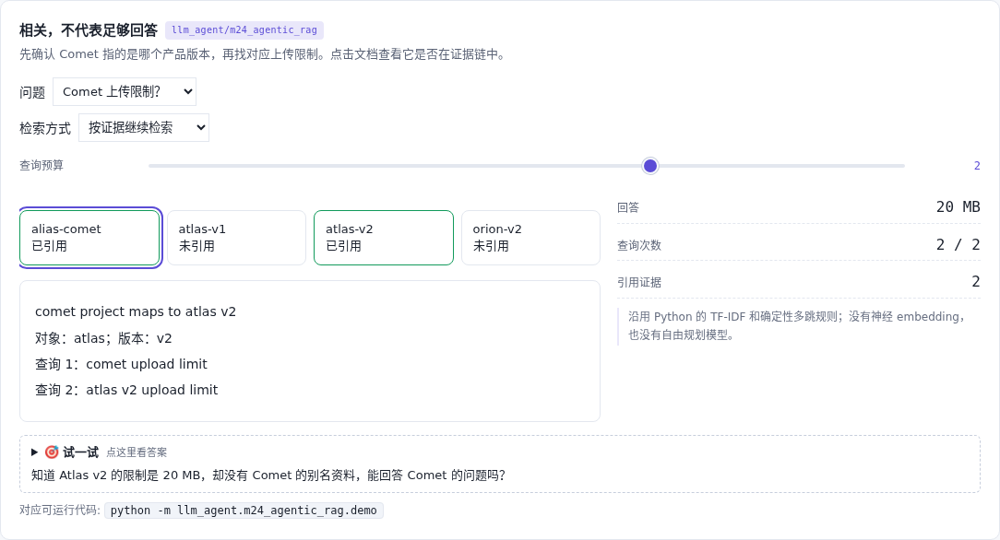

# 检索证据 · 从相关到足够回答

[](https://beleev.github.io/llm-engineering-lab/#/agent/evidence-chain)

[项目首页](../../README.md) · [Agent 目录](../README.md) · [交互实验](https://beleev.github.io/llm-engineering-lab/#/agent/evidence-chain)

## 直觉

相关文档找到了, 为什么还是不能回答?

别名、对象、版本与答案形成完整证据链, 才能输出结果。

## 核心原理

### 先给块补对象与版本

无上下文基线只取 top-1, 不能稳定区分同样写着 upload limit 的块。上下文版把实体与版本加入检索, 再筛选元数据。

### 两跳要有两段证据

Comet 的别名记录指向 Atlas v2; 对应版本的上传限制是 20 MB。两条来源都要引用, 不能只拿到数字就跳过对象确认。

### 预算不足时承认缺证据

直接问 Atlas v2 一跳就够。Comet 需要两跳, 预算为 1 时不回答。Nova 没有别名证据, 即使其他产品资料齐全也不能凑数。

### 指标从排名走到支持度

独立验证器检查引用来源是否匹配对象、版本和答案。错版本、错对象或缺少别名关系都会失败, 即使回答里有正确数字。

### 读代码的顺序

- `demo.py:retrieve`
- `demo.py:answer`
- `demo.py:supported`

## 运行

```bash
python -m llm_agent.m24_agentic_rag.demo
```

默认只用 Python 标准库, 不访问网络。所有断言都随 demo 运行, 也被 `pytest` 自动发现。

## 运行后应该看到什么

直接查询: 上下文版一跳得到 20 MB。Comet: 一跳证据不足, 两跳得到 20 MB 并引用 alias-comet、atlas-v2。Nova 保留未知。

这些数字来自本仓库默认配置的运行。费用、时间和工作量若在正文标成模拟, 就是模型值, 不是外部 API 实测。

## 与真实系统的差距

TF-IDF 与确定性查询规划, 不测神经检索或通用 Agent 自主规划。资料的元数据在夹具中给定; 真实系统还要验证来源与时间范围。

## 常见误区

- **Comet 问题只引用 atlas-v2 限制, 缺了什么?** 答案数字和对象关系都需要支持; 别名链不能省略。
- **什么时候两跳检索只是额外开销?** 能直接定位完整证据的简单题, 不必强制多跳。

## 自测题

1. Comet 问题只引用 atlas-v2 限制, 缺了什么?

<details><summary>答案</summary>

缺少 Comet 对应哪个版本的证据。答案数字和对象关系都需要支持; 别名链不能省略。

</details>

2. 什么时候两跳检索只是额外开销?

<details><summary>答案</summary>

问题已经明确对象和版本时。能直接定位完整证据的简单题, 不必强制多跳。

</details>

3. 预算用完还缺当前版本资料, 应怎么办?

<details><summary>答案</summary>

返回证据不足并保留缺失来源。预算与证据约束同时成立; 不能拿其他对象或旧版本凑答案。

</details>
