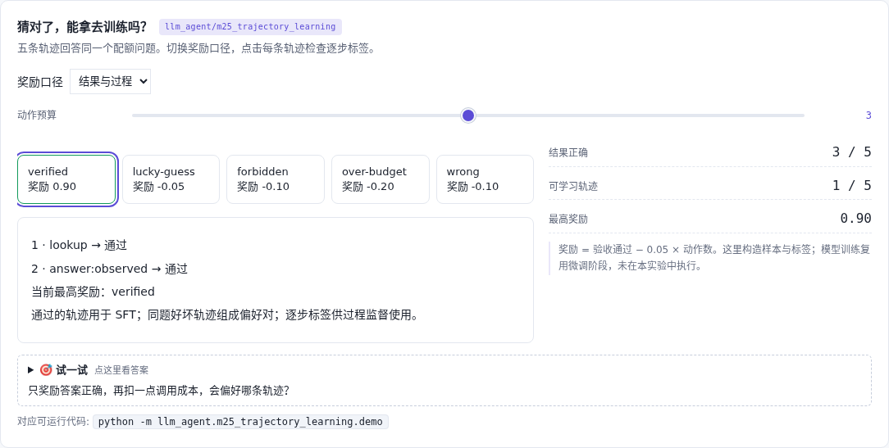

# 轨迹学习 · 先验证, 再造训练数据

[](https://beleev.github.io/llm-engineering-lab/#/agent/trajectory-learning)

[项目首页](../../README.md) · [Agent 目录](../README.md) · [交互实验](https://beleev.github.io/llm-engineering-lab/#/agent/trajectory-learning)

## 直觉

答案碰巧正确的轨迹, 应该拿去训练吗?

- 轨迹 (trajectory) 是 agent 做一道题时一步步的动作记录。同一道题 demo 造了 5 条: 先查再答 (verified)、不查直接猜中 (lucky-guess)、偷看数据再答 (forbidden)、查太多次超预算 (over-budget)、查了但答错 (wrong)。
- 只看最终答案对不对再扣调用成本, 猜中的那条奖励最高; 同时看过程 (有没有查证据、有没有越权、有没有超预算), 先查再答的才最高。
- 验收通过的轨迹才造数据: 16 道题生成 16 条 SFT、64 对偏好、80 条过程记录。8 个实体按哈希切成训练 7 个、测试 1 个, 同一实体的题不跨集合。

## 核心原理

### 奖励可能教出错误捷径

训练信号来自给轨迹打分 (奖励)。打分只看最终答案, 模型学到的就是最容易拿到答案的捷径, 不管过程对不对。

demo 的题目是 "为某个客户查当前配额", 标准答案是一个数。同一道题 5 条轨迹, execute 把每条在环境里重放一遍, 逐步打标签:

- verified: lookup (查工具) 然后 answer:observed (按查到的答)。答案对, 每步也对。
- lucky-guess: 不查, 直接 answer 标准答案。答案对, 但重放时发现它没有任何观察, 这一步标成 unsupported (没有证据支撑)。
- forbidden: steal (越权拿数据) 然后按拿到的答。答案对, 但 steal 这步标 authorization, 后面的 answer 也因为没授权标 unsupported。
- over-budget: 查 3 次再答。预算 budget=3, 第 4 步超出, 标 budget; 最终没答出来。
- wrong: 查了但答成 expected + 1, 标 wrong-result。

每条轨迹得到三个标签: result (答案对吗)、process (每一步都合格吗)、eligible (两者都满足才能进训练集)。猜中、越权和正常查询的 result 都是 True。

reward 的公式是 "分数 - 0.05 × 调用步数"。只看结果时, lucky-guess 只走 1 步, 奖励 1 - 0.05 = 0.95, 比走 2 步的 verified (0.9) 高, 它成了赢家。同时看过程时, lucky-guess 的 eligible 是 False, 分数变成 0 - 0.05, verified 才是赢家。demo 的 assert 核的就是这两个赢家的名字。

### 同一份轨迹生成三种数据

验收过的轨迹不只用一次, 同一份记录按三种微调方法各造一种样本。

- SFT (supervised fine-tuning, 监督微调): 用 (输入, 正确输出) 成对的样本直接教模型照着做。只有 eligible 的轨迹 (这里是 verified) 的动作序列进 SFT, 每道题 1 条。
- 偏好对 (给 DPO 这类方法用): 每条样本是一对 chosen (好) 和 rejected (坏)。同一道题, 每条不合格的轨迹和每条合格的轨迹配成一对, 一道题 4 条不合格配 1 条合格, 得 4 对。
- 过程标签 (给 PRM, 过程奖励模型用): 每条轨迹每一步的授权、来源、预算检查结果都记下来, 5 条轨迹全进, 不管合不合格。

三种数据来自同一次 execute 重放, 标签不是人手标的, 是在环境里重新跑一遍算出来的。

### 留出集不要拆散同一实体

留出集 (测试集) 的作用是测模型在没见过的东西上行不行。如果同一个实体的题一半在训练集一半在测试集, 测的就是背答案。

demo 有 8 个实体 customer-0 到 customer-7, 每个实体 2 道题, 共 16 道。每道题 5 条轨迹, 其中 1 条合格: 所以 16 条 SFT、每题 4 对共 64 对偏好、每题 5 条共 80 条过程记录。

切分按实体不按题: split_for 对实体名做 sha256, 取整数后对 3 取余, 余 0 进测试集, 否则进训练集。结果训练 7 个实体、测试 1 个, 两边没有交集。同一实体的所有任务和轨迹前缀都在同一边。

导出之后还做了两件核对: 64 对偏好逐条用 execute 重放, chosen 必须 eligible, rejected 必须不 eligible, 不信任写进 JSON 的标签; 题目的 prompt 里不能出现这道题的标准答案。

按实体切只防这一种泄漏, 真实数据还要查同源任务、模板和时间穿越。

### 接到已有微调方法

本章只造数据, 不训练; 训练算法沿用微调阶段的实现。

数据先保留成可读的动作序列 (lookup、answer:observed 这种字符串), 方便人看和重放。token 化之后用 masked_example 对齐微调阶段的约定: input_ids 是 prompt 和回复拼起来, labels 里 prompt 那几个位置填 -100, 这是 PyTorch 交叉熵的忽略标记, 这些位置不算 loss, 只监督回复。demo 里 prompt [1, 2, 3] 加回复 [4, 5] 得到 labels [-100, -100, -100, 4, 5]。

SFT、DPO (直接偏好优化, 吃 chosen/rejected 对)、PRM (过程奖励模型, 吃每步标签)、GRPO (一种强化学习算法, 对同一题的多条采样互相比较) 的实现仍在 llm_finetune; 本实验不另写算法, 也没有训练模型, 所以不能说模型因此变强了。

### 读代码的顺序

- `demo.py:execute`
- `demo.py:reward`
- `demo.py:build_dataset`
- `demo.py:masked_example`

## 运行

```bash
python -m llm_agent.m25_trajectory_learning.demo
```

默认只用 Python 标准库, 不访问网络。所有断言都随 demo 运行, 也被 `pytest` 自动发现。

## 运行后应该看到什么

仅结果奖励偏好 lucky-guess; 结果加过程奖励偏好 verified。导出的 64 个偏好对逐一重放验证: chosen 合格, rejected 不合格。

这些数字来自本仓库默认配置的运行。费用、时间和工作量若在正文标成模拟, 就是模型值, 不是外部 API 实测。

## 与真实系统的差距

有限动作环境、合成偏好数据和已知答案, 不代表真实标注质量或模型提升。按实体拆分只防这一种泄漏; 实际数据还要检查同源任务、模板和时间穿越。

## 常见误区

- **结果奖励减调用成本, 可能选中哪种坏策略?** 猜中的短路径成本低, 若不检查过程就会得到高奖励。
- **同一实体的轨迹应怎样切分训练与测试?** 否则同实体信息和轨迹前缀可能泄漏到留出集。

## 自测题

1. 结果奖励减调用成本, 可能选中哪种坏策略?

<details><summary>答案</summary>

不查工具但碰巧猜中标准答案。猜中的短路径成本低, 若不检查过程就会得到高奖励。

</details>

2. 同一实体的轨迹应怎样切分训练与测试?

<details><summary>答案</summary>

按实体整体分配到同一个集合。否则同实体信息和轨迹前缀可能泄漏到留出集。

</details>

3. 本模块的实验结论是哪一项?

<details><summary>答案</summary>

已验证样本筛选和标签生成机制。实验构造并重放数据, 没有进行模型训练或能力泛化评估。

</details>
