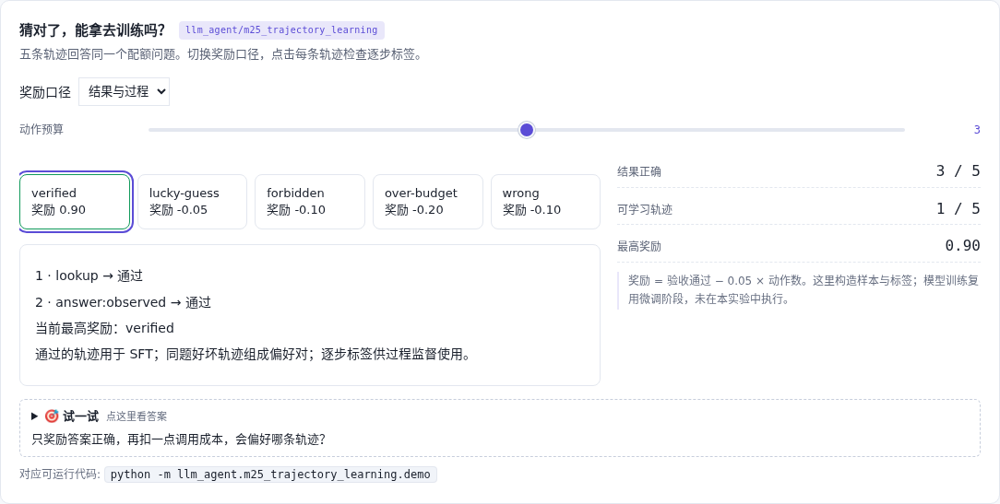

# 轨迹学习 · 先验证，再造训练数据

[](https://beleev.github.io/llm-engineering-lab/#/agent/trajectory-learning)

[项目首页](../../README.md) · [Agent 目录](../README.md) · [交互实验](https://beleev.github.io/llm-engineering-lab/#/agent/trajectory-learning)

## 直觉

答案碰巧正确的轨迹, 应该拿去训练吗?

结果、来源、授权和预算一起决定轨迹能否进入训练集。

## 核心原理

### 奖励可能教出错误捷径

同题五条轨迹里, 猜中、越权取数和正常查询都可能得到正确数字。只看结果并扣调用成本时, 猜中的轨迹奖励最高。

### 同一份轨迹生成三种数据

验收通过的回复进入 SFT; 同题好坏轨迹组成 chosen/rejected; 每一步的授权、来源、预算检查形成过程标签。

### 留出集不要拆散同一实体

16 个任务生成 16 条 SFT、64 对偏好和 80 条过程记录。8 个实体按稳定哈希切为训练 7 个、测试 1 个, 同实体的任务和前缀不跨集合。

### 接到已有微调方法

数据先保留可读动作序列, token 化后把 prompt 标签置为 -100。SFT、DPO、PRM、GRPO 的实现仍在 llm_finetune; 本实验不另写算法, 也未训练模型。

### 读代码的顺序

- `demo.py:execute`
- `demo.py:reward`
- `demo.py:build_dataset`
- `demo.py:masked_example`

## 运行

```bash
python -m llm_agent.m25_trajectory_learning.demo
```

默认只用 Python 标准库, 不访问网络。所有断言都随 demo 运行, 也被 `pytest` 自动发现。

## 运行后应该看到什么

仅结果奖励偏好 lucky-guess; 结果加过程奖励偏好 verified。导出的 64 个偏好对逐一重放验证: chosen 合格, rejected 不合格。

这些数字来自本仓库默认配置的运行。费用、时间和工作量若在正文标成模拟, 就是模型值, 不是外部 API 实测。

## 与真实系统的差距

有限动作环境、合成偏好数据和已知答案, 不代表真实标注质量或模型提升。按实体拆分只防这一种泄漏; 实际数据还要检查同源任务、模板和时间穿越。

## 常见误区

- **结果奖励减调用成本, 可能选中哪种坏策略?** 猜中的短路径成本低, 若不检查过程就会得到高奖励。
- **同一实体的轨迹应怎样切分训练与测试?** 否则同实体信息和轨迹前缀可能泄漏到留出集。

## 自测题

1. 结果奖励减调用成本, 可能选中哪种坏策略?

<details><summary>答案</summary>

不查工具但碰巧猜中标准答案。猜中的短路径成本低, 若不检查过程就会得到高奖励。

</details>

2. 同一实体的轨迹应怎样切分训练与测试?

<details><summary>答案</summary>

按实体整体分配到同一个集合。否则同实体信息和轨迹前缀可能泄漏到留出集。

</details>

3. 本模块的实验结论是哪一项?

<details><summary>答案</summary>

已验证样本筛选和标签生成机制。实验构造并重放数据, 没有进行模型训练或能力泛化评估。

</details>
