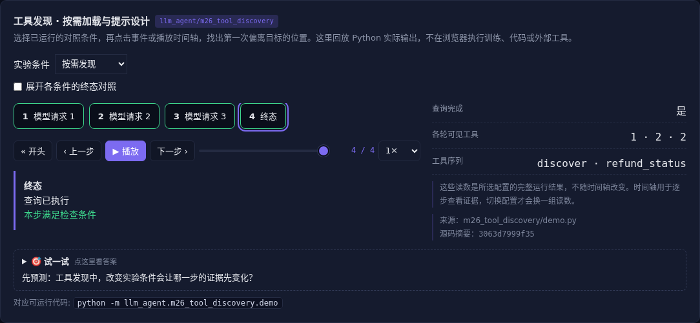

# 工具发现 · 按需加载与提示设计

[](https://beleev.github.io/llm-engineering-lab/#/agent/tool-discovery)

[Agent 目录](../README.md) · [知识覆盖表](../../docs/agent-book-coverage.md) · [交互实验](https://beleev.github.io/llm-engineering-lab/#/agent/tool-discovery)

## 直觉

工具有一百个, 模型该先看哪几个?

先发现能力, 再加载经过版本核验的工具定义。

## 核心原理

### 查目录不等于把目录全塞进去

Agent 初次只看到 discover。

执行后注册匹配工具, 下一次请求才带新 Schema。

目录检索用固定标签, 不声称能理解任意自然语言。

### 规则粒度和例子解决不同问题

关键词规则混淆查询与写入; 工作流程先判断意图, 项目例外再缩小范围。别名示例只补充它明确覆盖的表达。语气和角色不构成权限。

### 工具描述也是输入

加载前比对预审版本摘要。修改描述、实现元数据或参数语义都应重新审核; 摘要匹配只证明版本一致, 不证明内容安全。

### 缓存与能力扩展有代价

新增 Schema 会改变请求前缀。工具数量少了不保证任务总成本降低: 发现要多一次调用, 还可能漏召回。按名称排序只保证稳定顺序。

### 参数保真与字符串复制

文件路径、中文引号、反斜杠和换行都可能影响动作含义。

fidelity_check 验证 JSON 往返逐字保留; 自动把中文引号换成英文引号会改变内容。

精确编辑必须保留原字符串, 不把可读性整理偷偷混进参数。

### 读代码的顺序

- `demo.py:Spec`
- `demo.py:Discover`
- `demo.py:prompt_trials`

## 运行

```bash
python -m llm_agent.m26_tool_discovery.demo
```

默认只用标准库与本仓库模块, 不访问外网。

## 运行后应该看到什么

依次运行 `flat, discovery, poisoned` 三种条件, 输出结果与逐步轨迹。`main()` 对预期的成功和失败分别断言; 失败对照不是程序故障。网页可选择配置、播放或点击事件, 显示 Python 已运行记录, 不在浏览器里执行训练或工具。

## 与真实系统的差距

默认策略读取标签和返回值; 提示对照是固定语法解释器。没有联网 MCP、向量工具搜索或真实模型提示胜率。

## 常见误区

“有相同概念的教学实验”不等于“复现完整论文或具备通用产品能力”。对照只隔离本章说明的变量; 其他假设变化需重新测。

## 自测题

已经有 MCP tools/list, 为什么还要主动发现?

<details><summary>答案</summary>

启动时列全工具不等于按任务加载。协议枚举与模型可见范围是两件事。运行中发现能力后仍须经过版本和权限检查。

</details>

## 延伸阅读

机制参考 [ai-agent-book 第 4 章](https://github.com/bojieli/ai-agent-book/blob/dbc046eb896ac4e39aa19c7774c8bf49583b89a6/book/chapter4.md#L133)。模型、指标与脚本为本仓库的教学实现, 边界如上。
