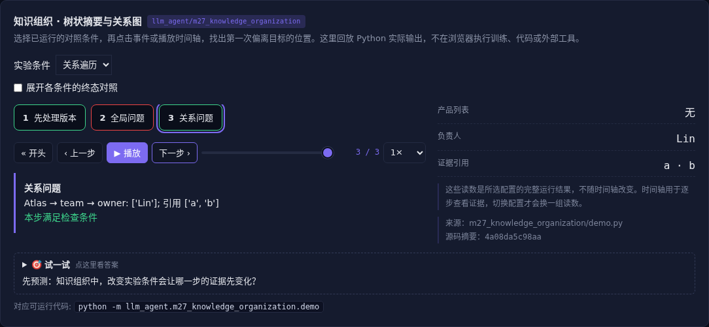

# 知识组织 · 树状摘要与关系图

[](https://beleev.github.io/llm-engineering-lab/#/agent/knowledge-organization)

[Agent 目录](../README.md) · [交互实验](https://beleev.github.io/llm-engineering-lab/#/agent/knowledge-organization)

## 直觉

问全局主题和问实体关系, 应该查同一种索引吗?

树适合汇总范围, 图适合沿关系找证据, 两者都要回到来源。

## 核心原理

### RAPTOR 的树形思路

原始块是叶子, 聚类后逐层摘要, 查询可命中不同粒度。本例按已知主题分组并摘取摘要, 隔离层次结构; 未运行嵌入聚类或 LLM 摘要。

### GraphRAG 的图形思路

实体和关系构成图。

沿 Atlas→团队→负责人可拼出关系答案。

完整 GraphRAG 还包含实体抽取、社区发现和社区摘要; 简单多跳遍历只是其中一环。

### 给分块补上上下文

只有 20 看不出对象、单位和版本。

将 Atlas、limit、v2 加回块, 提高可辨认性; 检索命中后仍校验来源, 不能让生成上下文替代原文。

### 更新与全量整理分开

增量更新先保留原证据, 同对象同关系按版本替换索引。定期整理再修复跨块关系、重复摘要和失效引用。索引过时也会造成回答过时。

### 文件系统与结构化知识

分层目录可用摘要索引、资源概览、完整正文三级加载, 以稳定 URI 关联证据。

表格分析应把统计事实和因果解释分开; 多模态记忆也要保存原文件与摘要之间的链接。

### 从数据到知识不等于多写摘要

dataset_insights 比较短任务和长任务的两种方案: A 在两组内成功率都较高, 总体却低于 B, 因为任务分配不同。

先保留计数、分组、分母和时间范围, 再分析关联; 观察数据的关联不能直接当因果。

### 读代码的顺序

- `demo.py:current_facts`
- `demo.py:hierarchy`
- `demo.py:graph_path`

## 运行

```bash
python -m llm_agent.m27_knowledge_organization.demo
```

默认只用标准库与本仓库模块, 不访问外网。

## 运行后应该看到什么

依次运行 `flat, hierarchy, graph` 三种条件, 输出结果与逐步轨迹。`main()` 对预期的成功和失败分别断言; 失败对照不是程序故障。网页可选择配置、播放或点击事件, 显示 Python 已运行记录, 不在浏览器里执行训练或工具。

## 与真实系统的差距

数据是人工构造的三元组; 不含自然语言实体抽取、真实语义嵌入或自动社区发现。实验比较表示方法, 不宣称完整复现论文算法。

## 常见误区

“有相同概念的教学实验”不等于“复现完整论文或具备通用产品能力”。对照只隔离本章说明的变量; 其他假设变化需重新测。

## 自测题

树摘要回答产品列表后, 能直接证明负责人是谁吗?

<details><summary>答案</summary>

还要检索负责人关系及其来源。全局汇总和关系证据解决不同问题。摘要里未出现的关系不能凭结构补出来。

</details>
