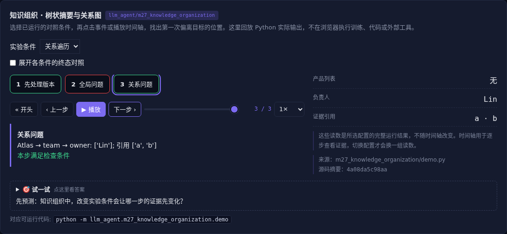

# 知识组织 · 树状摘要与关系图

[](https://beleev.github.io/llm-engineering-lab/#/agent/knowledge-organization)

[Agent 目录](../README.md) · [交互实验](https://beleev.github.io/llm-engineering-lab/#/agent/knowledge-organization)

## 直觉

问 "有哪些产品" 和问 "Atlas 谁负责", 该查同一种索引吗?

同一份 5 条事实: 平铺检索只答出 [Atlas], 树摘要答全 [Atlas, Boreal], 图遍历两跳答出负责人 Lin。全局问题走树, 关系问题走图, 答案都带来源 id。

## 核心原理

### RAPTOR 的树形思路

原始块是叶子, 聚类后逐层摘要, 查询可命中不同粒度。

本例 hierarchy 按已知 group 分 3 组 (products / people / limits), 每组摘取 subject 当摘要并保留叶子 id: products 组给出 [Atlas, Boreal], 来源 a、c, 全局问题答对; 平铺检索只命中 a 一块, 只答出 [Atlas]。

没有运行嵌入聚类或 LLM 摘要, 隔离的是层次结构本身。

### GraphRAG 的图形思路

实体是点, 关系是边。graph_path 从 Atlas 沿 team → owner 走两跳得到 Lin, 引用 a、b; 同一张图回答全局问题却列不出任何产品。

把 FACTS 倒序再查, 结果仍是 Lin 和 a、b, 路径不依赖事实的写入顺序。

完整 GraphRAG 还包含实体抽取、社区发现和社区摘要; 多跳遍历只是其中一环。

### 给分块补上上下文

叶子 f 的原文只有 "20", 看不出对象、单位和版本。

contextual_chunks 把它写成 "Atlas limit v2: 20", 检索时才认得出这是 Atlas 的 v2 上限。

检索命中后仍要回到来源 id 校验原文, 不能让生成的上下文替代原文。

### 更新与全量整理分开

Atlas limit 有 v1=10 和 v2=20 两条, current_facts 按版本取最新, 索引里只留 f, 原证据 e 不删; 同版本不同值直接抛 ValueError 等人审核。

定期整理再修复跨块关系、重复摘要和失效引用。

索引过时也会造成回答过时: graph_path 查 Atlas limit 返回 20 和来源 f, 是因为先按版本过滤过。

### 文件系统与结构化知识

把知识放在文件系统里时, 目录可以分三级加载: 摘要索引、资源概览、完整正文, 用稳定 URI 把每一级和证据连起来, 和本例的 source id 是同一个意思。

表格分析要把统计事实和因果解释分开写; 多模态记忆也要保存原文件与摘要之间的链接。

### 从数据到知识不等于多写摘要

dataset_insights 比较两种方案在两组任务上的成功率: A 在两组里都更高 (0.93 对 0.87, 0.73 对 0.69), 总体却更低 (0.78 对 0.83)。

原因是任务分配不同: 两边各 350 道, A 有 263 道落在成功率低的那组, B 只有 80 道。

先保留计数、分组、分母和时间范围, 再分析关联; 观察数据的关联不能直接当因果。

### 读代码的顺序

- `demo.py:current_facts`
- `demo.py:hierarchy`
- `demo.py:graph_path`

## 运行

```bash
python -m llm_agent.m27_knowledge_organization.demo
```

默认只用标准库与本仓库模块, 不访问外网。

## 运行后应该看到什么

依次运行 `flat, hierarchy, graph` 三种条件, 输出结果与逐步轨迹。`main()` 对预期的成功和失败分别断言; 失败对照不是程序故障。网页可选择配置、播放或点击事件, 显示 Python 已运行记录, 不在浏览器里执行训练或工具。

## 与真实系统的差距

数据是 6 条人工构造的三元组, 实体和关系都是手写的; 没有自然语言实体抽取、真实语义嵌入或自动社区发现。

实验比较的是三种表示方法在同一份事实上各答对哪个问题, 不宣称完整复现 RAPTOR 或 GraphRAG 算法。

## 常见误区

“有相同概念的教学实验”不等于“复现完整论文或具备通用产品能力”。对照只隔离本章说明的变量; 其他假设变化需重新测。

## 自测题

树摘要回答产品列表后, 能直接证明负责人是谁吗?

<details><summary>答案</summary>

还要检索负责人关系及其来源。全局汇总和关系证据解决不同问题。摘要里未出现的关系不能凭结构补出来。

</details>
