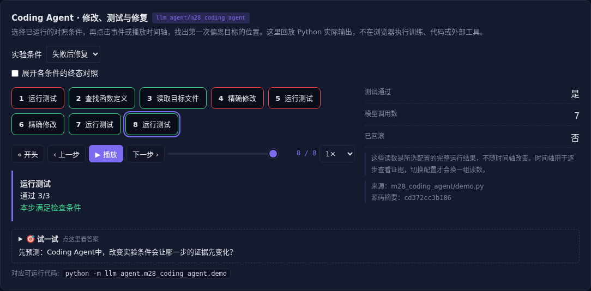

# Coding Agent · 修改、测试与修复

[](https://beleev.github.io/llm-engineering-lab/#/agent/coding-agent)

[Agent 目录](../README.md) · [交互实验](https://beleev.github.io/llm-engineering-lab/#/agent/coding-agent)

## 直觉

模型已经把补丁写入源文件并声明「修复完成」, 为什么系统仍不能直接采信这一结论?

代码修改写进文件不代表缺陷已经修好, 必须由外部驱动器实跑测试来验收, 未通过或超出调用预算时自动回滚文件:
- 本章用确定性的修复策略 (RepairPolicy) 模拟修复 pricing.py 的折扣函数: 第一次候选修改 return total 只通过 1/3 测试, 读回失败报错再改一次才通过 3/3, 共消耗 7 次模型调用。
- 若将调用预算收紧到 4 次, 预算耗尽仍未全过时驱动器直接将文件回滚原样。

## 核心原理

### 先建立工作区证据

代码修改必须遵循「先检索读取建立证据、再做唯一性精确替换」的工作流, 同时锁定测试文件防止篡改。demo 在临时目录中初始化两个文件: 待修复的折扣模块 pricing.py (含函数 discounted) 与包含 3 个测试用例的验收脚本 check.py。初始缺陷出在表达式 return total * (1 - percent): 调用方传入的 percent 是 10 这类百分数整数, 未除以 100 直接相减会算出负数。
确定性修复策略 RepairPolicy 代替真实模型驱动工具链, 按三步建立证据并落盘修改:
1. 调用 search 定位符号 discounted 位于 pricing.py 第 1 行。
2. 调用 read 读取源文件完整内容。
3. 调用 patch 提交精确文本替换。
Workspace.patch 在写入前执行三项约束:
- 唯一匹配检查: 待替换的旧文本必须在目标文件内恰好出现 1 次, 否则抛出「旧文本不存在或不唯一, 拒绝模糊替换」。
- 语法预检: 替换后的候选代码须先通过 Python 内置 compile 语法校验, 确认合法后才落盘写入。
- 变更留痕: 验收阶段通过 difflib 生成标准 unified diff, 清晰呈现修改前后的行级差异。
同时, Workspace 在初始化时记录 check.py 的 sha256 摘要, 每次运行测试前均重新核算比对, 阻止模型通过修改断言条件伪造测试通过。

### 测试真的运行

验证环节通过独立子进程真实导入修改后的模块并执行断言, 将结构化失败反馈送回下一轮修复。test 工具通过 subprocess 启动隔离的本地 Python 子进程运行 check.py, 采用固定参数列表、禁用 shell 解析并设置 5 秒超时上限。子进程重新 import 磁盘上修改后的 pricing.py, 依次核对 3 组用例: 输入 (100, 10) 期望输出 90, 输入 (19.99, 15) 期望输出 16.99, 输入 (80, 0) 期望输出 80。
首轮候选补丁 return total 直接原样返回原价: 输入 (100, 10) 得到 100 而非 90, 仅零折扣用例 (80, 0) 恰好相等, 测试通过数为 1/3。策略从工具返回结果中读取该失败明细后发起第二次 patch, 将实现更新为 round(total * (1 - percent / 100), 2), 按百分数折算并保留两位小数, 复测后 3/3 全部通过。

### 验收与修复预算独立

最终验收完全独立于智能体的自我声明, 由外层驱动器在循环结束后复跑测试并在失败时强制回滚工作区。策略末尾输出的文本「候选修复已提交验收」不作为判定依据; experiment 在 agent.run 退出后自行调用 workspace.check 重新执行测试套件, 并以该次实测结果为准。
对比三种运行模式:
- repair 模式: 允许失败后迭代修复, 经 7 次模型调用后通过全部 3/3 测试, 正确补丁得以保留。
- one-shot 模式: 禁用二次修复, 共消耗 5 次模型调用, 仅通过 1/3 测试。
- budget 模式: 允许修复但收紧轮次上限 max_turns=4, 满 4 次调用即被强制终止, 尚未执行第二次 patch, 同样仅通过 1/3 测试。
后两种模式均未通过外部验收, experiment 自动将 pricing.py 覆写恢复为初始源码, 避免未完成的错误改动污染工作区。

### Coding Agent 的工程接口

生产级 Coding Agent 在最小四工具闭环之上, 还需叠加符号索引、上下文裁剪、静态检查与分级权限门控制。本实验仅保留 search、read、patch、test 四个基础工具以聚焦「定位—编辑—验证—回滚」闭环; 面向大型真实仓库时, 系统还需支持跨文件符号跳转、超出窗口上限时的上下文管理、lint 与编译构建流水线、独立沙箱工作区隔离以及补丁差异审查。
尽管代码能够表达复杂的修改逻辑, 模型生成的写操作依然必须受权限门与工具风险等级约束:
- patch 工具: 会改动磁盘源文件, 标记为非只读 (read_only=False) 且风险等级为 medium。
- search、read、test 工具: 不修改业务源码, 标记为只读 (read_only=True) 且风险等级为 low。

### 读代码的顺序

- `demo.py:Workspace`
- `demo.py:ProjectTool`
- `demo.py:RepairPolicy`

## 运行

```bash
python -m llm_agent.m28_coding_agent.demo
```

默认只用标准库与本仓库模块, 不访问外网。

## 运行后应该看到什么

依次运行 `one-shot, repair, budget` 三种条件, 输出结果与逐步轨迹。`main()` 对预期的成功和失败分别断言; 失败对照不是程序故障。网页可选择配置、播放或点击事件, 显示 Python 已运行记录, 不在浏览器里执行训练或工具。

## 与真实系统的差距

本实验采用白名单表达式与路径围栏隔离控制流程, 不能替代运行不可信代码的操作系统级沙箱。RepairPolicy 是硬编码的确定性状态机而非真实模型; Workspace.patch 仅放行 3 个预审算术表达式 (初始缺陷行、return total 以及带 round 的正确实现), 其余任意代码片段一律抛出异常拒绝。
同时, 路径围栏严格限定仅允许读写当前临时目录下的 pricing.py, 针对 ../pricing.py、check.py 与 /etc/passwd 的访问均会被拦截。但进程内路径校验加临时目录并非 OS 级隔离沙箱, 不能用于直接执行任意不可信的模型生成代码。

## 常见误区

“有相同概念的教学实验”不等于“复现完整论文或具备通用产品能力”。对照只隔离本章说明的变量; 其他假设变化需重新测。

## 自测题

候选返回“已完成”, 测试失败且预算耗尽, 应怎样结束?

<details><summary>答案</summary>

回滚候选并报告验收未通过。完成由环境判断。预算和原始测试不能因为模型坚持完成而失效。

</details>
