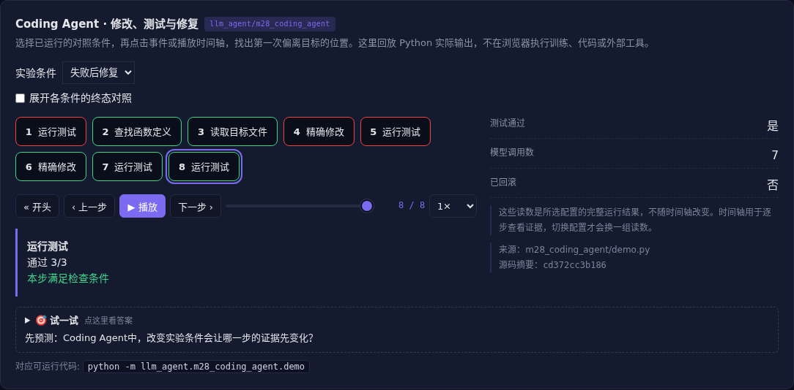

# Coding Agent · 修改、测试与修复

[](https://beleev.github.io/llm-engineering-lab/#/agent/coding-agent)

[Agent 目录](../README.md) · [知识覆盖表](../../docs/agent-book-coverage.md) · [交互实验](https://beleev.github.io/llm-engineering-lab/#/agent/coding-agent)

## 直觉

代码改完了, 为什么还不能说修好了?

读取、精确修改、运行测试和终态验收组成一次修复。

## 核心原理

### 先建立工作区证据

搜索定位函数, 读取原文, 唯一旧文本才能替换。含糊替换可能改错位置; 修改前后生成 diff, 测试文件保持原摘要。

### 测试真的运行

工具启动本地 Python 子进程导入修改后的模块。首个候选只返回原价, 测试失败; 模型读取反馈后换为正确折扣与两位小数。

### 验收与修复预算独立

最终文字不参与成功判定。预算耗尽或测试失败时恢复原文件; 只有环境验收通过才保留候选。

### Coding Agent 的工程接口

大项目还要检索符号、管理上下文、执行 lint 和构建、隔离工作区、审查差异。代码能表达复杂规则, 但生成代码仍需权限和运行约束。

### 读代码的顺序

- `demo.py:Workspace`
- `demo.py:ProjectTool`
- `demo.py:RepairPolicy`

## 运行

```bash
python -m llm_agent.m28_coding_agent.demo
```

默认只用标准库与本仓库模块, 不访问外网。

## 运行后应该看到什么

依次运行 `one-shot, repair, budget` 三种条件, 输出结果与逐步轨迹。`main()` 对预期的成功和失败分别断言; 失败对照不是程序故障。网页可选择配置、播放或点击事件, 显示 Python 已运行记录, 不在浏览器里执行训练或工具。

## 与真实系统的差距

策略是固定修复器, 只接受三个预审算术表达式。临时目录与路径围栏不是 OS 沙箱, 不支持运行任意不可信生成代码。

## 常见误区

“有相同概念的教学实验”不等于“复现完整论文或具备通用产品能力”。对照只隔离本章说明的变量; 其他假设变化需重新测。

## 自测题

候选返回“已完成”, 测试失败且预算耗尽, 应怎样结束?

<details><summary>答案</summary>

回滚候选并报告验收未通过。完成由环境判断。预算和原始测试不能因为模型坚持完成而失效。

</details>

## 延伸阅读

机制参考 [ai-agent-book 第 5 章](https://github.com/bojieli/ai-agent-book/blob/dbc046eb896ac4e39aa19c7774c8bf49583b89a6/book/chapter5.md#L13)。模型、指标与脚本为本仓库的教学实现, 边界如上。
