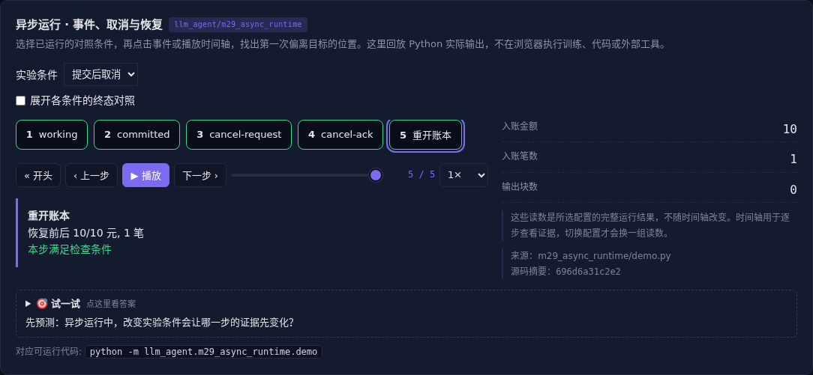

# 异步运行 · 事件、取消与恢复

[](https://beleev.github.io/llm-engineering-lab/#/agent/async-runtime)

[Agent 目录](../README.md) · [交互实验](https://beleev.github.io/llm-engineering-lab/#/agent/async-runtime)

## 直觉

用户点了取消, 工具究竟停在哪一步? 它刚提交的那笔钱怎么办?

取消是两段式: cancel-request 之后要等执行器的 cancel-ack。已提交的副作用不回滚: cancel-after 模式账本仍是 10 元, 重开再提交也还是 1 笔, 靠 SQLite 主键 invoice-1 做幂等。

## 核心原理

### 从调用栈变成事件生命周期

任务由外部事件唤醒, 在 await release.wait() 处真正挂起, 再由结果唤醒; 不是一个函数从头跑到尾。

每条事件标识任务与 generation, 状态包括 working、committed、stream、completed、cancel-request 与 cancel-ack。complete 模式按 working → committed → stream × 2 → completed 走完, 事件同时写进 SQLite 的 events 表。

### 取消要等执行器确认

asyncio 的 Task.cancel 只在可取消点 (await) 抛 CancelledError。

本例的 interrupt 先把 generation 加 1, 再 cancel, 然后 await 任务直到执行器记下 cancel-ack 才返回; 旧 generation 的 token 不再输出, cancel-after 模式 streamed 为 0。

已结束任务的取消是幂等的, 不伪造新确认。阻塞线程、外部服务和物理设备没有这种自动保证。

### 提交状态独立持久化

Journal 用 SQLite 主键 invoice-1 绑定操作与金额 10; 同键重复提交被 INSERT OR IGNORE 吸收, 同键换金额抛 "幂等键对应的参数变了"。

cancel-after 模式在挂起前就提交了 10 元, 取消确认后账本仍是 10 元; 关掉再重开账本、按同一键重提交, 恢复前后 10/10 元, 1 笔。

恢复后先查已有收据, 不能凭超时判断未执行: 只有 cancel-before 模式才是 0 元 0 笔。

### 流式输出也需要代际

模型文字块、工具进度、语音输出都是事件。本例把 "已"、"处理" 两个 token 当流式事件, 每出一个先比对 generation, 过期就直接 return。

展示已经发生的进度, 不把局部 token 当最终承诺。

预算预留在无 await 的临界段完成: write 先检查 generation 和 budget=2, used += 1 之后才提交。

### 长期任务需要更多恢复信息

生产任务还要持久化检查点、租约、输入版本和审批状态, 区分外部通知与用户新指令。

虚拟身份与工具凭证按执行身份隔离; 本例只展示单进程里的 generation、幂等键和事件表。

### 同步模型怎样接异步事件

模型不支持原生异步时, 运行时可以排队事件, 在安全轮次边界注入上下文, 或中止旧请求后用新 generation 重发。

支持原生事件接口的模型也仍需任务归属、迟到结果过滤和预算。

不能把后台通知直接升级为用户授权。

### 读代码的顺序

- `demo.py:Journal`
- `demo.py:Runtime`
- `demo.py:run_case`

## 运行

```bash
python -m llm_agent.m29_async_runtime.demo
```

默认只用标准库与本仓库模块, 不访问外网。

## 运行后应该看到什么

依次运行 `complete, cancel-before, cancel-after` 三种条件, 输出结果与逐步轨迹。`main()` 对预期的成功和失败分别断言; 失败对照不是程序故障。网页可选择配置、播放或点击事件, 显示 Python 已运行记录, 不在浏览器里执行训练或工具。

## 与真实系统的差距

用的是真实 asyncio 任务与磁盘 SQLite, 竞态靠 Event 屏障复现, 不靠 sleep 猜时序。

没有网络分区、分布式租约或进程强杀测试; "重开" 重开的是账本文件, 不是自动恢复任意 Python 调用栈。

## 常见误区

“有相同概念的教学实验”不等于“复现完整论文或具备通用产品能力”。对照只隔离本章说明的变量; 其他假设变化需重新测。

## 自测题

先提交再收到取消确认, 账本里的那笔写入怎样处理?

<details><summary>答案</summary>

仍存在, 补偿需要另一个操作。取消停止未来动作, 不撤销过去提交。补偿要有自己的授权和审计。

</details>
