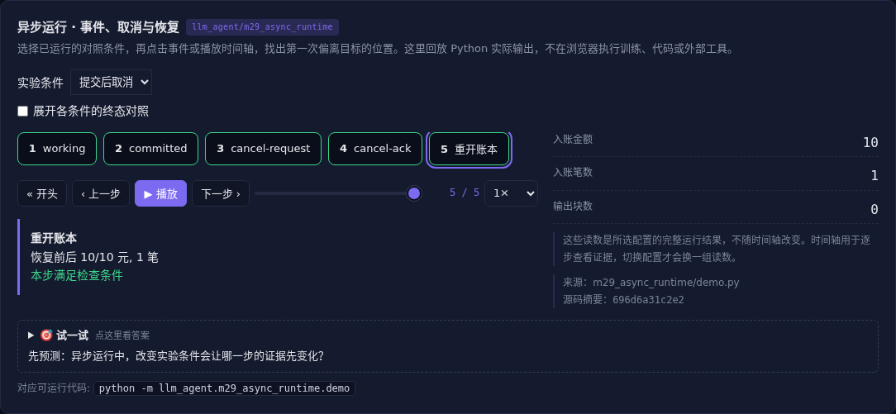

# 异步运行 · 事件、取消与恢复

[](https://beleev.github.io/llm-engineering-lab/#/agent/async-runtime)

[Agent 目录](../README.md) · [交互实验](https://beleev.github.io/llm-engineering-lab/#/agent/async-runtime)

## 直觉

用户打断时, 工具究竟执行到哪了?

请求取消和确认停止之间有状态; 已提交的副作用仍然存在。

## 核心原理

### 从调用栈变成事件生命周期

任务从外部事件开始, 在 await 处挂起, 再由结果唤醒。

事件应标识任务与 generation, 状态包括 working、completed、cancel-request 与 cancel-ack。

### 取消要等执行器确认

asyncio Task.cancel 在可取消点抛 CancelledError。

本例等待确认再结束, 旧 generation 不再输出。

阻塞线程、外部服务和物理设备没有这种自动保证。

### 提交状态独立持久化

SQLite 主键绑定操作与金额, 同键异参拒绝。同一事务边界内可避免重复入账; 恢复后查已有收据, 不能凭超时判断未执行。

### 流式输出也需要代际

模型文字块、工具进度、语音输出都是事件。展示已经发生的进度, 不把局部 token 当最终承诺。预算预留在无 await 临界段完成。

### 长期任务需要更多恢复信息

生产任务还要持久化检查点、租约、输入版本和审批状态, 区分外部通知与用户新指令。虚拟身份与工具凭证按执行身份隔离; 本例只展示单进程机制。

### 同步模型怎样接异步事件

模型不支持原生异步时, 运行时可以排队事件, 在安全轮次边界注入上下文, 或中止旧请求后用新 generation 重发。

支持原生事件接口的模型也仍需任务归属、迟到结果过滤和预算。

不能把后台通知直接升级为用户授权。

### 读代码的顺序

- `demo.py:Journal`
- `demo.py:Runtime`
- `demo.py:run_case`

## 运行

```bash
python -m llm_agent.m29_async_runtime.demo
```

默认只用标准库与本仓库模块, 不访问外网。

## 运行后应该看到什么

依次运行 `complete, cancel-before, cancel-after` 三种条件, 输出结果与逐步轨迹。`main()` 对预期的成功和失败分别断言; 失败对照不是程序故障。网页可选择配置、播放或点击事件, 显示 Python 已运行记录, 不在浏览器里执行训练或工具。

## 与真实系统的差距

真实 asyncio 与磁盘 SQLite, 但没有网络分区、分布式租约或进程强杀测试。重开的是账本, 不是自动恢复任意 Python 调用栈。

## 常见误区

“有相同概念的教学实验”不等于“复现完整论文或具备通用产品能力”。对照只隔离本章说明的变量; 其他假设变化需重新测。

## 自测题

先提交再收到取消确认, 账本里的那笔写入怎样处理?

<details><summary>答案</summary>

仍存在, 补偿需要另一个操作。取消停止未来动作, 不撤销过去提交。补偿要有自己的授权和审计。

</details>
