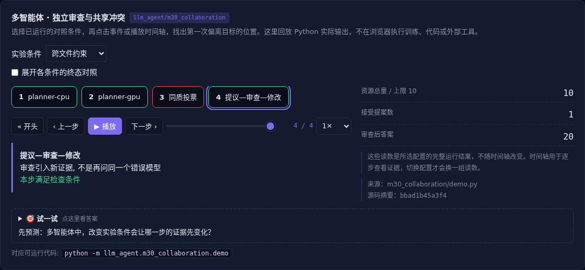

# 多智能体 · 独立审查与共享冲突

[](https://beleev.github.io/llm-engineering-lab/#/agent/collaboration)

[Agent 目录](../README.md) · [知识覆盖表](../../docs/agent-book-coverage.md) · [交互实验](https://beleev.github.io/llm-engineering-lab/#/agent/collaboration)

## 直觉

两个 Agent 改不同文件, 为什么仍可能冲突?

没有文本冲突不代表合并后满足共同约束。

## 核心原理

### 协作拓扑改变信息流

顺序流水线便于核查依赖, 并行专家汇总增加信息源, 提议—审查形成纠错循环。

去中心化协作需要消息、归属和终止协议, 不是去掉管理者就会自动协调。

### 版本检查与语义检查互补

两个 worker 都看见总量 8, 各把自己负责的资源从 4 改到 6。

单文件无冲突, 合并总量变成 12; 版本号拒绝过期提案, 总量约束拒绝不合法状态。

### 多数票不等于独立证据

同一过期来源让三个答案都错。审查者读取 v2 得到新事实, 才能纠正结果; 同质投票不能用独立随机误差公式估计收益。

### 避免级联和失控

委托要写目标、边界、输出和预算。

共享上下文容易互相污染, 隔离上下文需要显式传证据。

设任务所有者、迭代上限和人工升级条件, 不把所有模糊决策都转交用户。

### 读代码的顺序

- `demo.py:SharedPlan`
- `demo.py:reviewed_answer`

## 运行

```bash
python -m llm_agent.m30_collaboration.demo
```

默认只用标准库与本仓库模块, 不访问外网。

## 运行后应该看到什么

依次运行 `file-only, revision, invariant` 三种条件, 输出结果与逐步轨迹。`main()` 对预期的成功和失败分别断言; 失败对照不是程序故障。网页可选择配置、播放或点击事件, 显示 Python 已运行记录, 不在浏览器里执行训练或工具。

## 与真实系统的差距

规则 worker 提案与固定证据审查, 未证明真实多模型的独立性。并发取消和 A2A 协议分别见 m29 与 m18。

## 常见误区

“有相同概念的教学实验”不等于“复现完整论文或具备通用产品能力”。对照只隔离本章说明的变量; 其他假设变化需重新测。

## 自测题

三个 Agent 读了同一份旧文档, 投票能解决什么?

<details><summary>答案</summary>

只能汇总意见, 不能补出新事实。相关错误不能当独立抽样。纠错需要新证据、不同方法或独立验收。

</details>

## 延伸阅读

机制参考 [ai-agent-book 第 10 章](https://github.com/bojieli/ai-agent-book/blob/dbc046eb896ac4e39aa19c7774c8bf49583b89a6/book/chapter10.md#L194)。模型、指标与脚本为本仓库的教学实现, 边界如上。
