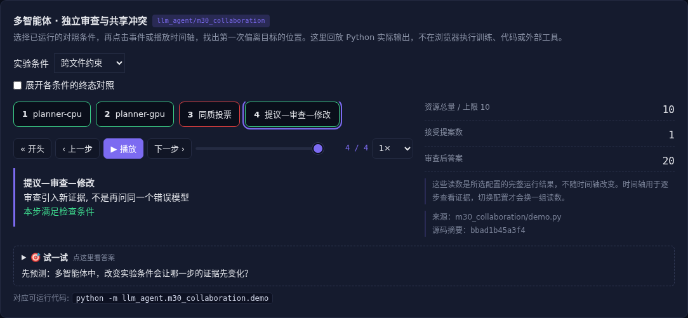

# 多智能体 · 独立审查与共享冲突

[](https://beleev.github.io/llm-engineering-lab/#/agent/collaboration)

[Agent 目录](../README.md) · [交互实验](https://beleev.github.io/llm-engineering-lab/#/agent/collaboration)

## 直觉

两个 Agent 分别修改不同文件且合并时未报任何文本冲突, 为什么合入后的全局状态仍然违背约束?

- 两个 worker 并行修改同一份共享计划中的不同资源字段, 合并时不产生任何文本冲突, 但合并后资源总量达到 12, 超出全局上限 10。引入版本号校验 (拒绝基于过期快照的提案) 或总量不变量校验 (拒绝合并后总和超过 10 的状态), 均可拦截第二个冲突提案。
- 3 个投票者读取同一份过期数据并一致投出 10, 3 票全票通过却依然错误; 唯有审查者独立读取最新证据 policy-v2 才能纠正为 20。多数投票仅在各投票者的误差相互独立时才具备纠错能力。

## 核心原理

### 协作拓扑改变信息流

多智能体的协作拓扑直接决定了信息传递路径与错误的暴露位置。
- 顺序流水线: 上游完成后交由下游继续处理, 阶段依赖清晰, 便于逐级核查。
- 并行专家汇总: 多个 Agent 各自负责子任务再统一合入, 能够扩展信息覆盖面, 但合并环节必须校验全局约束。
- 提议—审查: 由提议方给出候选方案、审查方引入独立依据核验, 构成闭环纠错。
本章实验实现了后两种拓扑:
- 并行合入: planner-cpu 与 planner-gpu 同时向共享计划 SharedPlan 提交局部修改。
- 投票后审查: 汇总 3 张投票结果后, 再由独立审查者读取外部新证据加以核对。
去中心化协作并不会在移除中心调度者后自动达成一致, 消息路由、决策归属与终止条件均需显式协议约束。

### 版本检查与语义检查互补

版本检查与语义不变量检查分别拦截并发陈旧写入与业务状态越界, 二者在合并环节互为补充。SharedPlan 初始状态为 {cpu: 4, gpu: 4}, 资源总量 8, 全局上限 10。两个 worker 基于该初始快照各自提交一条 Patch 提案, 携带的基准版本号 revision 均为 0:
- planner-cpu: 申请将 cpu 从 4 修改为 6。
- planner-gpu: 申请将 gpu 从 4 修改为 6。
merge 方法对比了三种合入策略:
- file-only: 仅检查两条提案是否修改同一键。由于 cpu 与 gpu 属于不同键, 不存在键级冲突, 两条提案均被接受, 合入后总量升至 12, 超出上限 10。
- revision: 每次成功合入令 revision 加 1。首条提案到达时当前 revision 为 0, 与提案匹配并合入, revision 升为 1; 第二条提案仍携带旧版本号 0, 因不等于当前版本号 1 而被拒绝, 总量维持在 10。
- invariant (不变量, 合入后必须恒成立的全局条件): 合入前预计算候选状态总和, 若满足 sum > 10 则拒绝。首条提案合入后总和为 10, 予以接受; 第二条提案会使总和升至 12, 因违背不变量而被拒绝, 总量同样保持在 10。
两类校验职责分明:
- 版本号校验: 拦截基于过期状态快照做出的陈旧提案。
- 总量不变量校验: 无论提案基准版本新旧, 直接拦截一切违反业务约束的非法状态。

### 多数票不等于独立证据

源自同一份过期数据的多张选票不具备误差独立性, 即使形成 3:0 的全票一致依然可能出错。reviewed_answer 接收 3 张选票 [10, 10, 10], 经 Counter 统计多数票得到 10, 表面呈现高度一致。
审查环节不再重复询问原投票者, 而是独立读取外部证据 policy-v2 获取最新值 current=20; 因与多数票结果 10 不一致, 系统将状态标记为 corrected 并采纳修订值 20。
多数投票降低错误率的数学前提是各投票者的误差相互独立, 使随机偏差在聚合时相互抵消。读取同一份过期数据源产生的同质投票具有完全一致的系统性偏差, 不能套用独立误差假设来高估增加投票席位带来的收益。

### 避免级联和失控

多智能体链路中的局部差错极易沿调用图向下游级联放大, 协作协议需从任务边界、上下文隔离与终止控制三方面加以约束:
- 显式委托契约: 子任务指派必须明确目标、权限边界、输出格式与资源预算, 不能假定下游 worker 自动共享上游的隐含背景。
- 上下文隔离与传参: 全量共享上下文容易导致中间推理产物相互污染; 隔离上下文则要求在交接时显式传递必要证据, 未传递的信息对下游不可见。
- 责任归属与收敛上限: 明确指定单一任务所有者、最大往返迭代轮数以及触发人工介入的升级条件, 避免多方无限互推或将所有模糊决策全部抛给终端用户。

### 读代码的顺序

- `demo.py:SharedPlan`
- `demo.py:reviewed_answer`

## 运行

```bash
python -m llm_agent.m30_collaboration.demo
```

默认只用标准库与本仓库模块, 不访问外网。

## 运行后应该看到什么

依次运行 `file-only, revision, invariant` 三种条件, 输出结果与逐步轨迹。`main()` 对预期的成功和失败分别断言; 失败对照不是程序故障。网页可选择配置、播放或点击事件, 显示 Python 已运行记录, 不在浏览器里执行训练或工具。

## 与真实系统的差距

本实验采用确定性规则替身而非真实大模型, 仅验证状态合并策略与独立证据审查的协议机制。代码中两个 worker 提交的是固定的两条 Patch 提案, 审查者读取的也是预设证据 current=20, 实验并未验证真实多模型采样之间的误差独立性。
并行任务取消传播与跨进程 A2A 通信协议分别在 m29 与 m18 中单独讨论。

## 常见误区

“有相同概念的教学实验”不等于“复现完整论文或具备通用产品能力”。对照只隔离本章说明的变量; 其他假设变化需重新测。

## 自测题

三个 Agent 读了同一份旧文档, 投票能解决什么?

<details><summary>答案</summary>

只能汇总意见, 不能补出新事实。相关错误不能当独立抽样。纠错需要新证据、不同方法或独立验收。

</details>
