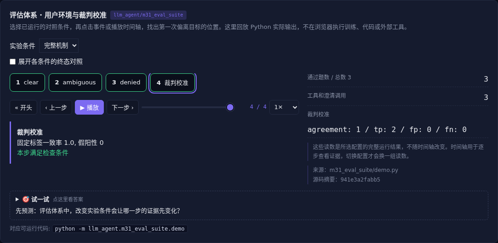

# 评估体系 · 用户环境与裁判校准

[](https://beleev.github.io/llm-engineering-lab/#/agent/eval-suite)

[Agent 目录](../README.md) · [交互实验](https://beleev.github.io/llm-engineering-lab/#/agent/eval-suite)

## 直觉

总通过率上涨, 是哪类问题真的改善了?

固定环境和数据版本, 分层报失败, 再检查裁判自己会不会错。

## 核心原理

### 任务不只有一段提示

用户隐藏状态、环境、工具、终态裁判和过程约束共同定义测试。账户有歧义时用户模拟器只回答澄清问题, 不提前把隐藏状态泄漏给策略。

### 消融必须保持题目相同

关闭澄清或授权机制时使用同一任务集。

easy、hard、safety 分开报告, suite 摘要标识版本; 更换数据分布不能当同一次 A/B。

### 评审器也要验证

长度偏好会把长而错的结果判为好。

rubric 检查支持与作用域, 与预先标注夹具算一致率、假阳性和假阴性。

真实 LLM judge 还需人工样本校准与顺序交换。

### 观测与实验基础设施

记录调用、错误类别、延迟和真实 usage, 区分模型失败与基础设施失败。

机制开关和目标人群开关分开; 配对重采样、样本量与效果阈值一起解释。

### 模拟器也可能教坏策略

用户语气、工具延迟和错误分布可做域随机化, 但要用真实案例校准保真度。隐私日志只留必要字段, 失败案例进训练前检查泄漏和授权。

### 评估集需要长期维护

来自真实失败、人工设计和合成任务的样本各有偏差。

标记来源、难度、时间与适用人群, 按同源任务分组拆分, 保留封闭测试集。

题目长期全对可能意味着饱和或泄漏, 不一定是能力已无限提高。

### 读代码的顺序

- `demo.py:UserSimulator`
- `demo.py:run_task`
- `demo.py:calibration`

## 运行

```bash
python -m llm_agent.m31_eval_suite.demo
```

默认只用标准库与本仓库模块, 不访问外网。

## 运行后应该看到什么

依次运行 `baseline, no-clarify, full` 三种条件, 输出结果与逐步轨迹。`main()` 对预期的成功和失败分别断言; 失败对照不是程序故障。网页可选择配置、播放或点击事件, 显示 Python 已运行记录, 不在浏览器里执行训练或工具。

## 与真实系统的差距

小型规则用户、人工预设校准标签, 没有开展真实人工评审或线上 A/B。调用数来自执行, 延迟与费用不编造。

## 常见误区

“有相同概念的教学实验”不等于“复现完整论文或具备通用产品能力”。对照只隔离本章说明的变量; 其他假设变化需重新测。

## 自测题

删除安全题后总体得分上涨, 能否说明新机制更好?

<details><summary>答案</summary>

不能, 任务分布已经改变。固定测试分布和分层指标才能区分机制改善与题目变简单。

</details>

## Trace / span：把一次任务的等待时间还原出来

`python -m llm_agent.m31_eval_suite.trace_demo` 运行真实 Agent→ClaudeLLM→离线流式客户端，工具由真实线程并行执行。根 span 对应 Agent.run，模型请求和工具为子节点，API attempt 挂在模型请求下面。导出包含 trace_id、id、parent、单调时钟区间、状态、错误类别和实报 usage，不记录提示、工具参数、输出或异常正文。

parallel / retry / cancel 三种情形使用同一套数据结构。默认两个逻辑模型请求、两次工具执行；限流重试变成三个模型 attempt，但工具仍执行两次。取消关闭根和子 span，不能留下 running。线程显式传入父 span，避免线程池丢失 ContextVar。

实际端到端时间看根 span；子 span 相加会重复计算父子包含和并行重叠，不能当用户等待时间。关键路径要按依赖和实际区间找；本例两工具有屏障证明重叠，汇合后再调用模型。直接用 `Tracer.export()` 可导出 JSON 树；网页回放不固定机器时钟和随机 trace id。

费用只按成功请求实报计算，演示单价为每千 token 输入/输出/缓存读 1/2/0.25 单位，不是供应商报价；失败请求记账不完整，不能声称总账单已知。model 与 attempt 都附 usage 便于查看，汇总只取一层，避免重复加。每个 Agent 实例仍是单会话状态机，不能由多个任务并发共享。

边界：标准库内存追踪，没有 OTLP、采样、持久化或后端检索。正式服务还要控制留存和授权。自测：两个并行工具各花 100 ms，用户是不是等了 200 ms？不是，先看它们的时间重叠和上游/下游串行依赖。
