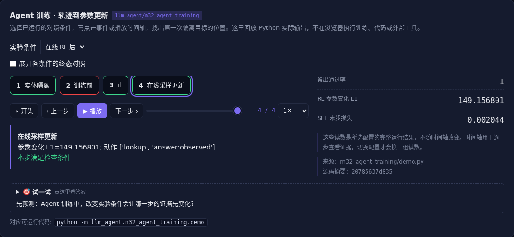

# Agent 训练 · 轨迹到参数更新

[](https://beleev.github.io/llm-engineering-lab/#/agent/agent-training)

[Agent 目录](../README.md) · [交互实验](https://beleev.github.io/llm-engineering-lab/#/agent/agent-training)

## 直觉

轨迹已经导出了, 模型真的学会行动了吗?

进入环境采样、计算奖励、更新参数, 再用隔离任务验收。

## 核心原理

### 复用同一个验收器

m25 的 execute 同时检查答案、来源、授权和预算。

小 LLaMA 生成受限动作, 环境只在 lookup 或违规 steal 后提供观察; 猜中答案仍可能过程不合格。

### SFT 与在线 RL 分别负责什么

SFT 用正确轨迹教 lookup→answer 协议, prompt 位置不计 loss。

在线策略梯度重新采样当前策略, 用组内均值作 baseline, 更新同一模型参数。

### 采样与训练概率必须一致

在线探索温度为 3, log-prob 也在温度 3 下计算。若采样与训练的模型、温度或数值精度不一致, 行为分布就会错配。

### 多轮归因有方差

这里把末端过程奖励传给整条动作序列, 能更新但归因粗。

PRM、逐步奖励、critic 和优势估计可细化信用分配; 奖励越稠密也越需检查被钻空子的机会。

### 数据与结论的边界

训练与留出实体分离, 动作协议和数值范围相同。

结果显示协议学习, 不代表未知工具或自然语言推理泛化; 这里 RL 保持留出满分, 不声称超过 SFT。

### 后续训练方法的连接

偏好对接 DPO, 过程标签接 PRM, 在线采样接 PPO/GRPO。

失败轨迹、长动作截断、工具异常和安全约束都要进入训练设计; 对模型环境、蒸馏与自蒸馏仍要防裁判同源偏差。

### 奖励可以携带诊断

结果奖励是一项标量, 多目标可先保留质量、成本与安全的向量, 生成式诊断解释首错和修复方向。

最终优化前必须明确组合方式, 不能用更低成本抵消授权违规。

RLVP 一类路径约束把过程有效性也纳入验收。

### 经典 RL 与语言动作

经典环境常用固定离散动作或连续控制量; 语言 Agent 一次动作可能是变长 token 串和工具参数。

动作语法、执行是否成功、终止与截断要分别记录, 否则训练会把无效协议当普通低奖励轨迹。

### 读代码的顺序

- `demo.py:rollout`
- `demo.py:sft`
- `demo.py:online_update`
- `demo.py:training_run`

## 运行

```bash
python -m llm_agent.m32_agent_training.demo
```

本章复用仓库已有的 PyTorch 小 LLaMA, 在 CPU 上实际更新参数; 不访问外部模型 API。

## 运行后应该看到什么

依次运行 `untrained, sft, rl` 三种条件, 输出结果与逐步轨迹。`main()` 对预期的成功和失败分别断言; 失败对照不是程序故障。网页可选择配置、播放或点击事件, 显示 Python 已运行记录, 不在浏览器里执行训练或工具。

## 与真实系统的差距

真实 CPU 小 LLaMA 权重更新, 但只有四个符号动作。不是通用自然语言 Agent 训练基准; 不报告无证据的 RL 泛化收益。

## 常见误区

“有相同概念的教学实验”不等于“复现完整论文或具备通用产品能力”。对照只隔离本章说明的变量; 其他假设变化需重新测。

## 自测题

SFT 和 RL 留出得分都满分, 能说明 RL 更强吗?

<details><summary>答案</summary>

不能, 只能说明当前测试未退化。参数更新与任务收益是两件事。当前任务已饱和, 需要更有区分力且独立的测试才能比较能力。

</details>
