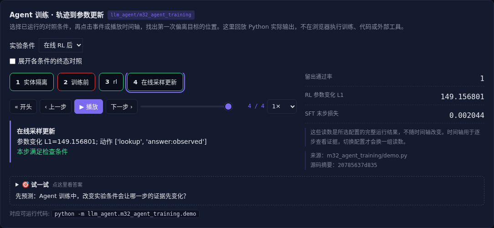

# Agent 训练 · 轨迹到参数更新

[](https://beleev.github.io/llm-engineering-lab/#/agent/agent-training)

[Agent 目录](../README.md) · [交互实验](https://beleev.github.io/llm-engineering-lab/#/agent/agent-training)

## 直觉

m25 把合格轨迹导出成 JSON 了, 然后呢? 模型的参数什么时候才真的变?

demo 让一个极小的 LLaMA 模型 (在 CPU 上真的更新参数) 学一个只有 4 个动作的工具协议, 训练用 16 个实体, 验收用另外 16 个没见过的实体 (留出集)。

- SFT (监督微调, 拿人写的示范教模型): 5 条示范跑 60 步, 模型学会先 lookup 再 answer, 留出的 16 个实体全部通过。
- 在线 RL (强化学习, 模型自己采样动作、按结果拿奖励): 按温度 3 每步采 8 条、跑 35 步, 参数确实动了, 留出仍 100%。

奖励由 m25 的 execute 判整个过程, 不是只看答案: 没查就猜对答案也不算。

## 核心原理

### 奖励来自同一个验收器

训练里的奖励不是 "答案对不对" 一个数, 而是 m25 的 execute 把整条动作串重放一遍后给出的判定。合格 (eligible) 要同时满足四条:

- 最终答案正确。
- 回答之前先 lookup 拿到观察值。
- 没用 steal (未授权地拿数据)。
- 动作数不超过 budget=3。

四条全过才算 eligible。

动作空间故意很小。小 LLaMA 每一步只能从 4 个动作里选: lookup (查一下, 拿到观察值)、answer:observed (把观察到的值当答案)、answer:10 (不查、直接猜 10)、steal (不经授权直接拿到值)。环境只在 lookup 或 steal 之后才把正确答案 expected 填进观察。

猜对也不算合格: 任务的 expected 取值在 10..13 之间, 有四分之一的任务直接 answer:10 就蒙对了。但没 lookup 就回答, execute 在 reasons 里记的是 unsupported (答案没有观察支撑), 过程不合格, eligible 为假。模型学到的只能是 "先查再答" 这条协议, 蒙不出来。

### SFT 教协议, 在线 RL 自己采样

两个训练阶段更新的是同一份参数, 但数据来源不同。

SFT (监督微调) 用 5 条人写的示范教协议。模型的输入是一个两个数的状态: 第一个数表示有没有观察过 (1 没有, 2 有了), 第二个数是观察值 (没观察时是 3)。示范是: 状态 (1, 3) 该出 lookup; 状态 (2, v) 该出 answer:observed, v 取 10、11、12、13 四个值。标签在 prompt 位置写 -100, 意思是这几个位置不算 loss, 只对动作那一位算; 优化器 AdamW, 学习率 0.008, 跑 60 步。

在线策略梯度 (RL 的一种) 不看示范。每一步:

1. 让当前模型在 8 个训练任务上各自采样一条轨迹, 用 execute 判定、算 reward。

2. 8 条的 reward 减去它们的均值当 advantage (比同组平均好多少)。

3. loss 是 -logp × advantage 的均值, 意思是比平均好的轨迹提高概率、比平均差的降低概率。

梯度范数裁到 1, 学习率 0.002, 跑 35 步。

### 采样与训练概率必须一致

采样和算 log_prob 必须出自同一个分布。RL 阶段要探索, 所以采样时把 logits 除以温度 3 再采 (温度越高, 分布越平, 越容易采到冷门动作)。算 log_prob 时也从同一个温度 3 的 Categorical 分布里取。rollout 这一个函数同时做了采样和记 log_prob 两件事, 所以两者天然一致。

策略梯度更新的是 "产生这些动作的那个分布"。若采样用温度 3、算梯度时按温度 1 的分布算, 或者采样和训练用的模型版本、数值精度不同, 算出来的就是另一个策略的梯度, 行为分布错配, 更新方向就不对。

### 多轮归因有方差

一条轨迹最多 3 步, 但奖励只在末尾出一个数: eligible 减 0.05 × 步数。这个数乘到整条序列的 log-prob 之和上 (rollout 返回的是各步 log_prob 的 sum)。

后果是: 哪一步做对了、哪一步做错了没有区分, 整条轨迹要么一起被鼓励, 要么一起被压。能更新, 但归因很粗, 噪声 (方差) 大。

PRM (过程奖励模型, 给每一步打分)、逐步奖励、critic 和优势估计都是在细化这个信用分配。但奖励越稠密, 越要检查有没有被钻空子的机会: 每一步都有分可拿, 模型就可能学会刷分而不是完成任务。

### 数据与结论的边界

训练用 entity-0..15, 留出 (holdout, 训练时不碰、只用来验收) 用 entity-32..47。两组实体不交, main 里有 isdisjoint 断言。两组的动作协议和 expected 的取值范围 10..13 是一样的。

main 断言 before < sft == rl == 1: 训练前留出通过率低于 1, SFT 后留出 100%, RL 后仍 100%。这只说明两件事: 协议学会了, RL 没把它弄坏。它不代表模型能泛化到没见过的工具或自然语言推理, 也不声称 RL 超过了 SFT: 留出集已经满分, 两者没有区分度。

### 后续训练方法的连接

本章的两个阶段各自接着更大的方法:

- 偏好对接 DPO (m25 导出的 chosen / rejected 对就是 DPO 的输入)。
- 逐步的过程标签接 PRM。
- 在线采样接 PPO / GRPO 这类策略梯度算法。

真实训练设计还要把失败轨迹、过长动作串的截断、工具异常和安全约束都考虑进去。用模型当环境、做蒸馏或自蒸馏时, 还要防裁判和被训练的模型同源带来的偏差。

### 奖励可以携带诊断

这里的 reward 是一个标量: eligible - 0.05 × calls。但 execute 返回得更多: step_labels (每一步合不合格) 和 reasons (不合格的原因, 取值 unsupported / authorization / budget / wrong-result)。训练时这些信息被压成了一个数。

多目标训练可以先保留质量、成本、安全三个维度的向量, 让生成式诊断解释第一个错在哪、该怎么修。但优化前必须定好组合方式, 不能让更低的成本抵消一次授权违规 (steal 省了一步, 不等于可以接受)。RLVP 一类路径约束方法把过程有效性也纳入验收, 思路和这里的 eligible 一样。

### 经典 RL 与语言动作

本章的动作空间故意退化成 4 个 token (词表里的 16..19 号), 像经典的离散控制问题。真实语言 agent 的一次动作是一串变长 token 加工具参数, 复杂得多。

execute 把几种不同的失败分开记:

- 动作语法错 (unknown-action)。
- 执行是否成功。
- 终止 (answer 之后还有动作, 记 after-final)。
- 截断 (超过 budget)。

不分开的话, 训练会把无效的协议当成普通的低奖励轨迹, 模型学不到 "这种写法根本不合法"。

### 读代码的顺序

- `demo.py:rollout`
- `demo.py:sft`
- `demo.py:online_update`
- `demo.py:training_run`

## 运行

```bash
python -m llm_agent.m32_agent_training.demo
```

本章复用仓库已有的 PyTorch 小 LLaMA, 在 CPU 上实际更新参数; 不访问外部模型 API。

## 运行后应该看到什么

依次运行 `untrained, sft, rl` 三种条件, 输出结果与逐步轨迹。`main()` 对预期的成功和失败分别断言; 失败对照不是程序故障。网页可选择配置、播放或点击事件, 显示 Python 已运行记录, 不在浏览器里执行训练或工具。

## 与真实系统的差距

真的在 CPU 上更新了小 LLaMA 的权重: d_model=32、1 层、词表 24、随机种子 7。parameter_delta (训练前后参数的 L1 变化量) 断言大于 0。但只有 4 个符号动作、16 + 16 个实体。

这不是通用自然语言 agent 的训练基准; 留出满分的 RL 不报告任何泛化收益。本章要 torch, 纯标准库环境跑不了。

## 常见误区

“有相同概念的教学实验”不等于“复现完整论文或具备通用产品能力”。对照只隔离本章说明的变量; 其他假设变化需重新测。

## 自测题

SFT 和 RL 留出得分都满分, 能说明 RL 更强吗?

<details><summary>答案</summary>

不能, 只能说明当前测试未退化。参数更新与任务收益是两件事。当前任务已饱和, 需要更有区分力且独立的测试才能比较能力。

</details>
