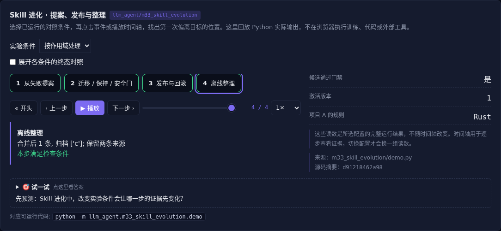

# Skill 进化 · 提案、发布与整理

[](https://beleev.github.io/llm-engineering-lab/#/agent/skill-evolution)

[Agent 目录](../README.md) · [知识覆盖表](../../docs/agent-book-coverage.md) · [交互实验](https://beleev.github.io/llm-engineering-lab/#/agent/skill-evolution)

## 直觉

从一次失败学到规则, 怎样避免影响别的项目?

先生成局部提案, 用迁移、保持和安全任务验收, 再发布版本。

## 核心原理

### 更新载体不只有记忆

知识修改事实, Prompt 修改决策顺序, Skill 保存可复用步骤, 程序修改执行机制, 参数修改模型概率。

四类载体使用不同检查, 不能用记住新事实代替全部学习。

### 提案来自已验证反馈

项目 A 的失败生成例外。直接把全局语言改成 Rust 会破坏 B 和安全用例; 局部提案通过后才发布, 验收集不进入提案生成输入。

### Skill 的三层加载

index.md 供发现, SKILL.md 供决策, rules.json 保存详细规则。

正文引用脚本或资源时还要检查路径、来源和执行权限; 描述命中不构成脚本执行授权。

### 睡眠学习是离线整合

按时间、轨迹数量、容量或错误频率触发, 在线只收证据。后台合并同范围重复项、保留来源、归档过期规则、重建索引, 经过回归再激活。

### 版本控制不能代替评估

可回滚让失败可恢复, 但不证明新规则可靠。程序更新还要测试和差异审查; 参数更新还要检查保持与安全。元优化比较学习方法本身, 见 m39。

### 怎样写一份可用的 Skill

先写触发条件、服务对象、步骤和输出验收。

核心规则带正反例, 禁止项注明合法例外, 资料和脚本放引用层。

用真实任务的失败与人工修改反推规则, 避免把一次对话全文直接当 Skill。

### 内容加载不等于固定角色

目录先可发现, 正文按需读取, 并不规定正文一定属于 system。

不同客户端可能用 user、developer 或工具结果承载, 需要按实际 API 与信任边界检查; 不能从加载位置推断自动提权。

### 读代码的顺序

- `demo.py:propose`
- `demo.py:SkillStore`
- `demo.py:curate`

## 运行

```bash
python -m llm_agent.m33_skill_evolution.demo
```

默认只用标准库与本仓库模块, 不访问外网。

## 运行后应该看到什么

依次运行 `global, scoped, rollback` 三种条件, 输出结果与逐步轨迹。`main()` 对预期的成功和失败分别断言; 失败对照不是程序故障。网页可选择配置、播放或点击事件, 显示 Python 已运行记录, 不在浏览器里执行训练或工具。

## 与真实系统的差距

规则提案器与本地文件发布, 不是自主生成任意自然语言 Skill。逐文件 replace 不构成跨文件原子事务, 并发发布需额外版本锁。

## 常见误区

“有相同概念的教学实验”不等于“复现完整论文或具备通用产品能力”。对照只隔离本章说明的变量; 其他假设变化需重新测。

## 自测题

候选修好了 A 却破坏 B, 发布前应该怎么办?

<details><summary>答案</summary>

拒绝全局候选, 缩小规则作用域。迁移收益不能掩盖负迁移。拒绝不合格提案, 再生成带作用域的规则。

</details>

## 延伸阅读

机制参考 [ai-agent-book 第 9 章](https://github.com/bojieli/ai-agent-book/blob/dbc046eb896ac4e39aa19c7774c8bf49583b89a6/book/chapter9.md#L56)。模型、指标与脚本为本仓库的教学实现, 边界如上。
