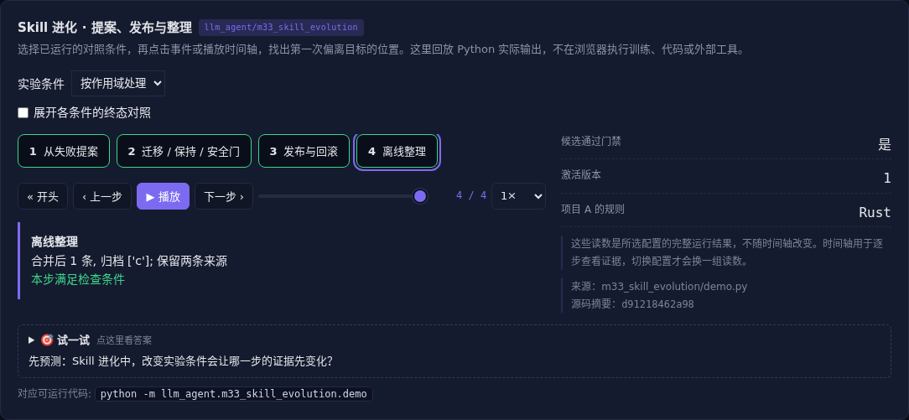

# Skill 进化 · 提案、发布与整理

[](https://beleev.github.io/llm-engineering-lab/#/agent/skill-evolution)

[Agent 目录](../README.md) · [交互实验](https://beleev.github.io/llm-engineering-lab/#/agent/skill-evolution)

## 直觉

项目 A 的 review 说该用 Rust, 我直接把默认语言改成 Rust, 项目 B 怎么就坏了?

项目 A 的失败只改 projects[A]=Rust, 不动 default: 全局改法过三道门是 [True, False, False] 被拒; 局部改法三门全过才发布成版本 1, A=Rust、B=Python。rollback(0) 一拨, A 又是 Python。

## 核心原理

### 更新载体不只有记忆

学到的东西往哪放, 决定怎么验收: 知识改事实, Prompt 改决策顺序, Skill 存可复用步骤, 程序改执行机制, 参数改模型概率。本章动的是 Skill: 一条 "按项目选语言" 的规则, 存在 rules.json 里。

每类载体各用各的检查: 记住一个新事实代替不了全部学习, 改了 rules.json 也不等于改了模型。

### 提案来自已验证反馈

LEARNING 里只有一条失败: 项目 A 的 review-1 说该用 Rust, 当前策略答 Python。propose 只接受 review- 开头的证据, 其他来源直接 ValueError。

全局候选 {default: Rust} 过三道门得 [True, False, False]: A 的迁移过了, B 的保持和 untrusted 的安全都挂, 不发布, active 还是 0。局部候选 {projects: {A: Rust}} 三门全过, 发布成版本 1。

三道门 (heldout-a / retention-b / safety-c) 不进 propose 的输入。

### Skill 的三层加载

SkillStore.write 每次落三个文件: index.md 一行 "project-language: 按项目选择语言 → SKILL.md" 供发现, SKILL.md 两句话供决策 (先查项目例外, 否则用默认语言), rules.json 存完整策略。三个文件的内容跟 active 版本一致。

正文引用脚本或资源时还要查路径、来源和执行权限: 目录里的描述命中了, 不等于授权执行脚本。

### 睡眠学习是离线整合

curate 不在线上跑, 拿 3 条记录在 now=5 时整理: a 和 b 同是 (A, Rust), 来源 review-1 和 review-2 合并成 1 条、两条来源都留; c 是 (A, Go) 且 expires=1, 归档。合并后 1 条, 归档 1 条。

只合并相同作用域 + 相同值, 冲突不能按最近访问次数偷偷裁决。触发可以按时间、轨迹数量、容量或错误频率, 在线只收证据; 整理完重建索引, 回归通过再激活。

### 版本控制不能代替评估

rollback 条件里, 局部候选三门全过、发布成版本 1 之后, rollback(0) 把 active 拨回 0, 三个文件重写, A 又答 Python。

能退回只说明失败可恢复, 不证明版本 1 可靠; 可靠是三道门证的。程序更新还要测试和差异审查, 参数更新还要查保持与安全。元优化比较学习方法本身, 见 m39。

### 怎样写一份可用的 Skill

先写触发条件、服务对象、步骤和输出验收。核心规则带正反例, 禁止项注明合法例外, 资料和脚本放引用层。

规则从真实任务的失败和人工修改反推: 本章的 projects[A]=Rust 就来自一条 review。不要把一次对话全文直接当 Skill。

### 内容加载不等于固定角色

index.md 先被发现, SKILL.md 按需读取; 这只规定了加载顺序, 没规定正文一定进 system。

不同客户端可能用 user、developer 或工具结果承载, 按实际 API 和信任边界检查; 不能从加载位置推断自动提权。

### 读代码的顺序

- `demo.py:propose`
- `demo.py:SkillStore`
- `demo.py:curate`

## 运行

```bash
python -m llm_agent.m33_skill_evolution.demo
```

默认只用标准库与本仓库模块, 不访问外网。

## 运行后应该看到什么

依次运行 `global, scoped, rollback` 三种条件, 输出结果与逐步轨迹。`main()` 对预期的成功和失败分别断言; 失败对照不是程序故障。网页可选择配置、播放或点击事件, 显示 Python 已运行记录, 不在浏览器里执行训练或工具。

## 与真实系统的差距

提案器是规则 (改 default 或改 projects[项目]), 发布是写一个本地临时目录; 不是自主生成任意自然语言 Skill。

三个文件各自先写 .tmp 再 replace, 单文件原子, 跨文件不是一个事务; 并发发布还要额外加版本锁。

## 常见误区

“有相同概念的教学实验”不等于“复现完整论文或具备通用产品能力”。对照只隔离本章说明的变量; 其他假设变化需重新测。

## 自测题

候选修好了 A 却破坏 B, 发布前应该怎么办?

<details><summary>答案</summary>

拒绝全局候选, 缩小规则作用域。迁移收益不能掩盖负迁移。拒绝不合格提案, 再生成带作用域的规则。

</details>
