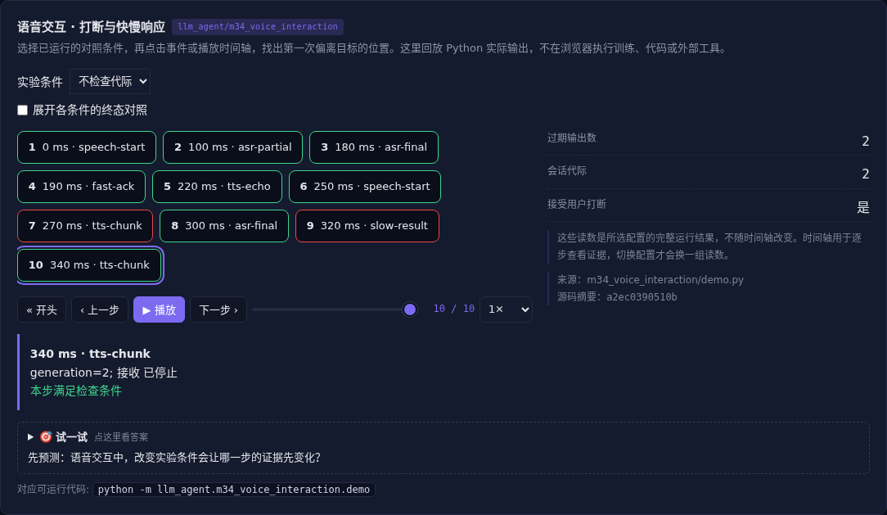

# 语音交互 · 打断与快慢响应

[](https://beleev.github.io/llm-engineering-lab/#/agent/voice-interaction)

[Agent 目录](../README.md) · [交互实验](https://beleev.github.io/llm-engineering-lab/#/agent/voice-interaction)

## 直觉

用户已经改口, 为什么系统还在播旧答案?

语音输入和输出可以重叠, 旧任务的音频仍要按 generation 丢弃。

## 核心原理

### 识别、推理与合成是不同阶段

VAD 判断说话边界, ASR 产生部分及最终转录, LLM 处理任务, TTS 分块播放。

级联系统便于替换组件, 原生 Omni 可联合建模但仍需控制状态。

### 全双工不能把回声当新用户

播放期间继续监听, 回声消除需要参考信号。示例用已知波形相减演示边界; 真实设备还有延迟、混响、串音和漏检。

### 快回应不等于快承诺

先播“正在查”降低等待感, 最终答案仍等工具结果。快慢双通道需要共享任务状态, 防止慢结果覆盖已经取消的新需求。

### 打断要传播到输出队列

用户新语音推进 generation, 旧 TTS 块和工具结果丢弃。仅停止当前声音却继续接受旧结果, 会稍后重新播出过期答案。

### 测量用户体验

区分首个响应延迟、最终答案延迟、打断到停播延迟和误打断率。时间线是给定事件, 不把这些数写成真实语音系统性能。

### 语音自然度不只看字准确

TTS 的音色、韵律、停顿和情感影响表达; 分块太短可能降低连贯性, 等完整句子又增加延迟。

流式感知还需保留时间戳、说话人和中断位置, 不应把多个音频片段简单当普通文字拼接。

### 读代码的顺序

- `demo.py:voice_activity`
- `demo.py:experiment`

## 运行

```bash
python -m llm_agent.m34_voice_interaction.demo
```

默认只用标准库与本仓库模块, 不访问外网。

## 运行后应该看到什么

依次运行 `half, duplex, no-generation` 三种条件, 输出结果与逐步轨迹。`main()` 对预期的成功和失败分别断言; 失败对照不是程序故障。网页可选择配置、播放或点击事件, 显示 Python 已运行记录, 不在浏览器里执行训练或工具。

## 与真实系统的差距

VAD 使用合成波形, ASR 与 TTS 事件是预设夹具。没有调用声学识别或合成模型; 重点是全双工和代际状态, 模型结构另见多模态阶段。

## 常见误区

“有相同概念的教学实验”不等于“复现完整论文或具备通用产品能力”。对照只隔离本章说明的变量; 其他假设变化需重新测。

## 自测题

打断后只停止播放器, 仍接收旧任务结果, 会怎样?

<details><summary>答案</summary>

旧结果可能重新进入播放队列。打断必须贯穿任务、结果和输出队列。只操作播放器不足以丢弃迟到事件。

</details>
