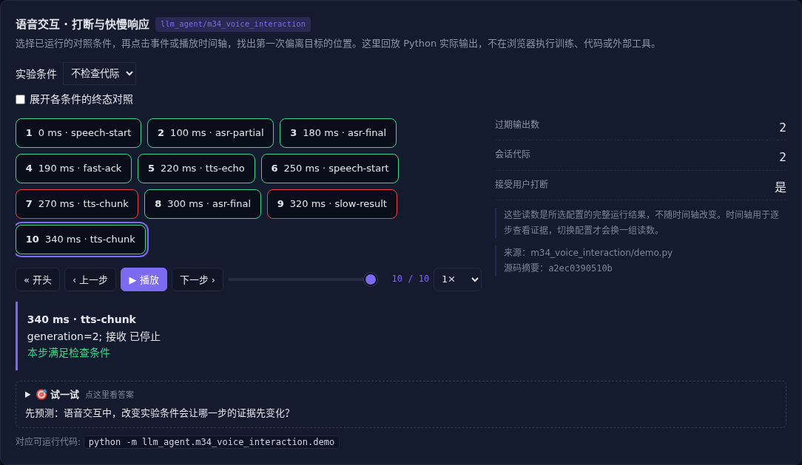

# 语音交互 · 打断与快慢响应

[](https://beleev.github.io/llm-engineering-lab/#/agent/voice-interaction)

[Agent 目录](../README.md) · [交互实验](https://beleev.github.io/llm-engineering-lab/#/agent/voice-interaction)

## 直觉

用户 300 ms 就说了 "停止查询", 为什么 320 ms 系统还把 "订单已发货" 播出来?

同一条 10 个事件的时间线: 半双工打不断, 3 条输出全是旧任务的; 全双工只停播放器会重播 2 条过期音频; 按 generation 丢弃后只剩 "正在查"、"已停止" 2 条, 过期 0 条。

## 核心原理

### 识别、推理与合成是不同阶段

时间线上 10 个事件分属四段: VAD 在 0 ms 判出 speech-start; ASR 100 ms 出部分转录 "查", 180 ms 出最终转录 "查订单"; LLM 侧 190 ms 先回 fast-ack "正在查", 320 ms 才出 slow-result "订单已发货"; TTS 按块播, 270 ms 一块 "旧结果"。

级联系统每段都能单独换件; 原生 Omni 把几段联合建模, 但 generation 这类状态照样要管。

### 全双工不能把回声当新用户

播放期间麦克风不关, 220 ms 收到的 tts-echo 是自己的声音, 三种条件都丢。

voice_activity 拿播放波形做参考逐样本相减, 剩余 rms > 0.05 才算人声: 纯回声 [0.1, -0.1] × 40 相减后是 0, 判无人声; 整体抬 0.2 后判有人声; 参考长度对不上直接 ValueError。

真实设备还有延迟、混响、串音和漏检, 已知波形相减只讲机制。

### 快回应不等于快承诺

asr-final 180 ms, fast-ack "正在查" 190 ms 就播, first_ack_ms=190; 真正的答案 "订单已发货" 320 ms 才到, 中间 130 ms 等的是工具。

快慢两条通道共享同一个 generation: duplex 条件下 slow-result 带的是代 1, 到达时已经是代 2, 丢弃; 慢结果盖不掉已取消的新需求。

### 打断要传播到输出队列

250 ms 用户再次开口, duplex 条件 generation 从 1 推到 2: 270 ms 的 tts-chunk "旧结果" (代 1) 丢, 320 ms 的 slow-result (代 1) 丢, 340 ms 的 "已停止" (代 2) 播。输出 ["正在查", "已停止"], stale=0。

no-generation 条件只停当前声音、照收旧结果: 输出 4 条, "旧结果" 和 "订单已发货" 在打断之后重新播出, stale=2。

### 测量用户体验

四个数分开报: 首个响应延迟 (这里 190 ms)、最终答案延迟、打断到停播延迟、误打断率。half 条件 interrupted=False, 用户 250 ms 的插话被丢, 打断根本没发生。

时间线是写死的 10 个事件, 190 ms 这类数字描述的是夹具, 不是真实语音系统的性能。

### 语音自然度不只看字准确

TTS 的音色、韵律、停顿和情感决定听感; 块切太短连贯性掉, 等完整句子延迟涨, 本章的粒度是 "旧结果"、"已停止" 这样一块一句。

流式感知要保留时间戳、说话人和中断位置 (Event 带 at 和 generation); 多个音频片段不能当普通文字直接拼接。

### 读代码的顺序

- `demo.py:voice_activity`
- `demo.py:experiment`

## 运行

```bash
python -m llm_agent.m34_voice_interaction.demo
```

默认只用标准库与本仓库模块, 不访问外网。

## 运行后应该看到什么

依次运行 `half, duplex, no-generation` 三种条件, 输出结果与逐步轨迹。`main()` 对预期的成功和失败分别断言; 失败对照不是程序故障。网页可选择配置、播放或点击事件, 显示 Python 已运行记录, 不在浏览器里执行训练或工具。

## 与真实系统的差距

VAD 只在 80 个合成样本上验了两次 (纯回声 / 回声整体抬 0.2); ASR 转录和 TTS 块是预设夹具, 没有调用任何声学识别或合成模型。

本章只看全双工和代际状态; 语音模型结构另见多模态阶段。

## 常见误区

“有相同概念的教学实验”不等于“复现完整论文或具备通用产品能力”。对照只隔离本章说明的变量; 其他假设变化需重新测。

## 自测题

打断后只停止播放器, 仍接收旧任务结果, 会怎样?

<details><summary>答案</summary>

旧结果可能重新进入播放队列。打断必须贯穿任务、结果和输出队列。只操作播放器不足以丢弃迟到事件。

</details>
