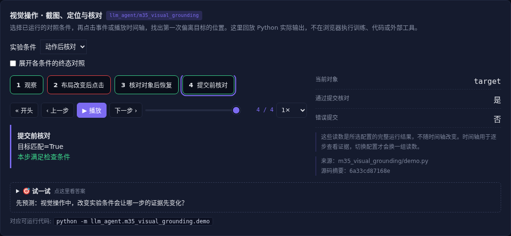

# 视觉操作 · 截图、定位与核对

[](https://beleev.github.io/llm-engineering-lab/#/agent/visual-grounding)

[Agent 目录](../README.md) · [交互实验](https://beleev.github.io/llm-engineering-lab/#/agent/visual-grounding)

## 直觉

我截图、找到绿色按钮中心 (29, 17)、点下去, 每一步都没错, 怎么打开的是另一个订单?

- 视觉定位 (visual grounding) 是从截图像素里算出目标在哪。demo 里同一个绿色按钮, 截图之后和红色按钮上下换了位:
- 按旧截图算出的坐标 (29, 17) 点下去, 打开的是另一个订单 (other)。
- 点击前重新截图, 坐标变成 (29, 52), 才打开目标 (target)。
- 点击只负责打开页面, 不负责提交。committed 只在核对 "打开的对象 == 目标" 之后才为真, 三种条件下都没有错误提交 (wrong_commit 都是 False)。

## 核心原理

### 从像素找到目标

截图是 80 × 80 的像素栅格, 每个像素一个 RGB 颜色。上面画了两个 40 × 16 的按钮: 绿色 (20, 180, 80) 是目标订单, 红色 (180, 40, 60) 是另一个订单。

locate 的做法: 找出所有绿色像素, 取它们的包围盒 (能框住全部绿像素的最小矩形) 的中心。按钮位置不同, 算出的中心不同:

- 目标按钮左上角在 (10, 10) 时, 绿像素 x 从 10 到 49、y 从 10 到 25, 中心是 (29, 17)。
- 左上角在 (10, 45) 时, 中心是 (29, 52)。

截图里一个绿像素都没有就抛 ValueError, 不猜坐标。

demo.py 用的是内存里画出来的栅格。browser.py 是同一套逻辑的真实版本: 用 Chromium 真截图、真鼠标点击, 同一个 locate 读真实像素, 所有网络请求被阻断。

### 观察和行动之间环境会变

坐标是对某一帧截图算的, 点击落在的却是点击那一刻的页面, 中间页面可以变。

render(shift=True) 把两个按钮上下换位, 模拟截图之后页面重排。hit 函数按当前布局判断一个点落在哪个按钮上。

- stale 条件: 按旧截图算出 (29, 17), 这时页面已经换位, (29, 17) 落在红色按钮上, hit 返回 other。坐标没算错, 算的是上一帧。
- refresh 条件: 点击前重新截图再定位, 得到 (29, 52), 落在绿色按钮上, 打开 target。

刷新只能保证截图那一刻是对的, 不能保证从截图到点击之间页面没有再变一次。

### 把导航和副作用分开

点击分两类: 导航 (打开一个页面, 点错了能退回来) 和副作用 (提交订单这类, 点错了撤不回)。demo 让点击只做导航, 提交另算。

三种条件里点击都只做一件事: 打开详情。committed 只在 opened == target 时为真:

- stale: 打开的是 other, committed=False。
- refresh: 打开 target, committed=True, 观察了 1 次。
- verify: 第一次也打开 other, 发现对象不符, 重新截图得到 (29, 52) 再点, 这次打开 target, committed=True, observations=2。

三种条件的 wrong_commit 全是 False: 误点能回退, 错误提交可能不可逆, 所以提交前的核对是独立的一步。需要事务、授权和人工确认的动作, 不能只看按钮上写的字。

### 不局限于浏览器

桌面和手机的自动操作是同一套结构: 感知 (截图)、动作空间 (点击 / 输入)、焦点和输入状态 (现在哪个窗口或输入框在接收输入)。这里的 80 × 80 栅格加 hit 函数就是这套结构的最小版本。

带音视频的界面还要在时间轴上采样, 不只看一帧。世界模型 (预测 "做了这个动作页面会变成什么样" 的模型) 可以先预测后果, 但预测仍要拿环境的真实反馈核对, 这和 verify 条件点完重截一次是同一件事。

### 读代码的顺序

- `demo.py:locate`
- `demo.py:hit`
- `demo.py:experiment`

## 运行

```bash
python -m llm_agent.m35_visual_grounding.demo
```

默认只用标准库与本仓库模块, 不访问外网。

真实浏览器版本是可选开发验证, 依赖 `playwright` 与 `pillow`:

```bash
python -m pip install playwright pillow
python -m playwright install chromium
python -m llm_agent.m35_visual_grounding.browser
```

它在 Chromium 中渲染本地页面、读取截图像素、点击并核对对象; 所有网络请求被阻断。

## 运行后应该看到什么

依次运行 `stale, refresh, verify` 三种条件, 输出结果与逐步轨迹。`main()` 对预期的成功和失败分别断言; 失败对照不是程序故障。网页可选择配置、播放或点击事件, 显示 Python 已运行记录, 不在浏览器里执行训练或工具。

## 与真实系统的差距

定位靠一种固定颜色, 不是通用的视觉语言模型; 两个同色元素会被算成一个包围盒的中心, 点到中间的空白处。

真实浏览器夹具在本地渲染、不联网, 要装 playwright 和 pillow。不声称能操作任意站点、桌面或手机。

## 常见误区

“有相同概念的教学实验”不等于“复现完整论文或具备通用产品能力”。对照只隔离本章说明的变量; 其他假设变化需重新测。

## 自测题

刷新截图后点中按钮, 何时才可以确认业务提交?

<details><summary>答案</summary>

核对当前对象和动作授权之后。几何定位不能证明业务对象与权限。导航后的核对是独立验收步骤。

</details>
