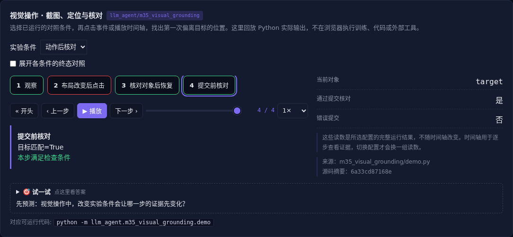

# 视觉操作 · 截图、定位与核对

[](https://beleev.github.io/llm-engineering-lab/#/agent/visual-grounding)

[Agent 目录](../README.md) · [知识覆盖表](../../docs/agent-book-coverage.md) · [交互实验](https://beleev.github.io/llm-engineering-lab/#/agent/visual-grounding)

## 直觉

截图上的坐标没算错, 为什么还是点错订单?

坐标属于一次观察, 提交前还要核对当前对象。

## 核心原理

### 从像素找到目标

定位器在截图里找目标颜色的区域中心。

默认 demo 用栅格图; browser.py 使用 Chromium 实际截图和鼠标点击, 同一个定位函数读取真实像素。

### 观察和行动之间环境会变

截图后交换两个订单按钮的位置, 旧坐标命中另一个订单。刷新截图可以更新坐标, 但不能保证点击瞬间页面没有再变。

### 把导航和副作用分开

点击先打开详情, 核对对象正确再提交业务动作。误点可以恢复, 错误提交则可能不可逆; 需要事务、授权和人工确认的动作不能只看按钮名字。

### 不局限于浏览器

桌面与手机都需要感知、动作空间、焦点和输入状态。音视频 GUI 还要采样时间轴; 世界模型可预测动作后果, 但预测仍需环境反馈核对。

### 读代码的顺序

- `demo.py:locate`
- `demo.py:hit`
- `demo.py:experiment`

## 运行

```bash
python -m llm_agent.m35_visual_grounding.demo
```

默认只用标准库与本仓库模块, 不访问外网。

真实浏览器版本是可选开发验证, 依赖 `playwright` 与 `pillow`:

```bash
python -m pip install playwright pillow
python -m playwright install chromium
python -m llm_agent.m35_visual_grounding.browser
```

它在 Chromium 中渲染本地页面、读取截图像素、点击并核对对象; 所有网络请求被阻断。

## 运行后应该看到什么

依次运行 `stale, refresh, verify` 三种条件, 输出结果与逐步轨迹。`main()` 对预期的成功和失败分别断言; 失败对照不是程序故障。网页可选择配置、播放或点击事件, 显示 Python 已运行记录, 不在浏览器里执行训练或工具。

## 与真实系统的差距

真实浏览器夹具没有联网, 定位靠特定颜色而非通用视觉语言模型。不会声称可操作任意站点、桌面或手机。

## 常见误区

“有相同概念的教学实验”不等于“复现完整论文或具备通用产品能力”。对照只隔离本章说明的变量; 其他假设变化需重新测。

## 自测题

刷新截图后点中按钮, 何时才可以确认业务提交?

<details><summary>答案</summary>

核对当前对象和动作授权之后。几何定位不能证明业务对象与权限。导航后的核对是独立验收步骤。

</details>

## 延伸阅读

机制参考 [ai-agent-book 第 6 章](https://github.com/bojieli/ai-agent-book/blob/dbc046eb896ac4e39aa19c7774c8bf49583b89a6/book/chapter6.md#L460)。模型、指标与脚本为本仓库的教学实现, 边界如上。
