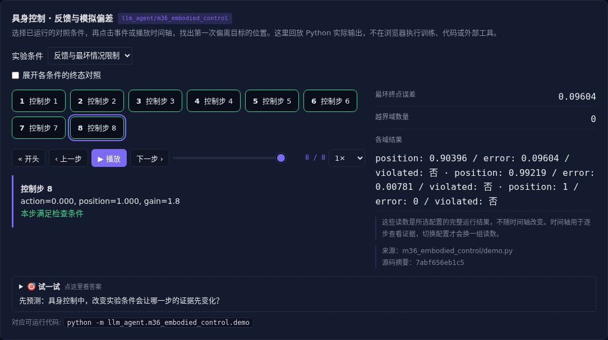

# 具身控制 · 反馈与模拟偏差

[](https://beleev.github.io/llm-engineering-lab/#/agent/embodied-control)

[Agent 目录](../README.md) · [交互实验](https://beleev.github.io/llm-engineering-lab/#/agent/embodied-control)

## 直觉

在模拟器中连发 5 步动作恰好停在目标位置 1.0, 换成增益为 1.8 的真实执行器后为什么会直接冲到 1.8?

模拟器标定的动作增益往往与真实执行器存在偏差, 直接照搬开环动作序列很容易冲过安全边界。本章用一维小车 (起点 0、目标 1.0, 每步位移等于「增益 × 动作」) 对比三种控制方式:
- 开环动作块 (连发 5 步 0.2, 中途不看位置): 标称增益 1.0 时刚好停在 1.0, 换成增益 1.8 的执行器直接冲到 1.8。
- 闭环位置反馈 (每步重测位置): 终点误差压到 0.026, 但中途仍越界 1 次。
- 按最坏增益 2.0 保守限幅: 全程 0 次越界, 代价是遇到偏慢执行器 (增益 0.6) 时 8 步只走到 0.904。

## 核心原理

### 动作块中途不看环境, 增益一变就越界

开环动作块在执行期间不读取位置反馈, 一旦执行器增益偏离标称值便会越过安全上限。本章 demo 采用一维离散运动模型: 位置 $x$ 从 0 出发, 目标 target=1.0, 安全上限 limit=1.0 (任意一步越过该上限即记为越界 violated)。每一步状态按 $x \leftarrow x + \text{gain} \times \text{action}$ 更新: action 是策略给出的控制动作, gain 是执行器增益, 代表单位动作实际产生的位移。模拟器中的标称增益为 gain=1.0, 而真实执行器的实际 gain 对策略而言事先未知。
对比开环与闭环两种控制方式:
- 开环动作块 (open-loop): 策略一次性给出前 5 步为 0.2、后 3 步为 0 的固定动作序列, 中途不重新观测位置。在标称增益 1.0 下, 5 步恰好停在 1.0, 终点误差为 0; 换成增益 1.8 的执行器后, 同一组动作每步实际推进 0.36, 第 3 步即到达 1.08 触发越界, 第 5 步冲至 1.8, 随后 3 步动作为 0, 最终停留在 1.8。
- 闭环反馈 (feedback): 每步重新测量当前位置 $x$, 按 clip(target - x, -0.25, 0.25) 朝剩余目标距离推进且单步幅度上限为 0.25, 将三种增益下的最大终点误差收敛至 0.026。
真实具身机器人的环境观测包含视觉画面、本体感知 (关节角度等自身状态) 与接触力信号, 动作输出则为力矩、关节角或末端位姿目标。单次下发的动作块越长, 模型推理调用越少, 但中途脱离环境反馈的盲走窗口也越长。

### VLA 与分层控制: 语言计划管不了越界

物理安全上限必须由高频低层控制回路守住, 高层语言规划无法替代底层安全约束。VLA (vision-language-action, 视觉-语言-动作模型) 将视觉输入与语言指令直接映射为底层动作, 输出既可采用离散动作 token, 也可采用连续分布。本章并未引入 VLA 网络: 高层等价于仅下发 target=1.0 这一标量目标, 低层则执行每步裁剪在 $\pm 0.25$ 内的固定控制律。
分层控制的核心在于高层负责任务拆解, 低层负责动态稳定性与约束保护。高层语言计划下达「走到 1.0」并不能阻止执行器越过安全上限 1.0: 在增益 1.8 下, 闭环反馈模式第 1、2 步实际各推进 0.45, 第 3 步仍冲到 1.08 发生越界, 越界之后才反向拉回。实时控制与碰撞限幅必须由低层控制器独立承担。

### 世界模型与规划: 模型偏差沿轨迹累积

动力学模型的参数偏差会在多步开环展开中沿轨迹持续累积放大。开环动作块本质上是基于标称模型 (假设增益为 1.0) 向前规划 8 步的结果: 策略预期每步推进 0.2, 5 步恰好抵达 1.0; 然而真实增益为 1.8 时每步实际推进 0.36, 单步多走 0.16, 经 5 步累加为 0.8 的终点误差。
引入闭环反馈等价于每步重新观测真实位置后再求解下一步动作 (即滚动规划), 将轨迹累积误差压缩至 0.026; 但单步内部的未建模增益风险依然存在: 第 3 步剩余距离为 0.1, 控制器给出动作 0.1, 实际物理位移却达到 0.18, 依然越界冲至 1.08。
借助动力学世界模型预测多条候选动作的未来状态再择优执行, 遵循同样的规划逻辑, 其多步预测结果同样会携带模型自身的近似偏差。

### Sim2Real: 三个增益上各跑一遍

Sim2Real (仿真到真机迁移) 要求将模拟器中设计或训练好的策略放到多组未知物理参数下检验鲁棒性, 单一标称环境下的零误差并不代表现实部署安全。demo 首先断言标称模拟器 (增益 1.0) 下开环终点误差为 0, 随后将执行器增益依次切换为 0.6、1.0、1.8 各运行 8 步, 统计最差终点误差与越界次数:
- 标称开环 (open-loop): 最差误差为 0.8 (增益 1.8 下停在 1.8), 越界 1 次。
- 闭环反馈 (feedback): 最差误差降至 0.026, 仍越界 1 次 (增益 1.8 下第 3 步冲至 1.08)。
- 最坏增益限幅 (robust): 最差误差为 0.096, 越界 0 次。
保守限幅的机制是假设执行器增益最坏可达 2.0 (即域随机化范围的上界), 在反馈动作之上再加一道上界约束, 令动作幅度不超过 $(\text{limit} - x) / 2$: 这样即便真实增益达到 2.0 也不会在下一步越界, 且全程不窥探未知的真实增益。其代价是在偏慢执行器 (增益 0.6) 上动作偏保守, 8 步结束仅走到 0.904。
工程上, 域随机化 (训练期随机采样增益)、系统辨识 (估计真实增益) 与真机校准彼此互补, 共同保障迁移安全。

### 读代码的顺序

- `demo.py:rollout`

## 运行

```bash
python -m llm_agent.m36_embodied_control.demo
```

默认只用标准库与本仓库模块, 不访问外网。

## 运行后应该看到什么

依次运行 `open-loop, feedback, robust` 三种条件, 输出结果与逐步轨迹。`main()` 对预期的成功和失败分别断言; 失败对照不是程序故障。网页可选择配置、播放或点击事件, 显示 Python 已运行记录, 不在浏览器里执行训练或工具。

## 与真实系统的差距

本实验仅模拟 8 步一维离散动力学过程, 未涉及真实多自由度机器人、接触力学或端到端训练的 VLA 模型。
robust 模式取得 0 次越界的结论仅在真实增益处于 0.6 至 1.8 区间 (保守限幅按上界 2.0 计算) 且位置观测完全精确的前提下成立: 实验中位置读数无噪声、无延迟。若真实增益超过 2.0, 或位置观测带有噪声与通信延迟, 该零越界结论便不能直接外推。

## 常见误区

“有相同概念的教学实验”不等于“复现完整论文或具备通用产品能力”。对照只隔离本章说明的变量; 其他假设变化需重新测。

## 自测题

域随机化测试通过, 能否保证任意真实执行器安全?

<details><summary>答案</summary>

不能, 真实条件可能超出训练范围。随机化覆盖有限分布, 真实观测误差、延迟与动力学还需独立验收。

</details>
