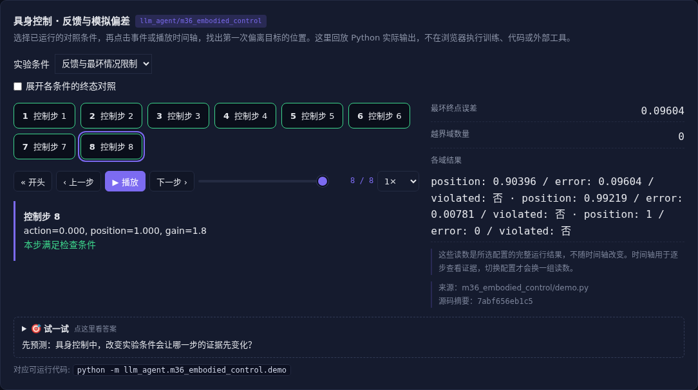

# 具身控制 · 反馈与模拟偏差

[](https://beleev.github.io/llm-engineering-lab/#/agent/embodied-control)

[Agent 目录](../README.md) · [知识覆盖表](../../docs/agent-book-coverage.md) · [交互实验](https://beleev.github.io/llm-engineering-lab/#/agent/embodied-control)

## 直觉

模拟器里刚好到达目标, 换个执行器为什么越界?

动作效果会漂移, 闭环反馈和最坏情况边界一起限制误差。

## 核心原理

### 观测、控制与动作块

机器人观测包括视觉、本体和接触信号, 动作可为力矩、关节或末端目标。长动作块减少推理次数, 却延长不看环境的时间; 反馈重新测量当前状态。

### VLA 与分层控制

VLA 将视觉、语言指令映射为动作, 动作可离散 token 或连续分布。

高层拆任务, 低层控制稳定性; 语言计划不能直接代替实时控制与碰撞限制。

### 世界模型与规划

用动力学预测多个候选动作的后果, 再选动作; 模型偏差会沿长轨迹放大。执行一段再观测的滚动规划减少累积误差, 但不能消除未建模风险。

### Sim2Real 需要变化的环境

本例改变执行器增益, 比较标称开环、反馈和最坏增益动作限制。域随机化、系统辨识和真实校准是互补方法, 在一个模拟器成功不代表现实安全。

### 读代码的顺序

- `demo.py:rollout`

## 运行

```bash
python -m llm_agent.m36_embodied_control.demo
```

默认只用标准库与本仓库模块, 不访问外网。

## 运行后应该看到什么

依次运行 `open-loop, feedback, robust` 三种条件, 输出结果与逐步轨迹。`main()` 对预期的成功和失败分别断言; 失败对照不是程序故障。网页可选择配置、播放或点击事件, 显示 Python 已运行记录, 不在浏览器里执行训练或工具。

## 与真实系统的差距

一维离散动力学模拟, 没有真实机器人、接触力学或训练 VLA。安全边界只在给定增益范围与精确观测假设下成立。

## 常见误区

“有相同概念的教学实验”不等于“复现完整论文或具备通用产品能力”。对照只隔离本章说明的变量; 其他假设变化需重新测。

## 自测题

域随机化测试通过, 能否保证任意真实执行器安全?

<details><summary>答案</summary>

不能, 真实条件可能超出训练范围。随机化覆盖有限分布, 真实观测误差、延迟与动力学还需独立验收。

</details>

## 延伸阅读

机制参考 [ai-agent-book 第 6 章](https://github.com/bojieli/ai-agent-book/blob/dbc046eb896ac4e39aa19c7774c8bf49583b89a6/book/chapter6.md#L585)。模型、指标与脚本为本仓库的教学实现, 边界如上。
