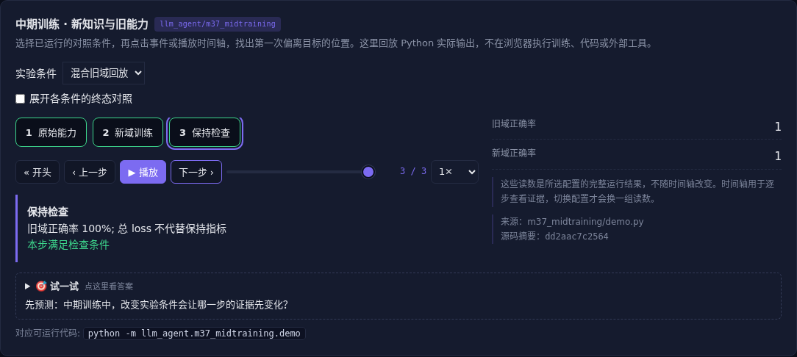

# 中期训练 · 新知识与旧能力

[](https://beleev.github.io/llm-engineering-lab/#/agent/midtraining)

[Agent 目录](../README.md) · [交互实验](https://beleev.github.io/llm-engineering-lab/#/agent/midtraining)

## 直觉

继续训练期间训练 loss 持续下降, 为什么原有任务的准确率反而从 100% 跌至 0%?

- 中期训练 (mid-training) 是在预训练之后继续以 next-token 预测目标在新领域语料上更新模型, 将领域知识直接写入底座权重。本章在小规模 LLaMA 上做对照实验: 仅在新域语料上继续训练 120 步, 新域准确率从 0% 升至 100%, 旧域准确率却从 100% 降至 0%; 由于训练 loss 全程单调下降, 仅监控新域 loss 无法发现旧能力退化。
- 改按 [2, 2, 1] 调度轮流采样 batch, 即每 3 步穿插 1 步旧域语料 (占比 1/3), 同样训练 120 步后新旧两个域的准确率均保持 100%。

## 核心原理

### 中期训练不是大剂量 SFT

中期训练、SFT 与 RL 处于模型训练管线的不同阶段, 各自修改的模型行为并不相同:
- 中期训练: 又称 mid-training, 位于预训练之后、对话微调之前, 继续沿用全序列 next-token 预测目标在领域语料、工具文档与长上下文数据上训练, 目的是将新知识写入底座模型权重。
- SFT: 使用对话样本训练并施加角色掩码, 仅对 assistant 回复区间的 token 计算 loss, 用户输入区间不计入梯度, 核心作用是规范交互格式而非注入新知识。
- RL: 在可评分的采样轨迹上重新分配输出概率, 提高高回报回答的生成概率。
本章 demo 仅实现第一阶段: 每条训练序列由 (域, key, 答案) 3 个 token 组成, 模型根据前两个位置预测后两个位置, 两个 next-token 位置均计算交叉熵 loss, 不做 assistant 角色掩码。工程上应根据具体失败原因选择对应的训练阶段。

### 新域 loss 降到底, 旧域正确率归零

仅监控新域的训练 loss 无法观测到旧能力的遗忘。实验复用单层小规模 LLaMA (词表 vocab 为 24, 隐层 d_model 为 32, 共 1 层), 语料为两组固定符号映射, key 取 4 到 11 共 8 个整数:
- 旧域 (domain 1): 输入 (1, key), 目标输出为 key 本身。
- 新域 (domain 2): 输入 (2, key), 目标输出为 key + 8。
实验先在旧域训练 100 步得到基座模型 base, 此时旧域准确率为 100%, 新域准确率为 0%。随后 domain-only 模式从 base 出发, 仅使用新域样本继续训练 120 步: 新域准确率从 0% 升至 100%, 但复测同一个模型的旧域表现时, 准确率已从 100% 跌至 0%。
训练 loss 之所以无法反映遗忘, 是因为它仅在当前输入的新域序列上求值, 只度量新域的拟合程度。为此 probe 函数对每个域独立执行三步探测:
1. 将 8 个 key 构造为 (域, key) 输入批次。
2. 在序列末尾位置取预测概率最大的 token (argmax), 与正确标签比对。
3. 计算该域的预测准确率。
只有将新旧两个域的探测指标分开报告, 新能力的提升才不会掩盖原有能力的遗忘。

### 混合回放与长度课程

抑制灾难性遗忘最直接的手段是在继续训练中按比例混入旧域回放语料。
replay 模式按 [2, 2, 1] 的 schedule 循环采样 batch: 第 1 步与第 2 步训练新域、第 3 步回放旧域, 即每 3 步中包含 1 步旧域复习。同样继续训练 120 步后, 新域准确率达到 100%, 旧域准确率也稳定保持在 100%; 旧域语料仅占训练步数的 1/3, 便足以守住原有符号映射。
上下文窗口扩展中的长度课程遵循同一思路: 逐级放大模型可处理的窗口长度, 并在每次扩窗后回测短上下文能力是否保持。不过标称窗口扩大并不代表远距离信息真正能被模型有效利用, 仍需额外补充长距离检索与多跳推理评测。本章实验未包含长度课程。

### 数据过滤与早停看两条曲线

中期训练的数据清洗、早停判据与阶段选型需同时兼顾新知识获取与旧能力保持。
- 训练前清洗: 过滤重复、低质与评测集污染语料 (防止测试题混入训练集), 并将验证集按数据来源与时间切分; 否则新域 loss 偏低可能只是模型记住了重复出现的样本。
- 训练中监控: 同时跟踪新域知识获取与旧域能力遗忘两条曲线, 早停判据必须综合两条曲线而非单看新域指标。本章 demo 仅在 120 步训练末尾探测了一次, 未绘制训练全过程曲线。
工程中可按失败原因选择对应的训练阶段:
- 底座缺知识: pass@k (独立采样 k 次至少做对一次的比例) 接近零, 说明模型本身缺乏该领域知识, 应先做中期训练补齐知识。
- 格式协议不稳: 回答格式或工具调用协议不匹配, 应先用 SFT 稳定输出格式。
- 候选存在奖励差距: 不同采样回答之间已能拉开奖励差异, 再引入 RL 优化输出分布。

### 读代码的顺序

- `demo.py:probe`
- `demo.py:continue_training`
- `demo.py:training_run`

## 运行

```bash
python -m llm_agent.m37_midtraining.demo
```

本章复用仓库已有的 PyTorch 小 LLaMA, 在 CPU 上实际更新参数; 不访问外部模型 API。

## 运行后应该看到什么

依次运行 `base, domain-only, replay` 三种条件, 输出结果与逐步轨迹。`main()` 对预期的成功和失败分别断言; 失败对照不是程序故障。网页可选择配置、播放或点击事件, 显示 Python 已运行记录, 不在浏览器里执行训练或工具。

## 与真实系统的差距

本实验执行了真实的参数梯度更新, 但语料仅限于玩具级固定符号映射。训练采用 AdamW 优化器, 学习率 lr 为 0.004, 随机种子 seed 为 19, 新旧两个域各含 8 条样本 (对应 8 个 key)。探测指标衡量的是已知符号映射的保持率, 不代表未见知识的泛化能力, 也不涉及真实长上下文训练。
实验结果呈现 100% 与 0% 的整齐读数, 是因为每个域仅有 8 个 key, 极易在更新后全部命中或全部覆盖; 真实领域语料上的能力遗忘通常表现为平滑下滑的曲线而非二值开关。
本章 demo 依赖 PyTorch 在本地 CPU 上运行, 不访问外部模型 API。

## 常见误区

“有相同概念的教学实验”不等于“复现完整论文或具备通用产品能力”。对照只隔离本章说明的变量; 其他假设变化需重新测。

## 自测题

新域 loss 下降而旧域正确率归零, 说明什么?

<details><summary>答案</summary>

新知识适应伴随旧能力遗忘。不同数据分布的能力必须分开测。混合语料、正则、回放和早停需要用保持指标验收。

</details>
