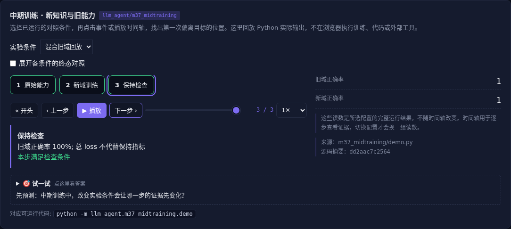

# 中期训练 · 新知识与旧能力

[](https://beleev.github.io/llm-engineering-lab/#/agent/midtraining)

[Agent 目录](../README.md) · [交互实验](https://beleev.github.io/llm-engineering-lab/#/agent/midtraining)

## 直觉

继续训练的 loss 很低, 为什么旧任务不会做了?

中期训练补底座, SFT 教协议, RL 调策略; 每一段都检查保持。

## 核心原理

### 中期训练不是大剂量 SFT

继续 next-token 学习领域语料、工具文档和长上下文; SFT 用角色遮罩教交互格式; RL 在可评分轨迹中重分配概率。

阶段选择取决于失败原因。

### 不要只看新域损失

本例复用小 LLaMA 学固定符号知识, 新域继续训练全部 token 位置。新域正确率之外单独探测旧域, 防止新能力遮住遗忘。

### 混合与课程

新旧语料混合帮助保留能力, 长度课程应逐级扩展并检查短上下文保持。标称窗口扩大不代表远距离信息可用, 需远距检索和推理测试。

### 数据和早停

过滤重复、低质和污染, 按来源与时间拆分训练验证, 观察知识获得和遗忘曲线。

若 pass@k 几乎为零先补知识, 协议失败先稳定格式, 有奖励差异再做 RL。

### 读代码的顺序

- `demo.py:probe`
- `demo.py:continue_training`
- `demo.py:training_run`

## 运行

```bash
python -m llm_agent.m37_midtraining.demo
```

本章复用仓库已有的 PyTorch 小 LLaMA, 在 CPU 上实际更新参数; 不访问外部模型 API。

## 运行后应该看到什么

依次运行 `base, domain-only, replay` 三种条件, 输出结果与逐步轨迹。`main()` 对预期的成功和失败分别断言; 失败对照不是程序故障。网页可选择配置、播放或点击事件, 显示 Python 已运行记录, 不在浏览器里执行训练或工具。

## 与真实系统的差距

训练真实更新权重, 但语料只有固定符号映射。探测衡量已知映射保持, 不称为未见知识泛化或真实长上下文训练。

## 常见误区

“有相同概念的教学实验”不等于“复现完整论文或具备通用产品能力”。对照只隔离本章说明的变量; 其他假设变化需重新测。

## 自测题

新域 loss 下降而旧域正确率归零, 说明什么?

<details><summary>答案</summary>

新知识适应伴随旧能力遗忘。不同数据分布的能力必须分开测。混合语料、正则、回放和早停需要用保持指标验收。

</details>
