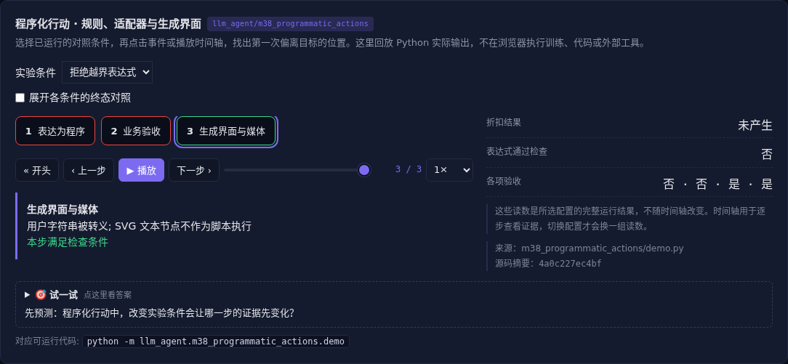

# 程序化行动 · 规则、适配器与生成界面

[](https://beleev.github.io/llm-engineering-lab/#/agent/programmatic-actions)

[Agent 目录](../README.md) · [交互实验](https://beleev.github.io/llm-engineering-lab/#/agent/programmatic-actions)

## 直觉

把规则写成代码, 就自动可靠了吗?

程序让执行可重复, 但规则、数据接口和生成结果仍须验证。

## 核心原理

### 代码是可执行的思考

算术、表格处理和复杂约束可交给解释器, 减少反复自然语言执行。错误规则写成代码只会稳定地执行错误, 所以仍需要边界用例。

### 能力形态按问题选择

专用工具提供稳定窄接口, 通用执行器组合能力强但风险大, Skill 说明何时怎样用。

运行时适配器把外部 Schema 转成内部协议, 不能静默接受接口漂移。

### 生成 UI 与媒体

数据和结构分开: 用户字符串转义后进入 HTML 文本, SVG 用文本节点生成。

媒体生成的程序表示便于编辑与复验, 不意味着生成的界面可以任意执行脚本。

### 自举也需要外部约束

Agent 可编写自己的适配器或测试, 但不能自己修改评分标准后证明进步。

只接受有限 AST 语法并计预算; 通用生成代码仍需真正的隔离执行环境。

### 读代码的顺序

- `demo.py:calculate`
- `demo.py:adapt`
- `demo.py:make_ui`
- `demo.py:make_svg`

## 运行

```bash
python -m llm_agent.m38_programmatic_actions.demo
```

默认只用标准库与本仓库模块, 不访问外网。

## 运行后应该看到什么

依次运行 `naive, validated, rejected` 三种条件, 输出结果与逐步轨迹。`main()` 对预期的成功和失败分别断言; 失败对照不是程序故障。网页可选择配置、播放或点击事件, 显示 Python 已运行记录, 不在浏览器里执行训练或工具。

## 与真实系统的差距

受限四则表达式与本地 HTML/SVG, 不执行任意 Python、JavaScript 或第三方 Skill 脚本。它展示表示方式, 不衡量通用生成质量。

## 常见误区

“有相同概念的教学实验”不等于“复现完整论文或具备通用产品能力”。对照只隔离本章说明的变量; 其他假设变化需重新测。

## 自测题

把错误业务规则改成确定性代码, 会怎样?

<details><summary>答案</summary>

错误会稳定复现, 仍需规则验收。可重复执行不是语义正确性。测试既要看程序行为, 也要验证规则适用范围。

</details>
