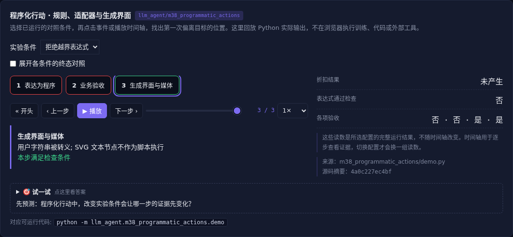

# 程序化行动 · 规则、适配器与生成界面

[](https://beleev.github.io/llm-engineering-lab/#/agent/programmatic-actions)

[Agent 目录](../README.md) · [交互实验](https://beleev.github.io/llm-engineering-lab/#/agent/programmatic-actions)

## 直觉

把业务折扣规则写成可执行代码交给解释器计算, 跑出来的数值就一定正确吗?

- 程序化行动让模型将计算与转换规则写成代码交由解释器求值, 替代不稳定的自然语言心算。代码执行只保证可重复性而不保证业务正确性: 写错的折扣公式 total * (1 - percent) 每次运行都会确定性地算出 -900。
- 完整的程序化行动需配合三道独立验收:
  - 业务用例验收: 用「期望 90」核验算式语义是否符合业务规则。
  - 受限 AST 白名单: 仅放行数字、变量与四则运算的语法树节点, 拒绝 __import__ 等任意函数调用。
  - 输出结构转义: 通过 html.escape 与 SVG 文本节点将用户字符串中的 、<script> 转为普通文本。

## 核心原理

### 代码是可执行的思考, -900 也执行得很稳

将算术计算、表格处理与复杂约束交给解释器求值, 比让模型反复做自然语言心算更稳定, 但确定性执行本身并不等同于业务正确。
同一个表达式代入相同变量时每次都会给出一致结果, 即便公式语义写错也是如此:
- naive 模式: 将折扣规则误写为 total * (1 - percent), 代入 total 为 100、percent 为 10 时, 由 1 减 10 得 -9, 再乘 100 算出 -900; 因语法合法, 解释器每次运行都会稳定返回 -900 而不报错。
- validated 模式: 将表达式修正为 total * (1 - percent / 100), 代入后由 1 减 0.1 得 0.9, 最终算出 90.0。
裁定哪条表达式正确的不是解释器, 而是「期望 90」这条外部业务用例: demo 在 trace 的「业务验收」环节将计算结果与 90 比对, naive 模式因「期望 90, 实际 -900」未通过验收。程序化执行不能替代边界测试用例。

### 工具、执行器、Skill 与适配器

让模型以代码方式行动通常借助专用工具、通用执行器与 Skill 三类载体, 并由独立适配器收口外部数据格式。
- 专用工具: 接口窄而边界清晰, 例如本章的 calculate 仅支持受限四则运算。
- 通用执行器: 允许运行任意生成代码, 组合能力强但安全风险高, 本章不开放此类执行器。
- Skill: 向模型说明何时以及如何组合调用上述工具的操作规范。
适配器函数 adapt 负责外部数据进入系统时的结构核验与单位换算。上游接口返回以分为单位的 {order_id, amount_cents}, 系统内部要求以元为单位的 {id, amount}: order_id 的 1004 转为字符串「1004」, amount_cents 的 1999 除以 100 换算为 19.99。转换前 adapt 严格校验字段集合必须恰好为 {order_id, amount_cents} 且 amount_cents 类型必须为 int; 字段增删或类型不符时直接抛出 ValueError「响应 Schema 不匹配」。上游发生接口漂移时适配器会当场报错拦截, 不会静默放行脏数据。

### 生成 UI 与媒体: 先转义再拼

程序化生成前端界面与图形媒体时, 必须将不可信的用户字符串与标记结构分离, 先完成转义或写入文本节点再组装输出。
- HTML 转义 (make_ui): 收到含事件注入属性的用户字符串  时, 先通过 html.escape 将 <、>、" 转换为字符实体 &lt;、&gt;、&quot;, 再填入 <h2> 标签。最终输出中不包含裸露的 <text> 节点树, 将 <script>not executable</script> 赋值给节点的 .text 属性而非直接拼接字符串。序列化后标签变为 &lt;script&gt;, 且仍可由 ET.fromstring 重新解析为合法 XML。
在 naive、validated 与 rejected 三种模式下, 这两项安全检查均保持通过, 与算式本身是否正确相互独立。用 SVG 等结构化程序表示生成媒体便于局部编辑与复验, 但并不意味着允许生成界面执行任意脚本。

### 自举也需要外部约束: AST 白名单

即使允许 Agent 自举编写适配器或测试代码, 验收标准与执行白名单也必须固定在受控边界之外。
一方面, Agent 不能修改评分标准来宣称性能提升: 「期望 90」这条验收用例固化在 experiment 函数内部, 模型生成的表达式无法篡改该判据。
另一方面, 表达式能否运行完全由 calculate 的语法树白名单裁决。函数先调用 ast.parse 将表达式解析为 AST (抽象语法树, 将代码拆解为运算、常量与变量节点的树状结构), 随后仅放行数字常量、已知变量名与四则运算 (+、-、*、/) 三类节点; 语法树节点总数超过 40 个即判定超预算, 除零、溢出或非有限浮点数一律抛出 ValueError。求值全程不调用 eval, 不会将输入字符串当作任意 Python 代码执行。
在 rejected 模式下, 输入表达式 __import__('os').system('echo unsafe') 解析出函数调用 Call 节点, 因不在白名单内被当场拒绝, 返回 amount 为 None。
受限 AST 白名单只是开销最低的一层约束; 若要运行通用生成代码, 仍需额外部署隔离沙箱环境。

### 读代码的顺序

- `demo.py:calculate`
- `demo.py:adapt`
- `demo.py:make_ui`
- `demo.py:make_svg`

## 运行

```bash
python -m llm_agent.m38_programmatic_actions.demo
```

默认只用标准库与本仓库模块, 不访问外网。

## 运行后应该看到什么

依次运行 `naive, validated, rejected` 三种条件, 输出结果与逐步轨迹。`main()` 对预期的成功和失败分别断言; 失败对照不是程序故障。网页可选择配置、播放或点击事件, 显示 Python 已运行记录, 不在浏览器里执行训练或工具。

## 与真实系统的差距

本章 demo 仅处理受限四则算术表达式与本地 HTML/SVG 字符串构造, 不执行任意 Python、JavaScript 或第三方 Skill 脚本。
实验聚焦于行动载体的核验方式, 即计算规则、数据适配器与生成界面三者各自的验收机制, 不评估通用代码生成的模型质量。最多 40 个语法树节点且仅允许四则运算属于教学简化设定, 无法直接承载复杂的生产业务规则。

## 常见误区

“有相同概念的教学实验”不等于“复现完整论文或具备通用产品能力”。对照只隔离本章说明的变量; 其他假设变化需重新测。

## 自测题

把错误业务规则改成确定性代码, 会怎样?

<details><summary>答案</summary>

错误会稳定复现, 仍需规则验收。可重复执行不是语义正确性。测试既要看程序行为, 也要验证规则适用范围。

</details>
