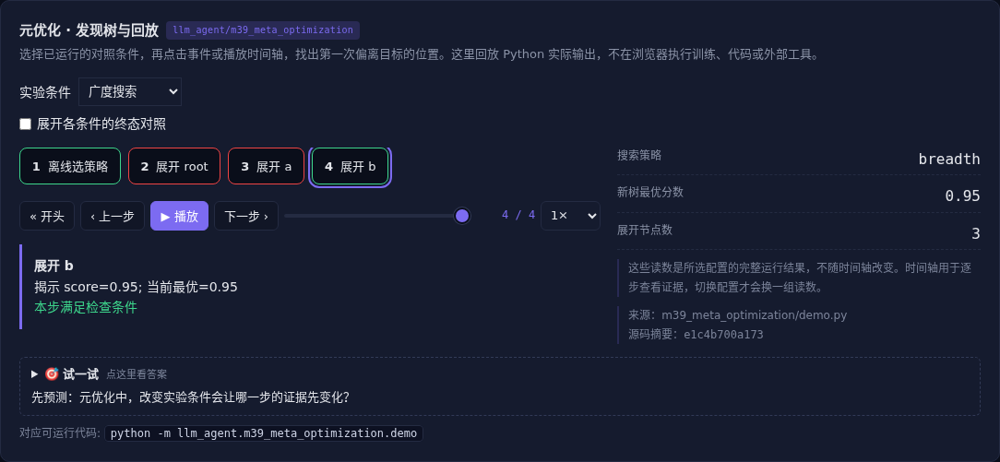

# 元优化 · 发现树与回放

[](https://beleev.github.io/llm-engineering-lab/#/agent/meta-optimization)

[Agent 目录](../README.md) · [交互实验](https://beleev.github.io/llm-engineering-lab/#/agent/meta-optimization)

## 直觉

回放历史选出的搜索策略分更高了, 拿到新任务上为什么反而更差?

- 元优化改的不是模型知道什么, 而是 agent "怎么探索": 本章比较两个搜索策略, breadth (按发现顺序展开节点) 和 prior (先展开先验分 prior 最高的节点)。
- 在训练树上回放历史, prior 策略拿到 0.9, breadth 0.8, 离线选中 prior。换到一棵没见过的留出树, prior 只拿到 0.2, breadth 拿到 0.95。回放只能重组走过的分支, 选出来的策略还要过一次留出树才算数。

## 核心原理

### 优化的对象上移一层

先说 "元优化" 在改什么。给 agent 做改进有三层, 改的东西不同: 知识更新改模型知道什么 (比如继续训练); 程序更新改怎么执行 (比如改工具、改流程); 元优化改的是 "怎么存取信息、怎么组织探索", 也就是改那套决定下一步看哪里的策略本身。

本章优化的就是搜索策略。把任务想成一棵树, 每个节点是一个可以尝试的方向, 展开一个节点才知道它好不好。两个候选策略: breadth 按节点被发现的先后顺序展开; prior 每次展开 prior (先验分, 展开之前就能看到的一个估计) 最高的那个。

候选也可以是一段 Prompt、一条工作流、一个 Harness (跑 agent 的外层程序), 不限于代码。要分清两件事: 机制是 "用什么办法选出更好的策略", 更新载体是 "策略本身是一段代码还是一段 prompt"。本章讲机制, 载体恰好是两段固定代码。

### 发现树只露前沿, expand 才揭示 score

离线回放要有用, 前提是策略在回放里看到的信息, 不能比在线时多。

发现树里每个 Node 存三样: prior (展开前就可见的先验分)、score (展开后才揭示的真实得分) 和 children (子节点)。ReplayWorld 维护一个前沿 frontier, 也就是 "已经发现、还没展开" 的节点集合, 一开始只有 root。options() 只返回前沿里每个节点的 prior, 不给 score, 也不给子节点。expand(节点) 才把它从前沿拿掉, 揭示它的 score, 更新当前最优 best, 再把它的子节点连同各自的 prior 放进前沿。

策略在 budget = 3 内选 3 个节点展开。训练树上 root 展开后, 前沿是 a (prior 0.9) 和 b (prior 0.2): breadth 取最早发现的 a, 再取 b, 路线 root → a → b; prior 取 a, a 展开后前沿多了 c (prior 0.8), 再取 c, 路线 root → a → c。

想绕过去直接对一棵新树 expand('b'): b 还没被发现 (root 没展开), 抛 ValueError "节点尚未被发现或已展开"。离线评估偷看不了未来。

### 回放省成本, 但造不出新分支

回放省的是真实调用的钱。在线评估一个策略, 每展开一个节点都要让底层 Agent 真跑一次; 回放用记录好的树当世界, 2 个策略 × 2 棵树 × 3 次展开, 一共 0 次真实调用。

代价是回放只能重组历史里走过的分支。树里没有的节点, 策略再聪明也发现不了: 回放里永远不会冒出一个历史上没试过的新方向。

为了让在线和离线的结果可比, 两边用同一套决策接口: 策略只能先 options() 看前沿, 再 expand() 展开一个。预算 (展开几次) 和顺序 (先展开谁) 在两边意义相同, 比出来的差异才是策略本身的差异。

### 元过拟合: 训练树 0.9, 留出树 0.2

这条讲的是: 在历史上选出的最优策略, 可能只是贴合了历史的形状, 换个环境就不灵, 这叫元过拟合。

训练树上: prior 策略走 root → a → c, c 的 score 是 0.9, best 0.9; breadth 走 root → a → b, b 的 score 0.8, best 0.8。离线按 best 选, 选中 prior。

留出树 (test 树, 选策略时没用过) 上: a 的 prior 还是 0.9, 但 score 掉到 0.1; c 掉到 0.2; b 变成 0.95。prior 策略还是走 root → a → c, 只拿到 0.2; breadth 还是走 root → a → b, 拿到 0.95。

历史最优只是历史内的保证。selected 模式演示正确做法: 保留两个策略在训练树上的成绩 (train 字段), 把选中的 prior 拿到留出树上验证, 报告 cost = 3 (展开了 3 个节点) 和失败 (best 0.2 低于 breadth 的 0.95)。main 里的断言就是 selected 的 best 必须小于 breadth 的 best。

### 读代码的顺序

- `demo.py:ReplayWorld`
- `demo.py:search`

## 运行

```bash
python -m llm_agent.m39_meta_optimization.demo
```

默认只用标准库与本仓库模块, 不访问外网。

## 运行后应该看到什么

依次运行 `breadth, prior, selected` 三种条件, 输出结果与逐步轨迹。`main()` 对预期的成功和失败分别断言; 失败对照不是程序故障。网页可选择配置、播放或点击事件, 显示 Python 已运行记录, 不在浏览器里执行训练或工具。

## 与真实系统的差距

固定两棵 4 节点的发现树 (root、a、b、c) 和两个程序策略, 没有在线自动写代码, 也没复现论文规模实验。

prior 是 TREES 里写死的数字, 不假装是模型置信度。留出树故意把 a 的高 prior (0.9) 配上 0.1 的 score, 元过拟合是构造出来的; 真实搜索里它多严重要另测。

main 断言的只有三件事: 离线选中的是 prior, prior 在训练树上确实高于 breadth, 以及它在留出树上确实输给 breadth。

## 常见误区

“有相同概念的教学实验”不等于“复现完整论文或具备通用产品能力”。对照只隔离本章说明的变量; 其他假设变化需重新测。

## 自测题

策略在训练发现树上更好, 能否直接上线替换?

<details><summary>答案</summary>

不能, 还要新任务验证和回滚点。离线树覆盖有限, 策略可过拟合旧分支结构。新任务是独立检验。

</details>
