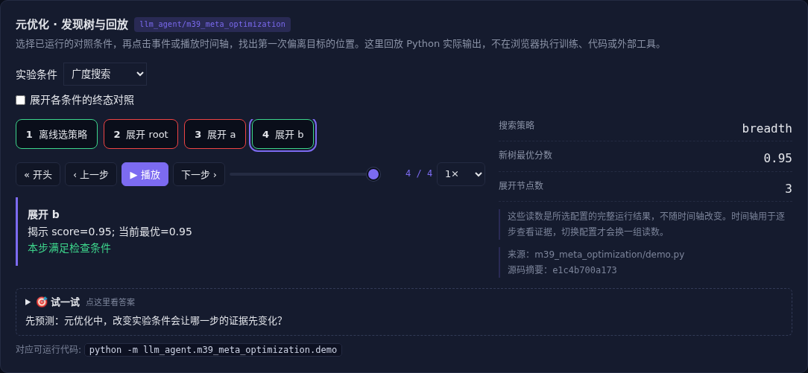

# 元优化 · 发现树与回放

[](https://beleev.github.io/llm-engineering-lab/#/agent/meta-optimization)

[Agent 目录](../README.md) · [知识覆盖表](../../docs/agent-book-coverage.md) · [交互实验](https://beleev.github.io/llm-engineering-lab/#/agent/meta-optimization)

## 直觉

历史回放分数提高, 为什么新任务反而更差?

回放只能重组走过的分支; 学习搜索方法也需要独立测试。

## 核心原理

### 优化的对象上移一层

知识更新改变知道什么, 程序更新改变怎么执行, 元优化改变如何存取信息或组织探索。

候选可以是 Prompt、工作流、Harness 或搜索策略, 不能混淆机制和更新载体。

### 发现树保留可回放过程

每个节点保存历史评分和后继。策略只看已经发现的前沿及先验, 选择展开才看到得分, 防止离线评估偷看未来。

### 复用反馈不等于预测世界

回放省下重复调用底层 Agent 的成本, 但不能生成历史中没发生过的分支。在线和离线决策接口一致, 才有可比的预算和顺序。

### 验证元过拟合

训练树选择按先验搜索, 留出树却更适合广度搜索。历史最优只是历史内保证; 保留旧策略、用新任务验证、报告探索成本和失败。

### 读代码的顺序

- `demo.py:ReplayWorld`
- `demo.py:search`

## 运行

```bash
python -m llm_agent.m39_meta_optimization.demo
```

默认只用标准库与本仓库模块, 不访问外网。

## 运行后应该看到什么

依次运行 `breadth, prior, selected` 三种条件, 输出结果与逐步轨迹。`main()` 对预期的成功和失败分别断言; 失败对照不是程序故障。网页可选择配置、播放或点击事件, 显示 Python 已运行记录, 不在浏览器里执行训练或工具。

## 与真实系统的差距

固定发现树与两个程序策略, 没有在线自动写代码或复现论文规模实验。先验只是给定信号, 不假装是模型置信度。

## 常见误区

“有相同概念的教学实验”不等于“复现完整论文或具备通用产品能力”。对照只隔离本章说明的变量; 其他假设变化需重新测。

## 自测题

策略在训练发现树上更好, 能否直接上线替换?

<details><summary>答案</summary>

不能, 还要新任务验证和回滚点。离线树覆盖有限, 策略可过拟合旧分支结构。新任务是独立检验。

</details>

## 延伸阅读

机制参考 [ai-agent-book 第 9 章](https://github.com/bojieli/ai-agent-book/blob/dbc046eb896ac4e39aa19c7774c8bf49583b89a6/book/chapter9.md#L256)。模型、指标与脚本为本仓库的教学实现, 边界如上。
