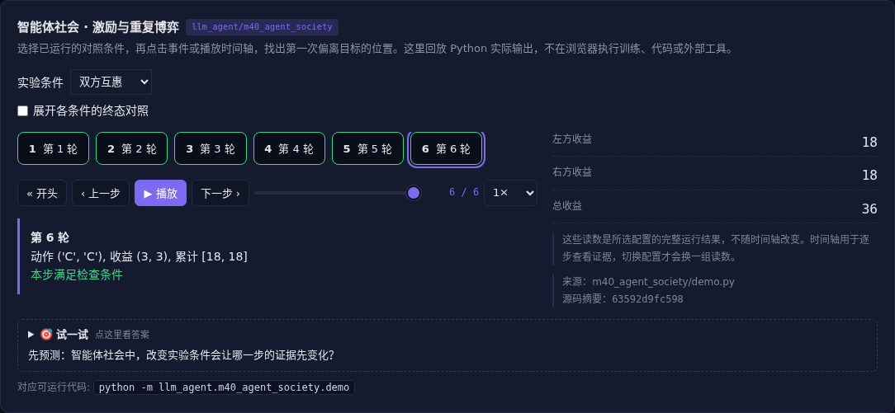

# 智能体社会 · 激励与重复博弈

[](https://beleev.github.io/llm-engineering-lab/#/agent/agent-society)

[Agent 目录](../README.md) · [知识覆盖表](../../docs/agent-book-coverage.md) · [交互实验](https://beleev.github.io/llm-engineering-lab/#/agent/agent-society)

## 直觉

每个 Agent 都优化自己, 集体会更好吗?

个体奖励、公共目标和交互历史共同决定协作结果。

## 核心原理

### 从任务协作到长期社会

长期 Agent 需要身份、记忆、关系和信息传播机制。小镇式模拟可观察日程和关系演化, 但模拟行为不是现实人类规律。

### 个体最优可能损害集体

固定收益矩阵中背叛合作方获得高个体收益, 双方都背叛却总收益更低。市场、谈判和竞价同样要检查奖励与公共约束。

### 重复交互改变激励

互惠策略记住上一轮对方行为, 对持续合作与持续利用给出不同结果。声誉、预算、契约和退出机制会改变长期行为。

### 评估社会实验

区分个人收益、总收益、分配不均、规则违规与长期稳定性。对角色、信息、网络结构和奖励分别消融; 相关模型偏差可能放大群体假象。

### 信息不对称与策略博弈

隐藏角色游戏中, 每个 Agent 只能看到自己的信息与公开消息。

实验必须限制观察接口, 防止把其他角色状态泄漏给策略。

讨论、承诺、欺骗和投票的收益取决于规则, 不能从一个固定游戏外推社会行为。

### 读代码的顺序

- `demo.py:action`
- `demo.py:play`

## 运行

```bash
python -m llm_agent.m40_agent_society.demo
```

默认只用标准库与本仓库模块, 不访问外网。

## 运行后应该看到什么

依次运行 `exploit, mutual, reciprocal` 三种条件, 输出结果与逐步轨迹。`main()` 对预期的成功和失败分别断言; 失败对照不是程序故障。网页可选择配置、播放或点击事件, 显示 Python 已运行记录, 不在浏览器里执行训练或工具。

## 与真实系统的差距

规则策略的重复囚徒困境, 没有 LLM 社会仿真、真实市场或人类行为推断。结论只属于给定收益矩阵和策略。

## 常见误区

“有相同概念的教学实验”不等于“复现完整论文或具备通用产品能力”。对照只隔离本章说明的变量; 其他假设变化需重新测。

## 自测题

个体奖励提高, 是否代表多 Agent 系统整体改善?

<details><summary>答案</summary>

不一定, 总收益和违规也要检查。局部激励可能与公共目标冲突。重复互动和机制设计会改变这种关系。

</details>

## 延伸阅读

机制参考 [ai-agent-book 第 10 章](https://github.com/bojieli/ai-agent-book/blob/dbc046eb896ac4e39aa19c7774c8bf49583b89a6/book/chapter10.md#L581)。模型、指标与脚本为本仓库的教学实现, 边界如上。
