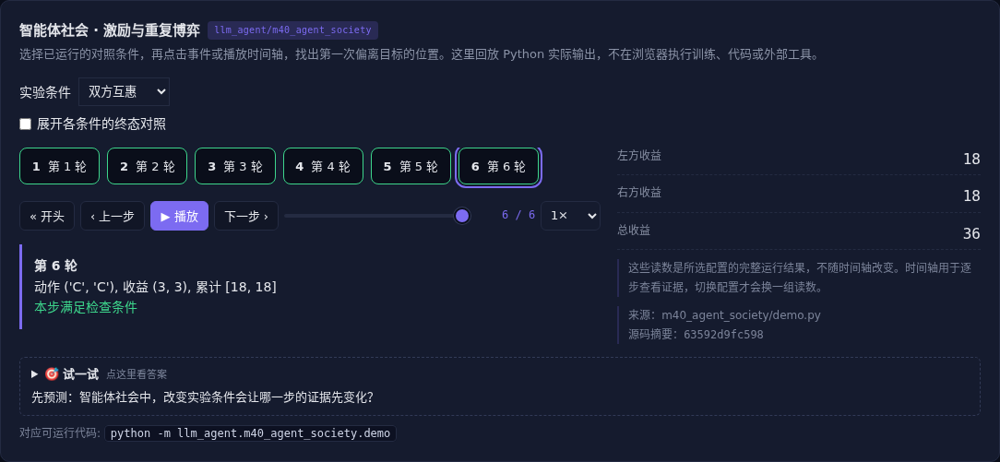

# 智能体社会 · 激励与重复博弈

[](https://beleev.github.io/llm-engineering-lab/#/agent/agent-society)

[Agent 目录](../README.md) · [交互实验](https://beleev.github.io/llm-engineering-lab/#/agent/agent-society)

## 直觉

当系统中的每个 Agent 都只最大化自身得分时, 集体总收益会随之变好吗?

当每个智能体只最大化自身得分时, 个体理性往往会把集体总收益拉向双输。本章用 6 轮重复囚徒困境对比不同策略的个体得分与总收益:
- 背叛者对阵无条件合作者: 背叛者单方拿走 30 分。
- 双方持续背叛: 各自只拿 6 分, 总收益跌至 12 分。
- 互惠策略 (首轮合作, 之后照抄对方上一轮动作): 互惠双方各拿 18 分、总收益达 36 分, 遭遇背叛者时也能将对方压制在 10 分。
评估多智能体交互时, 个体收益、总收益与被利用损失需要分开统计。

## 核心原理

### 从任务协作到长期社会

长期共存的多智能体系统与一次性任务协作的核心区别在于需要维护持久身份、历史记忆、关系状态与信息传播机制。前序多智能体章节旨在合力完成单次任务, 任务结束后协作关系即销毁; 而在持续交互场景中, Agent 需要识别交互对象并记住对方过往的博弈行为。
本章仅引入最小粒度的一种跨轮记忆: reciprocal (互惠) 策略只读取对手上一轮的动作 opponent_history[-1]。连续 6 轮对局构成一段最短的关系演化史, 当前轮次的每一次选择都会被对手在下一轮读取并响应。
本实验未调用 LLM, 两个 Agent 均为硬编码的确定性规则策略。即便在小镇式的 LLM 社会模拟中能够观察到角色日程与社交关系演化, 模拟呈现的行为也并非现实人类社会规律; 本章的三组对局同样只刻画给定收益矩阵下的策略互动。

### 个体最优把总收益压到 12

当每个 Agent 独立最大化自身单轮收益时都会选择背叛, 6 轮累计集体总收益会被压缩至 12 分。每轮两个 Agent 同步选择 C (合作) 或 D (背叛), 按收益矩阵 PAYOFF 结算双方得分 (括号内依次为左方与右方得分):
- 双方合作 CC: 记为 (3, 3), 双方各得 3 分。
- 单方背叛 CD 与 DC: 分别记为 (0, 5) 与 (5, 0), 背叛方得 5 分、合作方得 0 分。
- 双方背叛 DD: 记为 (1, 1), 双方各得 1 分。
单轮博弈中无论对手出 C 还是 D, 自己选择 D 的得分都高于选择 C (对手出 C 时 5 分高于 3 分, 对手出 D 时 1 分高于 0 分), 因此 D 是严格占优策略。demo 的前两组对局展示了这一结果:
- 单方剥削 (exploit): 左方 defect (每轮出 D) 对阵右方 cooperate (每轮出 C), 每轮结算 (5, 0), 6 轮累计背叛方得 30 分、合作方得 0 分, 总收益为 30 分。
- 相互背叛 (mutual): 双方均采用 defect, 每轮结算 (1, 1), 6 轮累计各得 6 分, 总收益仅为 12 分, 比双方全程合作的 36 分损失了 24 分。
市场撮合、自动谈判与竞价中的多 Agent 系统同样需要核查这一机制: 奖励信号是个体的, 约束条件却是公共的, 默认没有单一主体为集体总收益负责。

### 记住上一轮, 背叛只拿 10

引入上一轮动作记忆后, 当期背叛会触发后续轮次的报复, 使背叛方的 6 轮累计得分被压制在 10 分。reciprocal 策略遵循一条极简规则: 第 1 轮主动出 C, 之后每轮直接复刻对手上一轮的动作, 对方合作则继续合作, 对方背叛则下一轮回击 D。
- 互惠双方对局: 第 1 轮双方同出 C, 随后每轮持续复刻对方的 C, 6 轮全程维持 (C, C), 各自累计 18 分, 总收益达到 36 分。
- 互惠对阵背叛: 即 reciprocal 对阵 defect, 第 1 轮 reciprocal 出 C 遭遇对方出 D, 单轮记为 (0, 5); 从第 2 轮起 reciprocal 复刻对方的 D, 剩余 5 轮均为 (1, 1)。背叛方 6 轮累计只拿到首轮 5 分加后续 5 分共 10 分, 而非对阵无条件合作者时的 30 分。
当持续合作能拿 18 分而持续投机只能拿 10 分时, 单方背叛的激励便大幅削弱。声誉机制、配额预算、显式契约与退出权在博弈结构上同属一类设计: 让当期动作直接影响未来轮次的可得收益。

### 评估社会实验: 三种收益分开算

评估多智能体交互不能只报告单一汇总分数, 必须将个体收益、集体总收益与抗剥削损失分项统计。demo 的 main 函数设置三条独立 assert 分别核查这三项指标:
- 个体收益: exploit 模式下背叛方的 30 分高于 reciprocal 下的 18 分; 若只看单方个人分数, 背叛策略会被判为赢家。
- 集体总收益: mutual 模式下的总收益 12 分低于 reciprocal 下的 36 分; 从群体总分衡量, 互惠策略才是赢家。
- 抗剥削边界: defect 对阵 reciprocal 时仅拿到 10 分而非 30 分, 该指标专门检验合作策略能否避免被无偿剥削。
三项读数分别指向不同维度的结论, 合并报告会掩盖激励冲突。真实规模的多智能体实验还需分开统计分配不均度、规则违约率与长期稳定性, 并对角色设定、信息可见度、交互网络结构与奖励函数逐一做消融实验。此外还需警惕同源偏差: 若使用同一个模型驱动所有 Agent, 彼此相关的模型先验偏差会相互放大群体假象, 表面看似达成「社会共识」, 实则是单一模型分布的同质化复读。

### 信息不对称: 只给对方的动作历史

多智能体实验必须严格限制各参与方的观测接口, 仅向决策函数提供规则允许访问的公开动作历史。
在本章的 play() 函数中, 系统分别调用 action(left, histories[1]) 与 action(right, histories[0]), 仅将右方的历史动作序列传给左方、左方的历史动作序列传给右方; 双方均无法查看对手内部的策略名称或源码实现, 只能根据过往动作推断对手行为。
不完全信息与隐藏角色类博弈同样遵循这一原则, 每个 Agent 只能读取自身私有信息与公共频道消息。实验框架一旦将其他角色的私有内部状态泄漏给策略接口, 策略便可直接针对内部状态作弊, 导致评测结论彻底失效。
协商讨论、承诺、欺骗与投票机制的收益高低高度依赖具体博弈规则, 不能将单一固定博弈下的实验结果直接外推为普适的社会行为规律。

### 读代码的顺序

- `demo.py:action`
- `demo.py:play`

## 运行

```bash
python -m llm_agent.m40_agent_society.demo
```

默认只用标准库与本仓库模块, 不访问外网。

## 运行后应该看到什么

依次运行 `exploit, mutual, reciprocal` 三种条件, 输出结果与逐步轨迹。`main()` 对预期的成功和失败分别断言; 失败对照不是程序故障。网页可选择配置、播放或点击事件, 显示 Python 已运行记录, 不在浏览器里执行训练或工具。

## 与真实系统的差距

本实验只是确定性规则策略下的有限轮重复囚徒困境, 仅包含 cooperate、defect 与 reciprocal 共 3 种策略、固定 6 轮对局与 1 张静态收益矩阵, 不包含 LLM 社会仿真、真实市场环境, 也不对人类社会行为做任何推断。
实验得到的 30、12、36、10 四个特征数值严格绑定于当前收益矩阵与策略配对: 一旦更换收益矩阵、调整博弈轮数或改用在线学习策略, 相关结论均需重新运行验证。

## 常见误区

“有相同概念的教学实验”不等于“复现完整论文或具备通用产品能力”。对照只隔离本章说明的变量; 其他假设变化需重新测。

## 自测题

个体奖励提高, 是否代表多 Agent 系统整体改善?

<details><summary>答案</summary>

不一定, 总收益和违规也要检查。局部激励可能与公共目标冲突。重复互动和机制设计会改变这种关系。

</details>
