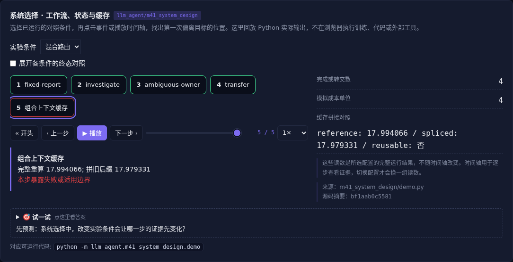

# 系统选择 · 工作流、状态与缓存

[](https://beleev.github.io/llm-engineering-lab/#/agent/system-design)

[Agent 目录](../README.md) · [交互实验](https://beleev.github.io/llm-engineering-lab/#/agent/system-design)

## 直觉

什么时候该用固定流程, 什么时候放开 Agent?

按任务不确定性分配自主性, 按证据与预算约束执行。

## 核心原理

### 先画观察、决策和行动边界

固定步骤用 workflow, 开放调查用循环 Agent, 混合系统把可验证流程与不确定决策分开。

模型选择还要看工具行为、质量、成本、延迟和可恢复性。

### 框架与 Harness 的职责

框架提供编排和接口, Harness 管权限、上下文、预算、恢复和验收。选择框架按这些接口能否满足任务评估, 不按产品名判断先进程度。

### 结构化状态栏

把目标、已完成项、剩余预算、待核实问题作为独立状态维护。状态更新来自环境事件, 不把模型自述直接当事实; 状态栏本身也占上下文。

### Prompt Cache 与 KV 不等价

Prompt 缓存是服务接口的前缀复用与计费语义; KV 是模型层的中间状态。

Chat template、工具顺序、位置、模型版本和前缀都影响复用条件。

### 可编辑上下文必须核对因果依赖

本例用两层因果混合说明: 后缀隐藏状态依赖之前的前缀, 换前缀后直接拼旧状态会错。

组合 KV 需要额外模型结构或重算验证, 不能只按文本块 id 拼接。

### 人工介入应有明确触发

对象歧义先澄清, 高后果动作交授权方。

护栏要覆盖输入、上下文和执行; Sidecar 只看结构化动作能减少被原文诱导, 但仍需要独立执行约束。

### 上下文学习的机制边界

上下文示例能激活关联、模式匹配和任务适应, 并不更新持久参数。

书中“检索而非推理”应读作相关机制实验的解释, 不能当作所有模型和任务的定理。

压缩后能否保留关系、否定和约束, 仍须用具体任务检验。

### 读代码的顺序

- `demo.py:choose`
- `demo.py:status_bar`
- `demo.py:cache_experiment`

## 运行

```bash
python -m llm_agent.m41_system_design.demo
```

默认只用标准库与本仓库模块, 不访问外网。

## 运行后应该看到什么

依次运行 `workflow, agent, hybrid` 三种条件, 输出结果与逐步轨迹。`main()` 对预期的成功和失败分别断言; 失败对照不是程序故障。网页可选择配置、播放或点击事件, 显示 Python 已运行记录, 不在浏览器里执行训练或工具。

## 与真实系统的差距

任务路由与费用是明确的教学模型; KV 反例使用标量因果混合, 不代替真实 Transformer 精度和性能测试。

## 常见误区

“有相同概念的教学实验”不等于“复现完整论文或具备通用产品能力”。对照只隔离本章说明的变量; 其他假设变化需重新测。

## 自测题

前缀改了, 可直接复用同文本后缀的 KV 吗?

<details><summary>答案</summary>

不能, 后缀状态可能依赖旧前缀。精确前缀复用和任意片段拼接条件不同。模型版本、位置和因果依赖都需检查。

</details>
