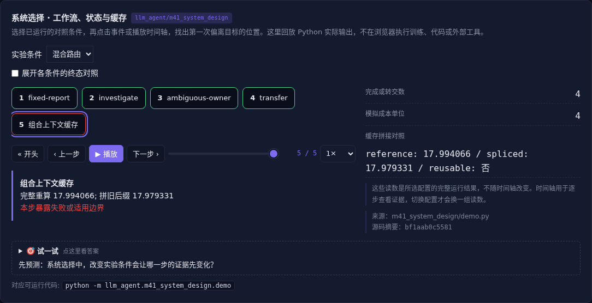

# 系统选择 · 工作流、状态与缓存

[](https://beleev.github.io/llm-engineering-lab/#/agent/system-design)

[Agent 目录](../README.md) · [交互实验](https://beleev.github.io/llm-engineering-lab/#/agent/system-design)

## 直觉

固定流程便宜但做不完, 放开 Agent 做得完但贵, 怎么分? 前缀改了, 后缀的 KV 还能接着用吗?

- 两种做法: workflow 是事先写好步骤清单的固定流程, 便宜但清单里没有的事做不了; Agent 是让模型每一步自己决定下一步, 什么都能做但贵。demo 的分路规则是: 有清单走 workflow, 没清单走 Agent, 意图不清或高风险的直接交人。
- 同样 4 个请求, 混合路由 (hybrid) 4 个全处理完、费用 4 单位; 全 Agent 也是 4 个全完成, 但费用 6; 全 workflow 只做完 3 个。
- 执行过程中的进度要用结构化的状态栏单独记, 不靠模型自述。prompt 前缀一换, 后缀的 KV 别拼: demo 里拼出来的数 17.979331 和重算的 17.994066 对不上。

## 核心原理

### 先画观察、决策和行动边界

先决定每个请求由谁来处理: 固定流程、循环 Agent, 还是人。

choose 只看请求的 3 个布尔特征: known_steps (步骤清单事先已知吗)、ambiguous (意图有歧义吗)、high_risk (风险高吗)。4 个请求分别是: fixed-report (有清单)、investigate (没清单, 要边查边定)、ambiguous-owner (歧义)、transfer (有清单但高风险)。

分路规则: ambiguous 或 high_risk 的先交人; 剩下的按模式走。workflow 模式全走固定流程; agent 模式全交给循环 Agent; hybrid 模式有清单走 workflow, 没清单走 Agent。

一个请求算 "处理完" 的条件是: 交了人, 或者走了 Agent, 或者走 workflow 且确实有清单。费用按路由加: human 0、workflow 1、agent 3。

同样 4 个请求跑三种模式:

- 全 workflow: investigate 没清单做不完, 处理 3 个, 费用 2。
- 全 Agent: 4 个全处理完, 费用 6 (两个非人工请求各 3)。
- hybrid: fixed-report 走 workflow 花 1, investigate 走 Agent 花 3, 4 个全处理完, 费用 4。

费用是教学模型里人为定的数 (human 0 / workflow 1 / agent 3), 真实选型还要看工具行为、质量、成本、延迟和可恢复性。

### 框架与 Harness 的职责

两个词要分开。框架 (framework) 提供编排和接口, 比如 choose 这种 "把请求派给谁" 的路由函数就是编排。Harness 是包在模型外面、让它能安全跑起来的那层程序, 管五件事: 权限、上下文、预算、恢复和验收。demo 里的 status_bar 和 cache_experiment 都属于 Harness 的活。

选框架时看它的接口能不能撑起这五件事, 不按产品名判断谁更先进。

### 结构化状态栏

长任务跑到一半, "做到哪了" 不能靠模型自己说, 要有一个结构化的记录。

status_bar 把进度拆成 4 个独立字段: goal (目标, 这里是 完成报告)、completed (已完成项, [检索])、remaining_calls (剩余预算, 2)、pending (待核实问题, [核对引用])。

这些字段由环境事件更新, 比如工具真的返回了才把 检索 记进 completed; 不把模型说的 "我已经检索过了" 直接当事实。remaining 传负数直接抛 ValueError, 预算不允许透支。

代价: 状态栏本身也占上下文, 每轮请求都要跟着发。

### Prompt Cache 与 KV 不等价

两个 "缓存" 不是一回事。

- Prompt cache 是服务接口层的东西: 你发的 prompt 前面一段 (前缀) 和上次完全一样, 服务商就复用上次的计算, 并按复用部分少收费。它的语义是 "前缀逐字相同才算命中"。
- KV 是模型层的中间状态: 注意力层给每个 token 算出的 K、V 向量, 存下来之后后面的 token 就不用重算它们。

demo 用 sha256({model, prefix, positions}) 当缓存键, 模型名、前缀内容、位置三者一起决定键。前缀从 [1, 2] 换成 [9, 2], 键就不同, reusable=false。

Chat template、工具顺序、位置、模型版本和前缀, 任何一样变了, 复用条件就不成立。

### 可编辑上下文必须核对因果依赖

想把旧 prompt 后半段的 KV 直接拼到新前缀后面, 这是错的, 因为后半段的状态依赖前半段。

cache_experiment 用一个很小的模拟来演示。contextual_states 是第一层: 每个位置的状态 = 自身值 + 到它为止所有 token 的均值, 所以后缀每个位置的状态都带着前缀的信息。attend 是第二层: 拿最后一个位置当 query, 对所有状态做一次注意力加权求和, 输出一个数。

前缀 [1, 2] 换成 [9, 2], 后缀 [3, 4] 不变:

- 完整重算: 对 [9, 2, 3, 4] 从头算, 得 17.994066。
- 拼旧后缀: 新前缀 [9, 2] 的状态接上按旧序列算出来的后缀状态, 得 17.979331。

两个数不相等, 因为旧后缀状态里的均值是按 [1, 2, 3, 4] 算的。真实 Transformer 里后缀 token 的 K、V 同样依赖前缀。组合 KV 要么模型结构明确支持, 要么重算验证, 不能只按文本块的 id 拼接。

### 人工介入应有明确触发

什么时候交人, 要是写死的条件, 不是模型自己决定。

choose 最先查两个触发条件: ambiguous 为真就先去澄清对象, high_risk 为真就交给有授权的人。ambiguous-owner 和 transfer 这两个请求在三种模式下都路由到 human, 模式再放开也绕不过。

护栏要覆盖三处: 输入、上下文和执行。Sidecar (挂在主流程旁边的独立检查器) 只看结构化的动作 (工具名和参数), 不读原文, 所以不容易被原文里的话诱导; 但它仍然需要独立的执行约束, 不能只靠它。

### 上下文学习的机制边界

上下文学习 (in-context learning) 指模型只靠 prompt 里给的示例学会做一件事, 不改任何参数。

它能做的是激活已有关联、模式匹配和任务适应; 它不更新任何持久参数, 会话结束就没了。

书里的「检索而非推理」是对相关机制实验的一种解释, 不是所有模型和任务的定理。

另一个没测的问题: 上下文压缩之后, 原来的关系、否定和约束还保不保得住, 得用具体任务测, 本章 demo 没测这一项。

### 读代码的顺序

- `demo.py:choose`
- `demo.py:status_bar`
- `demo.py:cache_experiment`

## 运行

```bash
python -m llm_agent.m41_system_design.demo
```

默认只用标准库与本仓库模块, 不访问外网。

## 运行后应该看到什么

依次运行 `workflow, agent, hybrid` 三种条件, 输出结果与逐步轨迹。`main()` 对预期的成功和失败分别断言; 失败对照不是程序故障。网页可选择配置、播放或点击事件, 显示 Python 已运行记录, 不在浏览器里执行训练或工具。

## 与真实系统的差距

没模拟的: 路由规则只有 3 个布尔特征; 费用是人为定的 0 / 1 / 3, 不是实测 API 价格, 也不代表普遍的成本排序。

KV 反例是标量的因果混合, 17.994066 和 17.979331 差 0.0147, 只说明拼接会错, 不能外推到真实 Transformer 的误差大小和性能。

## 常见误区

“有相同概念的教学实验”不等于“复现完整论文或具备通用产品能力”。对照只隔离本章说明的变量; 其他假设变化需重新测。

## 自测题

前缀改了, 可直接复用同文本后缀的 KV 吗?

<details><summary>答案</summary>

不能, 后缀状态可能依赖旧前缀。精确前缀复用和任意片段拼接条件不同。模型版本、位置和因果依赖都需检查。

</details>
