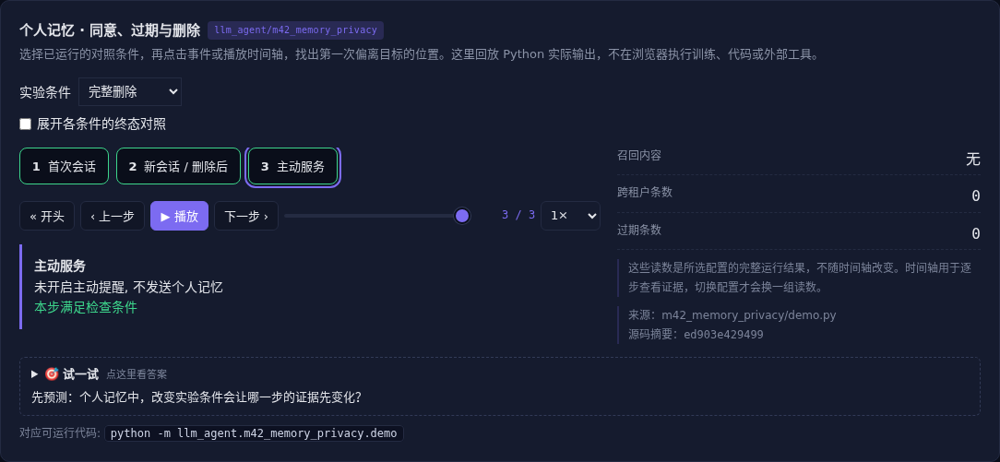

# 个人记忆 · 同意、过期与删除

[](https://beleev.github.io/llm-engineering-lab/#/agent/memory-privacy)

[Agent 目录](../README.md) · [交互实验](https://beleev.github.io/llm-engineering-lab/#/agent/memory-privacy)

## 直觉

记忆删了, 为什么检索结果还可能找到它?

授权要在召回之前检查, 删除要覆盖原文、索引和派生缓存。

## 核心原理

### 记忆层次与表示

工作记忆放当下状态, 情节记忆保留经历, 语义记忆保留事实, 程序记忆保留做法。

这些是设计类比, 不是对模型认知能力的证明; 可用列表、文档、图或可执行规则表示。

### 跨会话与主动服务分开测

记住一条事实、在多轮对话找回、在合适时机主动帮助是三种能力。主动使用个人信息还需要同意, 不能因为记得就自动通知。

### 层级与多模态不绕过权限

租户、用户和主题共同决定召回范围。摘要层、完整正文、图片字幕、音频转录和原文件链接都继承来源权限, 不能只过滤最终原文。

### 删除与压缩的区别

过期决定是否还可召回, 压缩减少体积, 删除清理原文及派生引用。本例删除同步清理索引和缓存, 审计只留操作和散列标识, 不保留个人正文。

### 后台整理需要冲突策略

频率、时间、重要性可辅助筛选, 但不能把常被访问的错误当真。合并前保留来源与作用域, 碰到冲突重新求证; 索引损坏需可从证据重建。

### 读代码的顺序

- `demo.py:MemoryService`

## 运行

```bash
python -m llm_agent.m42_memory_privacy.demo
```

默认只用标准库与本仓库模块, 不访问外网。

## 运行后应该看到什么

依次运行 `flat, scoped, forget` 三种条件, 输出结果与逐步轨迹。`main()` 对预期的成功和失败分别断言; 失败对照不是程序故障。网页可选择配置、播放或点击事件, 显示 Python 已运行记录, 不在浏览器里执行训练或工具。

## 与真实系统的差距

内存中的合成个人信息, 没有生产身份认证、加密或备份删除。说明数据生命周期, 不宣称满足某项法律或平台合规要求。

## 常见误区

“有相同概念的教学实验”不等于“复现完整论文或具备通用产品能力”。对照只隔离本章说明的变量; 其他假设变化需重新测。

## 自测题

只删原文而保留包含正文的摘要缓存, 算完整遗忘吗?

<details><summary>答案</summary>

不算, 派生数据仍可能泄露内容。遗忘需要沿数据派生关系清理。保留审计时应避免重新保存被删除的正文。

</details>
